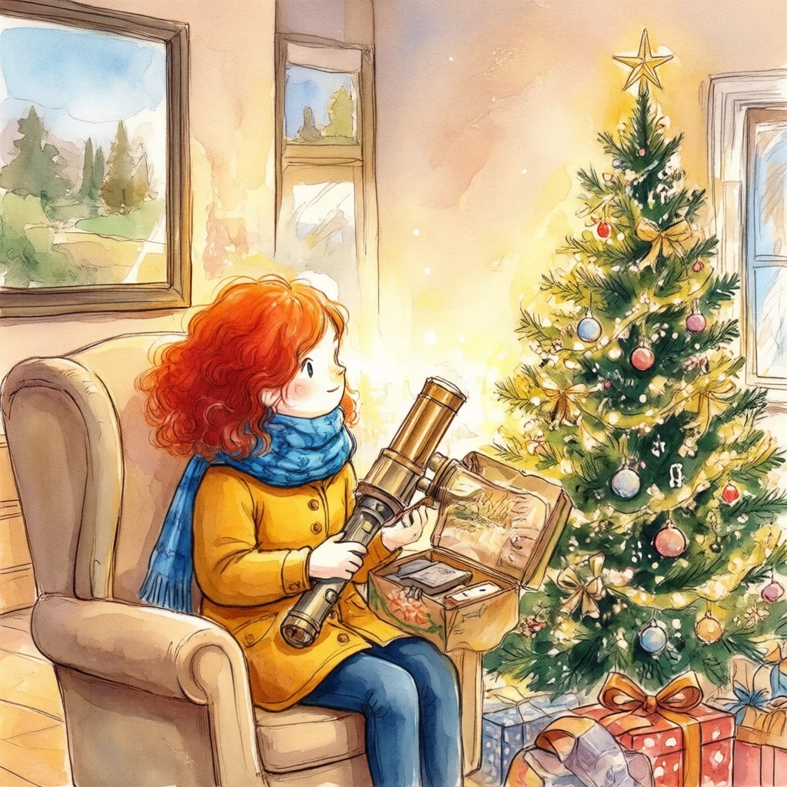
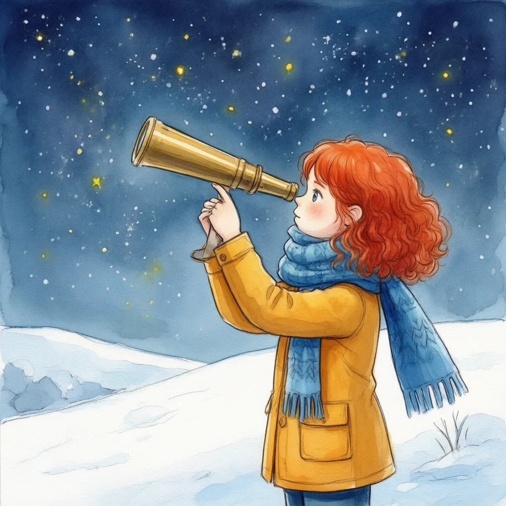

# 01b - What "Consistent" Means

This module is called Consistent Media Generation. In the previous lesson we picked a model for each asset on Emma's card. But the card only works if every asset shows the same Emma: the illustration, the new scene and the clip. If we generate each asset separately, we get a different girl every time.

Viewers notice. Bark.com and AWS built personalized video ads on open Wan 2.1 with a cloned brand voice. When they stopped passing reference images from one shot to the next, their engagement score dropped from 6.5 to 4.8 out of 10. [AWS blog](https://aws.amazon.com/blogs/machine-learning/how-bark-com-and-aws-collaborated-to-build-a-scalable-video-generation-solution)

In this lesson we name the five kinds of consistency, see why a fixed seed gives us only one of them, and keep Emma the same across scenes with reference images. There's no code here: we run the experiments ourselves in [lesson 02](02-first-generation.md).

## Five kinds of consistency

We use "consistent" for five different problems:

| Kind | What it means | What breaks it | See it | Where we handle it |
|---|---|---|---|---|
| Reproducibility | Same settings and seed give the same output, within a tolerance | Another PyTorch release, GPU or attention backend. Reusing a seeded generator | [Diffusers guide](https://huggingface.co/docs/diffusers/using-diffusers/reusing_seeds) | lesson 02: same seed, same image. Lesson 04: compare runs |
| Identity | The same character or product in a new scene | A seed doesn't carry identity. Models paste the reference instead of re-rendering it | [ConsiStory comparison](https://research.nvidia.com/labs/par/projects/consistory/), [OpenS2V copy-paste](https://pku-yuangroup.github.io/OpenS2V-Nexus/) | Reference-image editing (Qwen-Image-Edit-2511). Module 2 judge loop |
| Temporal | No flicker within a clip, no drift when a clip is extended | Unstable frames. Errors that add up as a clip is extended | [FramePack drift](https://lllyasviel.github.io/frame_pack_gitpage/), [VBench flicker](https://vchitect.github.io/VBench-project/) | Short clips. Module 4 evaluation |
| Cross-asset | The card, the clip and the next shot show the same Emma | Each asset made separately | [HoloCine multi-shot](https://holo-cine.github.io/) | Image first, then image-to-video (Module 2) |
| Voice | The same voice in every clip | A changed voice. A reference clip in another language | [Chatterbox demos](https://resemble-ai.github.io/chatterbox_demopage/) | Kokoro preset voices. One fixed reference clip for Chatterbox |

## What a seed does

A seed fixes the random starting point of a generation. With the same model, settings, prompt and seed, we get the same image again: that's reproducibility.

A seed doesn't keep a character. When we change the prompt to put Emma in a new scene, the same seed gives a different picture, and nothing ties it to the first one. A seed you didn't record is also a setting you can't repeat, so we always save it with the asset.

## Keeping Emma the same

To keep Emma's identity, we give the model her picture, not only a description of her. We ask Qwen-Image-Edit-2511 to move Emma indoors from the first image, then to put her back on the hill from two references: Emma and the telescope from the gift scene, the sky and snow from the first image.

<table>
  <tr>
    <td width="33%"></td>
    <td width="33%"></td>
    <td width="33%"></td>
  </tr>
  <tr>
    <td>Reference. Sana, seed 7</td>
    <td>New scene. One reference: indoors by the tree, same face, hair, coat and scarf. 20 steps, seed 7, <code>8.3 s</code></td>
    <td>Two references. Emma and telescope from image 2, sky and snow from image 1. 20 steps, seed 6, <code>8.8 s</code></td>
  </tr>
</table>

The image on the right is also the first frame of Emma's clip: Wan2.2-I2V-A14B animated it. That's how the card and the clip show the same Emma.

You can try both kinds of identity in your browser on free Hugging Face Spaces: put one character into new scenes with [Qwen-Image-Edit-2511](https://huggingface.co/spaces/Qwen/Qwen-Image-Edit-2511), or clone a voice from a short clip with [Chatterbox](https://huggingface.co/spaces/ResembleAI/Chatterbox).

## What this means for picking models

Consistency mostly comes from how we build the pipeline, not from the model we pick:

- Reproducibility: pin the model version and every setting, and record the seed.
- Identity: give the model a reference image, with an image editing model such as Qwen-Image-Edit-2511.
- Cross-asset: make and check the image first, then animate that image with an image-to-video model.
- Voice: use one preset voice, or one fixed reference clip, for every greeting.

It touches the model choice in one place: if you need the same character across assets, pick a task that takes an image as input, like image editing or image-to-video, not only text-to-image.

Next, we generate our first image and test seeds ourselves in [02 - First Media Generation in a Few Minutes](02-first-generation.md).

<!-- nav:start -->
[← Previous: 01 - Landscape: Modalities and Model Families](01-landscape.md) · [Next: 02 - First Media Generation in a Few Minutes →](02-first-generation.md)
<!-- nav:end -->
