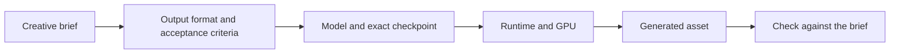

# 1.1 Landscape: Modalities and Model Families

We start with a creative brief and choose the GPU model that can turn it into an asset. By the end, you will have a model choice, a deployment path and a link to the exact model's licence. No GPU is needed for this lesson.

## Start with the asset

Our running example is a storybook illustration: a friendly fox looking through a telescope. Later, the Personalized Media Factory will add a voice greeting and an agent that decides what to generate. Today, a Python function takes the prompt and returns one image.

Write your own one-sentence brief before choosing a model. For example: “Create a square illustration for a children's astronomy club, with a friendly animal character and no lettering.” This gives you something concrete to inspect: is the telescope visible, is the style appropriate, and is there unwanted text?

## Modalities change the input and the output

A modality is a kind of media. A model family groups related models, but a family name is not a deployable configuration: a particular checkpoint, variant and runtime are still needed.

| Task | Inputs | Output | What to inspect |
|---|---|---|---|
| Text-to-image | Prompt, size, seed | Still image | Composition, details, prompt adherence |
| Image editing | Source image, instruction | Edited image | Requested change and preservation of the subject |
| Text-to-video | Prompt, duration, size | Video | Motion, temporal consistency, visual quality |
| Image-to-video | Source image, motion prompt | Video | Identity and composition across frames |
| Text-to-speech | Text, voice settings | Speech waveform | Pronunciation, intelligibility, voice consistency |
| Text-to-music | Music description, duration | Audio | Structure, style, artifacts |

Do not assume an image API client can call every modality. The workshop uses a similar function boundary for its tools, but each server still has its own request and response fields. In this module, the executable reference path is **Sana text-to-image**. The other models in the [module catalog](README.md#models-used-in-this-module) are optional explorations through their own template instructions.

## Why video needs a different budget

An image represents one spatial arrangement. Video must also maintain a useful relationship between frames. More frames and larger frames generally mean more intermediate data and computation; implementation choices such as compression and attention affect the exact relationship. Speech introduces a different axis: output duration and audio representation.

This is why we do not rank every model by its parameter count. GPU memory also holds intermediate tensors, the text encoder, decoder, temporary buffers and runtime overhead. A checkpoint's download size is not its peak VRAM requirement. A faster image model and a larger video model are not comparable benchmarks.

For your own configuration, record peak allocated GPU memory and generation time using the worker in [1.2](02-first-generation.md). Those measurements apply to that configuration and environment. The module has no measured cross-modality benchmark yet; see [validation status](VALIDATION.md).

## Choose a model family, then a checkpoint

For the fox illustration, Sana is the default because the course has a ready-made L40S template for it. Qwen-Image and Z-Image-Turbo offer other image paths; Wan covers video; Kokoro and Chatterbox cover speech. Start with the smallest experiment that answers your creative question. Changing all of model, prompt, resolution and seed together makes the result hard to explain.

Our [generation.json](code/generation.json) records the full Sana model ID, a Hub commit, an `fp16` weight variant, a prompt, a seed and generation parameters. The pinned worker can load that exact checkpoint. The prebuilt Endpoint template does not expose a revision selector, so its resolved checkpoint remains unknown unless you collect that evidence separately.

The [official template catalog](https://github.com/nebius/serverless-ai-cookbook/tree/main/templates) is the place to check available deployments. Its GPU choices are tested deployment recipes, not universal minimum-memory claims. Check the chosen region's capacity and quota before creating a resource.

## Licences belong to checkpoints

Follow the exact checkpoint's model card and licence file. Do not transfer terms from another model with a similar name. For the default configuration, start with the [Sana model card](https://huggingface.co/Efficient-Large-Model/Sana_1600M_1024px_diffusers/tree/ac0da2ff55fbe434795be0dce883042e4d49e2fc). Record the licence link and any restrictions relevant to your intended use. Open weights do not mean that all models share one licence.

## Try it: a model choice you can defend

Fill in [model-choice.md](model-choice.md). Describe your audience, one asset, the exact model, expected input/output formats, a template GPU, the licence source and two acceptance criteria. Keep unmeasured latency and memory values marked “not measured.”

A useful answer connects choices to the brief: “I need a still illustration, so I can test text-to-image before adding motion. I will reject an output that omits the telescope.” “It is the newest model” does not explain whether it solves the task.

The fox storybook, a product advertisement and a spoken event invitation are example use cases, not customer case studies. Your choice is complete when another learner can identify which model to run and how you will judge the result. Next, [generate the first asset](02-first-generation.md).
