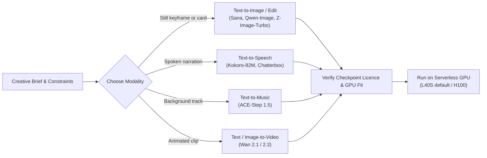

# 1.1 Landscape: Modalities and Model Families

In this lesson we map the generative media modalities and model families, see what changes between them and why video costs the most, and pick a model for your Homework 1 idea. You're done when you have a model, its GPU and its licence link written down.

## Modalities

In the **Personalized Media Factory**, we start from a brief: a recipient record, a creative task, and constraints on format and budget. In our running example from the [Build a Media Agent workshop](https://github.com/DataTalksClub/build-media-agent-workshop), a 7-year-old named Emma wishes for a telescope, and we want to generate a personalized holiday card illustration, a spoken voice greeting, and an optional short video animation.

Before writing any agent code, we need to understand the GPU media models that actually produce those files. Every generative media task maps an input conditioning signal (a text prompt, a reference image, or a script) to a media artifact:

| Task | Typical Inputs | Output Artifact | What You Inspect |
|---|---|---|---|
| **Text-to-image** | Prompt, negative prompt, size (`width x height`), seed | Still image (`PNG` / `JPEG`) | Subject accuracy, style, composition, absence of unwanted text |
| **Image editing** | Source image + edit instruction, seed | Edited image (`PNG`) | Requested modification applied while preserving the rest of the scene |
| **Text-to-video** | Motion prompt, resolution, frame count / duration, fps, seed | Video clip (`MP4`) | Temporal coherence, smooth motion, object permanence across frames |
| **Image-to-video** | Starting keyframe image + motion prompt, duration, seed | Video clip (`MP4`) | Identity preservation from the first frame, natural camera/object movement |
| **Text-to-speech (TTS)** | Exact script text, voice preset, speed / duration bound | Speech audio (`MP3` / `WAV`) | Pronunciation, word recall (via ASR), natural prosody, no clipping |
| **Text-to-music** | Style/genre tags, lyrics or instrumental prompt, duration, seed | Music track (`MP3` / `WAV`) | Musical structure, tempo, instrument clarity, absence of distortion |

## What changes between modalities

Switching from text-to-image to speech, music, or video changes four engineering numbers at once:

1. **Latent representation size:** An image is a 2D spatial grid of latent patches. Audio is a 1D waveform or 2D spectrogram over time. Video is a 3D spatio-temporal volume (`frames x height x width`).
2. **Peak GPU memory (VRAM):** VRAM holds not only the model weights, but also the text encoder, the VAE or audio decoder, and the intermediate attention activations during denoising.
3. **Cold load time (`load_s`):** How long it takes to fetch weights (if not cached) and move the pipeline into GPU memory before the first asset can be rendered.
4. **Generation latency (`t_gen`):** How long the GPU spends denoising and decoding a single asset once the model is already warm in memory.

Here is what we measured across all four modalities on the course's default single-GPU configuration (`gpu-l40s-a`, `1gpu-8vcpu-32gb`, 48 GB VRAM, `eu-north1`) `[measured: 2026-11-02, gpu-l40s-a, 1gpu-8vcpu-32gb, eu-north1]`:

| Modality | Model & Spec | Peak VRAM | Cold Load (Download + Load) | Generation Time (`t_gen`) | Output Size |
|---|---|---|---|---|---|
| **Text-to-speech** | `hexgrad/Kokoro-82M` (20-word script, seed 0) | `0.73 GB` | `10.55 s` (`5.75 s` fetch + `6.66 s` load) | `1.88 s` | `154 KB` (`MP3`, 7.6 s) |
| **Text-to-image** | `Efficient-Large-Model/Sana_1600M_1024px_diffusers` (`1024x1024`, 20 steps, seed 7) | `10.91 GB` | `39.89 s` (`26.60 s` fetch + `13.29 s` load) | `4.42 s` | `1.78 MB` (`PNG`) |
| **Text-to-music** | `ACE-Step/acestep-v15-xl-turbo-diffusers` (8 s motif, seed 11) | `11.86 GB` | `99.50 s` | `2.88 s` | `194 KB` (`MP3`, 8.0 s) |
| **Text/Image-to-video** | `Wan-AI/Wan2.2-TI2V-5B-Diffusers` (`832x480`, 121 frames @ 24 fps, 50 steps, seed 3) | `27.89 GB` | `495.57 s` | `157.49 s` | `103 KB` (`MP4`, 5.0 s) |

Notice how both `Kokoro-82M` (`0.73 GB`), `Sana 1.6B` (`10.91 GB`), and `ACE-Step 1.5` (`11.86 GB`) use less than a quarter of a 48 GB L40S GPU and finish a warm generation in `1.9–4.4 s`.

## Why video is expensive

On the exact same L40S GPU, generating one 5-second `832x480` video clip with `Wan 2.2 TI2V-5B` takes `157.49 s` — **35.6 times longer** than generating a `1024x1024` image with Sana (`4.42 s`), and peaks at `27.89 GB` of VRAM `[measured: 2026-11-02, gpu-l40s-a, 1gpu-8vcpu-32gb, eu-north1]`. Larger 14B-parameter video models (`Wan2.2-I2V-A14B`) have ~35 GB of weights before activations and move you onto an 80 GB H100.

Three factors drive the video cost multiplier:

1. **Spatio-temporal token count:** An image diffusion transformer attends over patches of a single frame. A video diffusion transformer attends across both space and time (`121 frames` compressed in time and space still produces thousands of 3D latent tokens per step).
2. **More denoising steps:** While fast image models converge in 8–20 steps, maintaining smooth motion across 5 seconds of video typically requires 30–50 steps (`50 steps` in our baseline run).
3. **Parameter count is not the memory bill:** `Wan 2.2 TI2V-5B` has 5 billion parameters (~10 GB in `bfloat16` at 2 bytes per parameter), yet the run peaked at `27.89 GB` of VRAM. The extra ~18 GB comes from the text encoder, intermediate attention activations across 121 frames, and the 3D VAE decode pass at the end of generation.

In a production media pipeline, this ~35x gap shapes your architecture:

- **Gate video on image quality:** Generate and verify the still keyframe first (`4.42 s`), and only run image-to-video when the keyframe passes inspection.
- **Sample video in large batches:** In Module 3 (Homework 3), we generate personalized text, images, and speech for all 200 records, and run video only on a deterministic 10-record sample so the whole batch stays within budget.

## Model families

Within each modality, open-weights models fall into distinct architectural families:

- **Linear and standard Diffusion Transformers (DiT) for images:**
  - **Sana (`Sana_1600M_1024px_diffusers`):** Uses a deep compression autoencoder (32x spatial compression) and linear attention to generate `1024x1024` images in 20 steps on a single L40S (`4.42 s`, `10.91 GB` VRAM).
  - **Qwen-Image & Qwen-Image-Edit:** Multimodal Diffusion Transformers (MMDiT) coupled with a strong vision-language encoder, excelling at complex prompt following, embedded typography, and instruction-guided image editing.
  - **Z-Image-Turbo:** A 6B-parameter step-distilled image transformer tuned for 8-step generation.
- **3D Spatio-Temporal Diffusion Transformers for video:**
  - **Wan 2.1 / Wan 2.2 (`Wan2.1-T2V-1.3B`, `Wan2.2-TI2V-5B`, `Wan2.2-I2V-A14B`):** Open-weights video generation models supporting text-to-video and keyframe-conditioned image-to-video. Compact variants (1.3B, 5B) fit on 48 GB GPUs; the 14B flagship (`A14B`) targets 80 GB H100 GPUs.
- **Compact neural TTS vs expressive voice models:**
  - **Kokoro-82M:** An 82M-parameter Apache-2.0 TTS model built on StyleTTS2/ISTFTNet that loads in seconds, uses `0.73 GB` VRAM, and synthesizes clear English speech in `1.88 s`.
  - **Chatterbox:** A larger expressive English TTS model with preset voices and emotion control.
- **Diffusion/Flow transformers for music:**
  - **ACE-Step 1.5:** A fast text-to-music diffusion transformer capable of generating structured instrumental motifs or songs with vocals in a few seconds (`2.88 s` for an 8-second clip on L40S).

## Licences

Open weights do not mean "free for any commercial use." Furthermore, **different checkpoints inside the same model family can carry different licences**:

- For example, `Efficient-Large-Model/Sana_1600M_1024px_diffusers` is licensed under **Apache-2.0**, whereas certain `BF16` and `Sana-Sprint` checkpoints in the same family use the **NVIDIA Open Model License**.
- Similarly, container template code in the Serverless AI Cookbook is **Apache-2.0**, while each underlying model checkpoint has its own licence on Hugging Face.

Always inspect the `LICENSE` file on the exact Hugging Face repository (and commit revision) you deploy, and record that link before putting a model into production.

## Real projects

Production teams use this exact combination of a lightweight CPU control plane and serverless GPU media workers for three main workloads:

1. **Personalized cards and lifecycle marketing:** Turning customer or recipient profiles into tailored illustrations and voice greetings (like our Holiday Gift Card / Storybook factory).
2. **E-commerce and product ad studios:** Taking a product catalog row, generating a clean hero product shot (`Text-to-Image` or `Image-Edit`), checking that the product and brand constraints hold, and animating passing keyframes into short social video ads (`Image-to-Video`).
3. **Automated narration and localization pipelines:** Converting articles, course lessons, or release notes into narrated audio and illustrated summary cards at predictable cost per episode.

## Models used in this module

Every model below has a ready-to-deploy 1-click template in the [Nebius Serverless AI Cookbook](https://github.com/nebius/serverless-ai-cookbook/blob/main/templates/README.md).

The default course path is **Sana on L40S** (`$1.5484/h` on-demand for `gpu-l40s-a` / `1gpu-8vcpu-32gb`), which keeps your Module 1 and Homework 1 spend to a few cents.

| Task | Model | Template GPU | Checkpoint & Licence |
|---|---|---|---|
| Text-to-image *(Course Default)* | [Sana (`Sana_1600M_1024px_diffusers`)](https://github.com/nebius/serverless-ai-cookbook/blob/main/templates/endpoint-sana/README.md) | L40S | [Apache-2.0](https://huggingface.co/Efficient-Large-Model/Sana_1600M_1024px_diffusers/blob/main/LICENSE) |
| Text-to-image | [Qwen-Image](https://github.com/nebius/serverless-ai-cookbook/blob/main/templates/endpoint-qwen-image/README.md) | H100 | [Apache-2.0](https://huggingface.co/Qwen/Qwen-Image) |
| Text-to-image | [Z-Image-Turbo](https://github.com/nebius/serverless-ai-cookbook/blob/main/templates/endpoint-z-image-turbo/README.md) | H100 | [Apache-2.0](https://huggingface.co/Tongyi-MAI/Z-Image-Turbo) |
| Image editing | [Qwen-Image-Edit-2511](https://github.com/nebius/serverless-ai-cookbook/blob/main/templates/endpoint-qwen-image-edit-2511/README.md) | H100 | [Apache-2.0](https://huggingface.co/Qwen/Qwen-Image-Edit-2511) |
| Text-to-video | [Wan2.1-T2V-1.3B](https://github.com/nebius/serverless-ai-cookbook/blob/main/templates/endpoint-wan21-t2v-1-3b/README.md) | H100 | [Apache-2.0](https://huggingface.co/Wan-AI/Wan2.1-T2V-1.3B-Diffusers) |
| Image-to-video | [Wan2.2-I2V-A14B](https://github.com/nebius/serverless-ai-cookbook/blob/main/templates/endpoint-wan22-i2v-a14b/README.md) | H100 | [Apache-2.0](https://huggingface.co/Wan-AI/Wan2.2-I2V-A14B-Diffusers) |
| Text-to-speech | [Kokoro-82M](https://github.com/nebius/serverless-ai-cookbook/blob/main/templates/endpoint-kokoro-82m/README.md) | L40S | [Apache-2.0](https://huggingface.co/hexgrad/Kokoro-82M) |
| Text-to-speech | [Chatterbox](https://github.com/nebius/serverless-ai-cookbook/blob/main/templates/endpoint-chatterbox/README.md) | H100 | [MIT](https://huggingface.co/ResembleAI/chatterbox) |
| Text-to-music | [ACE-Step 1.5](https://github.com/nebius/serverless-ai-cookbook/blob/main/templates/endpoint-ace-step-1-5/README.md) | H100 / L40S | [MIT](https://huggingface.co/ACE-Step/Ace-Step1.5) |

Before moving on, write down the creative idea you want to build for [Homework 1](../cohorts/2026/homework/01-consistent-media-generation-on-serverless-gpus/homework.md), the model you selected from the table above, its target GPU, and the link to its licence. Next, let's generate your first media asset in [1.2 First Media Generation in a Few Minutes](02-first-generation.md).
