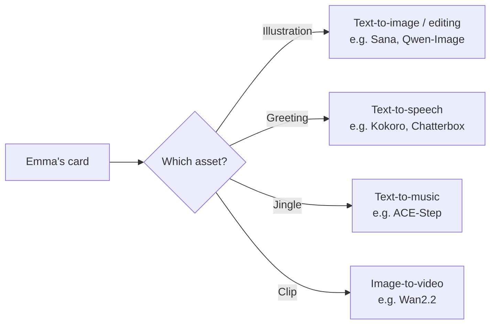

# 01 - Landscape: Modalities and Model Families

This course uses one running example throughout.

In this example, a toy store wants to send a personalized holiday card to every child on its mailing list:

- an illustration of the child's wish
- a spoken greeting
- a short animated clip
- a jingle.

We start with one child: Emma, a 7-year-old who wishes for a telescope.

<table>
  <tr>
    <td width="50%"></td>
    <td width="50%"><a href="https://drive.google.com/file/d/1UmhniMAGMvvpEsSNNmyGTsS9mDvxFgle/view"></a></td>
  </tr>
  <tr>
    <td>Illustration. Sana, 512x512, 20 steps, seed 7, <code>1.2 s</code></td>
    <td>Clip. Wan2.2-I2V-A14B, animated from this frame (made <a href="01-consistency.md">in lesson 01b</a>), 640x480, 81 frames at 16 fps (5 s), 20 steps, <code>40.7 s</code>. <a href="https://drive.google.com/file/d/1UmhniMAGMvvpEsSNNmyGTsS9mDvxFgle/view">Watch the clip</a></td>
  </tr>
  <tr>
    <td>Greeting. Kokoro-82M, voice af_bella, <code>0.4 s</code>: "Happy holidays, Emma! We heard you wished for a telescope. May all your nights be full of stars." <a href="https://drive.google.com/file/d/1ZCgQ6BFjjlCTAICdrJxbjwZVqma1loDD/view">Listen</a><br><audio src="assets/3_greeting.mp3" controls></audio></td>
    <td>Jingle. ACE-Step 1.5, 8 s, 8 steps, <code>2.3 s</code>. <a href="https://drive.google.com/file/d/1jr_yo7LW_ekJlzaixGnw5k9xrXgxj8F6/view">Listen</a><br><audio src="assets/4_jingle.mp3" controls></audio></td>
  </tr>
</table>

Once it works for Emma, we make a card for each of [the 200 kids](../examples/mediafactory/data/kids.csv) on our mailing list, each with a name, an age and a wish.

Then we ask what it would take to do this for every child in the world: thousands or millions of cards, each one different, with a known cost and no drop in quality.

To build one card, we run 5 steps:

1. Illustration: Sana draws Emma on a snowy hill from a text prompt.
2. New scene: Qwen-Image-Edit-2511 takes that illustration and moves the same Emma indoors, unwrapping her telescope.
3. Clip frame: the same model combines both images: Emma with the telescope, back under the stars.
4. Clip: Wan2.2-I2V-A14B animates that frame into a 5-second clip.
5. Greeting and jingle: Kokoro reads the card text and ACE-Step writes a short tune. Neither depends on the images.

See [`code/emma_gift.ipynb`](code/emma_gift.ipynb) if you're interested how this was generated.

Before we write any code, we have to choose:

- which models to use for each asset
- how to use these models
- how much they cost to run
- what their licences allow

In this lesson, we review the models available today so we can make these choices.

We explore these choices in more detail in [Homework 1](../cohorts/2026/homework/01-consistent-media-generation-on-serverless-gpus/homework.md).

## Modalities and tasks

A modality is a kind of media, and it can be on either side of a model: what goes in or what comes out. In this course there are four: text, image, video and audio. A task names both sides. Text-to-image takes text in and gives an image out. Image editing takes an image and text in and gives an image out. Every asset on Emma's card comes from one task:

| Task | Input → output | On Emma's card | Typical settings | What you inspect |
|---|---|---|---|---|
| Text-to-image | text → image (`PNG`) | The illustration | Prompt, size, seed | Subject, style, composition, no unwanted text |
| Image editing | image(s) + text → image (`PNG`) | Emma in a new scene | Instruction, seed | The edit is applied. The rest is preserved |
| Text-to-video | text → video (`MP4`) | – | Motion prompt, resolution, frames, fps, seed | Smooth motion. Objects persist |
| Image-to-video | image + text → video (`MP4`) | The clip | Keyframe, motion prompt, duration, seed | Identity kept from the first frame |
| Text-to-speech | text → audio (`MP3`/`WAV`) | The greeting | Script, voice, speed | Pronunciation, prosody, no clipping |
| Text-to-music | text → audio (`MP3`/`WAV`) | The jingle | Style tags, lyrics or prompt, duration, seed | Structure, tempo, no distortion |

Speech and music share an output modality but are different tasks with different models, so you choose a model per task. The output modality still influences the cost most: a video takes much longer to make than an image or a voice clip (more [below](#why-video-is-expensive)).

For Emma's card, we map each part of the brief to a task and a family of models:



## The decisions behind each asset

For every asset on the card, we answer the same six questions: which task it is (what goes in and what comes out), which model does that task, which GPU that model needs, whether its licence allows our use, what drives its cost, and whether a hosted API would be simpler. Write the answers down as a model decision record:

```text
1. Task:                    <task from the tasks table, e.g. text-to-image>
2. Model:                   <model from the models table>
3. GPU:                     <the recommended GPU for that model>
4. Licence:                 <link to the model card>, commercial use: <yes / with conditions / no>
5. Cost driver (estimate):  <seconds or minutes per asset, and why: image, audio or video>
6. API to compare:          <a hosted API for the same or a similar model, with its pricing link>
```

We fill in these lines in the rest of the lesson:

| Line | Where we answer it |
|---|---|
| 1. Task | [Modalities and tasks](#modalities-and-tasks) |
| 2. Model | [Models for each task](#models-for-each-task) |
| 3. GPU | [Models for each task](#models-for-each-task): recommended GPU. [GPU and cost per asset](#how-to-pick-a-gpu): how to pick |
| 4. Licence | [Licences](#licences) |
| 5. Cost driver | [GPU and cost per asset](#what-to-measure): time per asset. [Why video is expensive](#why-video-is-expensive): why |
| 6. API to compare | [Open vs closed models](#open-vs-closed-models) |

## Models for each task

We run these models on Nebius Serverless AI. The [Serverless AI Cookbook](https://github.com/nebius/serverless-ai-cookbook/blob/main/templates/README.md) has a quick-start template for each of them: the Launch link in the last column opens the Nebius console with the model, container and recommended GPU already filled in. We'll deploy one in the next lesson.

| Task | Model | Recommended GPU | Licence | When to use it | Launch on Nebius |
|---|---|---|---|---|---|
| Text-to-image | [Sana](https://huggingface.co/Efficient-Large-Model/Sana_1600M_1024px_diffusers) | L40S | Apache-2.0 + Gemma terms | Fast, cheap images on an L40S. Avoid it when the image needs readable text | [Launch][deploy-sana] |
| Text-to-image | [Qwen-Image](https://huggingface.co/Qwen/Qwen-Image) | H100 | Apache-2.0 | Images with readable text in them, like a name or a greeting (vendor-reported) | [Launch][deploy-qwen-image] |
| Text-to-image | [Z-Image-Turbo](https://huggingface.co/Tongyi-MAI/Z-Image-Turbo) | H100 | Apache-2.0 | Higher-quality images that are still quick to make | [Launch][deploy-z-image] |
| Image editing | [Qwen-Image-Edit-2511](https://huggingface.co/Qwen/Qwen-Image-Edit-2511) | H100 | Apache-2.0 | The same character or product in a new scene, from one or more reference images (Emma by the tree) | [Launch][deploy-qwen-edit] |
| Text-to-video | [Wan2.1-T2V-1.3B](https://huggingface.co/Wan-AI/Wan2.1-T2V-1.3B-Diffusers) | H100 | Apache-2.0 | A clip straight from a prompt, when you have no image to start from | [Launch][deploy-wan21] |
| Image-to-video | [Wan2.2-I2V-A14B](https://huggingface.co/Wan-AI/Wan2.2-I2V-A14B-Diffusers) | H100 | Apache-2.0 | Animating an image you already checked (Emma's clip) | [Launch][deploy-wan22] |
| Text-to-speech | [Kokoro-82M](https://huggingface.co/hexgrad/Kokoro-82M) | L40S | Apache-2.0 | A spoken greeting with a preset voice: 54 voices in 8 languages, on an L40S | [Launch][deploy-kokoro] |
| Text-to-speech | [Chatterbox](https://huggingface.co/ResembleAI/chatterbox) | H100 | MIT | A specific voice, cloned from a short clip. Clone only voices you have consent to use. Every output is watermarked | [Launch][deploy-chatterbox] |
| Text-to-music | [ACE-Step 1.5](https://huggingface.co/ACE-Step/Ace-Step1.5) | H100 | MIT | Music: jingles and short tracks (Emma's jingle) | [Launch][deploy-ace-step] |

Templates deploy as preemptible by default: cheaper, but the GPU can be interrupted. Prices in eu-north1, 11 Nov 2026 ([Nebius pricing](https://docs.nebius.com/compute/resources/pricing)): an L40S template costs `$0.7492/h` preemptible or `$1.5484/h` on-demand. An H100 costs `$4.50` per GPU-hour on-demand, while preemptible H100 is spot-priced from `$0.79` and can exceed on-demand.

For the measured music run, we used the larger `ACE-Step/acestep-v15-xl-turbo-diffusers` checkpoint, also [MIT](https://huggingface.co/ACE-Step/acestep-v15-xl-turbo-diffusers).

[deploy-sana]: https://console.nebius.com/serverless/endpoint/create?template=sana
[deploy-qwen-image]: https://console.nebius.com/serverless/endpoint/create?template=qwen-image
[deploy-z-image]: https://console.nebius.com/serverless/endpoint/create?template=z-image-turbo
[deploy-qwen-edit]: https://console.nebius.com/serverless/endpoint/create?template=qwen-image-edit-2511
[deploy-wan21]: https://console.nebius.com/serverless/endpoint/create?template=wan21-t2v-1-3b
[deploy-wan22]: https://console.nebius.com/serverless/endpoint/create?template=wan22-i2v-a14b
[deploy-kokoro]: https://console.nebius.com/serverless/endpoint/create?template=kokoro-82m
[deploy-chatterbox]: https://console.nebius.com/serverless/endpoint/create?template=chatterbox
[deploy-ace-step]: https://console.nebius.com/serverless/endpoint/create?template=ace-step-1-5

## GPU and cost per asset

We now have a model for each asset. Next we need to know which GPU it runs on and what one asset costs: lines 3 and 5 of the decision record.

### How to pick a GPU

Picking a GPU takes two steps:

1. The model has to fit. Its peak memory (VRAM) while it generates must be below the GPU's memory: 48 GB on an L40S, 80 GB on an H100. You can estimate it from the weights, about 2 bytes per parameter in `bfloat16`, but the real number is usually much higher. Wan2.2-TI2V-5B has about 10 GB of weights, yet it peaked at 27.89 GB: the other parts of the pipeline and the working memory add the rest.
2. Among the GPUs it fits on, pick the one with the lowest cost per asset. A faster, more expensive GPU can still be cheaper per asset if it finishes much sooner. You only find out by measuring.

So there's a lot of trying and measuring. Luckily, someone has done it for us: every template comes with a recommended GPU (the models table above). Start with it, and measure only if you want to go cheaper.

### What to measure

For each model we measure two numbers: peak VRAM, which decides the GPU, and generation time (`t_gen`), the time to make one asset with the model already loaded, which drives the cost. Starting the GPU and loading the model also take time. We measure that in [lesson 05](05-measuring-costs.md).

We measured one reference model per modality on a single NVIDIA L40S GPU (48 GB VRAM). Generation time depends on the GPU, the resolution, the number of steps and other settings, so your numbers will differ:

<!-- verify before release: link the 2026-11-02 run artifacts (metrics.json per row). -->
<!-- TODO: embed one reference output per row (image, speech, music, video) with its metrics.json from the author re-run. -->

| Task | Model and settings | GPU | Peak VRAM | `t_gen` | Output |
|---|---|---|---|---|---|
| Text-to-speech | `hexgrad/Kokoro-82M` (20-word script) | L40S | `0.73 GB` | `1.88 s` | 7.6 s of speech, MP3 |
| Text-to-image | `Efficient-Large-Model/Sana_1600M_1024px_diffusers` (`1024x1024`, 20 steps) | L40S | `10.91 GB` | `4.42 s` | 1024x1024 PNG |
| Text-to-music | `ACE-Step/acestep-v15-xl-turbo-diffusers` (8 s motif) | L40S | `11.86 GB` | `2.88 s` | 8 s of music, MP3 |
| Text/image-to-video | `Wan-AI/Wan2.2-TI2V-5B-Diffusers` (`832x480`, 121 frames, 50 steps) | L40S | `27.89 GB` | `157.49 s` | 5 s clip, MP4 |

If your model isn't in this table, use the row for its modality as your estimate.

### Why video is expensive

On the same GPU, one 5-second clip from Wan2.2-TI2V-5B takes about 36 times longer than one Sana image (`157.49 s` vs `4.42 s`). Two things make video slower:

1. Much more to generate. A 5-second clip is 121 frames. Even after the model compresses them, it works on about 12 times as much data as for one 1024x1024 image, and for video models the work grows faster than the amount of data. [Wan2.2-TI2V-5B](https://huggingface.co/Wan-AI/Wan2.2-TI2V-5B-Diffusers)
2. More steps. The model makes an asset in several passes, called steps. We ran the image with 20 steps and the video with 50.

The larger [Wan2.2-I2V-A14B](https://huggingface.co/Wan-AI/Wan2.2-I2V-A14B-Diffusers) has 27B parameters. Its official script at 720p needs at least 80 GB of VRAM, so we run it on an H100 rather than an L40S. Don't carry the 36x figure over to it. It's a different model on a different GPU.

Because a clip costs so much more than an image, build the pipeline around that: generate and check the still image first, animate only the images that pass, and make video for a sample of records rather than all of them.

The other way to cut cost is to use fewer steps. [Z-Image-Turbo](https://huggingface.co/Tongyi-MAI/Z-Image-Turbo) makes an image in 8 steps, at the cost of less variety. [Wan2.2-Lightning](https://huggingface.co/lightx2v/Wan2.2-Lightning) makes video in 4 steps, with artifacts on very large motion (both vendor-reported). In Module 3, we measure what that does to cost.

## Licences

Open weights don't mean free for any commercial use, and the licence applies to the exact model you deploy.

Most media models use one of five kinds of licence. This is a summary, not legal advice:

| Licence | Commercial use | Gotchas | Examples |
|---|---|---|---|
| Apache-2.0 | Yes | The model card or a part of the model can add its own terms. Keep the licence and NOTICE files if you redistribute the weights | Sana, Qwen-Image, Wan, Kokoro |
| MIT | Yes | The shortest permissive licence. It says nothing about what you generate: cloning someone's voice still needs their consent | Chatterbox, ACE-Step |
| OpenRAIL | Yes, with use restrictions | You must pass the use restrictions on to your own users, for example in your terms of service | Stable Diffusion 1.5 (CreativeML OpenRAIL-M) |
| Community licence with a revenue cap | Free below a revenue threshold | The threshold usually counts the whole company group. Above it you need a paid licence. Some also require content filters or AI disclosure | LTX-2.5, FLUX 3 Image Klein |
| Non-commercial or research | No | Running the model behind a product or a paid API counts as commercial. Models in one family can have different licences | FLUX.2 [dev], Qwen-Image-2.1 |

The models in this course are Apache-2.0 or MIT, but some cards add terms on top:

- Sana checkpoints are Apache-2.0. Their card adds the Gemma terms for the text encoder and says the model is "intended for research purposes only". Read both before commercial use. [Card](https://huggingface.co/Efficient-Large-Model/Sana_1600M_1024px_diffusers)
- Wan cards add a condition to Apache-2.0: use "must not involve sharing any content that violates applicable laws, causes harm". [Card](https://huggingface.co/Wan-AI/Wan2.1-T2V-1.3B-Diffusers)
- Qwen-Image is Apache-2.0. Qwen-Image-2.1 is a different model with a research licence (below). [Card](https://huggingface.co/Qwen/Qwen-Image)

Several strong "open" models of 2026 come with conditions. We only summarize them here, and this isn't legal advice, so read the linked text:

| Model | Licence | Main conditions |
|---|---|---|
| [Qwen-Image-2.1](https://huggingface.co/Qwen/Qwen-Image-2.1/blob/main/LICENSE) | Qwen Research License | Free for research and non-commercial use only. For anything commercial you have to ask Qwen for a separate licence, and its terms aren't public |
| [FLUX.2 [dev]](https://huggingface.co/black-forest-labs/FLUX.2-dev) | FLUX Non-Commercial License | Weights non-commercial. Outputs follow the licence's own terms |
| [FLUX 3 Image Klein](https://huggingface.co/black-forest-labs/flux-3-image-klein/blob/main/LICENSE.md) | FLUX Kommunity License | Output use for companies under US$5M revenue (with affiliates), with content filters or output review and AI disclosure. BFL's product page says product use needs a commercial licence, so confirm with BFL |
| [LTX-2.5](https://huggingface.co/Lightricks/LTX-2.5) | LTX-2.x Community License | No cost under US$10M revenue across the whole company group, subject to its use restrictions |
| [MiniMax H3](https://huggingface.co/MiniMaxAI/MiniMax-H3/blob/main/docs/QA-about-License.md) | MiniMax H3 Community License | EU, UK, South Korea and US organisations must apply. MiniMax may authorise |

One more trap for serverless: Black Forest Labs' standard commercial weights licence doesn't allow exposing the model through an external-facing API endpoint. [BFL](https://bfl.ai/open-weights)

## Open vs closed models

Closed models lead on image quality. Open weights are close on video. [Artificial Analysis](https://artificialanalysis.ai/image/leaderboard/text-to-image) ranks models by blind pairwise preference votes (Elo), one board per task. Snapshot of 11 Nov 2026:

| Board | #1 (closed) | Best open weights | Elo gap |
|---|---|---|---|
| [Text-to-image](https://artificialanalysis.ai/image/leaderboard/text-to-image) | GPT Image 2.6 Sunburst (max), 1259 | Qwen-Image-2.1 (#23), 1046 | 213 |
| [Image editing](https://artificialanalysis.ai/image/leaderboard/editing) | GPT Image 2.6 Sunburst (max), 1209 | Fibo 2.0 (#26), 1086 | 123 |
| [Text-to-video, with audio](https://artificialanalysis.ai/video/leaderboard/text-to-video) | Wan 3.0, 1175 | MiniMax H3 (#3), 1161 | 14 |
| [Image-to-video, with audio](https://artificialanalysis.ai/video/leaderboard/image-to-video) | Seedance 2.5, 1161 | MiniMax H3 (#4), 1133 | 28 |
| [Text-to-speech, provider voices](https://artificialanalysis.ai/text-to-speech/leaderboard/provider-voice) | Eleven v4, 1337 | Fish Audio Drama 3 (#8), 1274 | 63 |

Compare gaps only within a board: each has its own Elo scale, the speech board uses public votes, and the 14-point video gap is inside the confidence interval. Video boards now come with and without audio, because models such as MiniMax H3 and [LTX-2](https://huggingface.co/Lightricks/LTX-2) generate the soundtrack with the picture.

Providers retire hosted models on a schedule:

| Date | Provider | What shuts down |
|---|---|---|
| 12 May 2026 | OpenAI | dall-e-2 and dall-e-3 |
| 24 Sep 2026 | OpenAI | Sora 2 and the Videos API |
| 22 Oct 2026 | Google | Veo 3.1 preview in the Gemini API |
| 23 Oct 2026 | OpenAI | gpt-image-1 |
| 1 Dec 2026 (scheduled) | OpenAI | gpt-image-1.5 and gpt-image-1-mini |
| 4 Jan 2027 (scheduled) | fal | Hosted Wan 2.2 A14B endpoint |

Sources: [OpenAI deprecations](https://platform.openai.com/docs/deprecations), [Gemini API Veo](https://ai.google.dev/gemini-api/docs/veo) (Veo 3.1 GA remains on Google's enterprise platform), [fal](https://fal.ai/models/fal-ai/wan/v2.2-a14b/text-to-video).

When to just use an API. If you need the best still images, make a few hundred assets a month, and have no one to run GPUs, a per-call API is the sensible choice. Self-hosting pays off when you need a model version you control (pin it and keep a copy of the weights), licence terms fixed to that model, a custom or fine-tuned model, or a volume where your cost per asset beats the API. You'll measure that breakeven in Homework 1.

## Your model decision record

For Emma's card:

```text
1. Task:                    text-to-image
2. Model:                   Sana
3. GPU:                     L40S
4. Licence:                 https://huggingface.co/Efficient-Large-Model/Sana_1600M_1024px_diffusers
                            Apache-2.0 + Gemma terms. Card says "research purposes only": check before commercial use
5. Cost driver (estimate):  an image takes seconds on one GPU. A short video clip takes minutes
6. API to compare:          a hosted text-to-image API, e.g. Z-Image Turbo, listed at $5.00 per 1,000 images on
                            https://artificialanalysis.ai/image/leaderboard/text-to-image
```

If we added the clip to Emma's card, we would write image-to-video on line 1, Wan2.2-I2V-A14B on line 2 and H100 on line 3.

We'll measure your real numbers in [lesson 05](05-measuring-costs.md). 

Next, we look at how to keep Emma the same across assets in [01b - What "Consistent" Means](01-consistency.md).

## References

Free resources to go deeper, picked for this lesson's topics:

1. [Hugging Face Diffusion Models Course](https://huggingface.co/learn/diffusion-course/unit0/1) (free course): diffusion and latent diffusion with hands-on Diffusers notebooks, including audio.
2. [Hugging Face Audio Course](https://huggingface.co/learn/audio-course/chapter0/introduction) (free course): audio data, transformer models and text-to-speech.
3. [The Illustrated Stable Diffusion, Jay Alammar](https://jalammar.github.io/illustrated-stable-diffusion/) (blog post): the clearest picture of text encoder, latent denoising, decoder and steps.
4. [Generative modelling in latent space, Sander Dieleman (2025)](https://sander.ai/2025/04/15/latents.html) (blog post): why generators work on compressed latents, the basis of the video cost gap.
5. [Diffusion Models for Video Generation, Lilian Weng (2024)](https://lilianweng.github.io/posts/2024-04-12-diffusion-video/) (blog post): how video models extend image models in time, and temporal consistency.
6. [Scalable Diffusion Models with Transformers (DiT)](https://arxiv.org/abs/2212.09748) (paper): the diffusion transformer behind most current image and video models.
7. [Wan: Open and Advanced Large-Scale Video Generative Models](https://arxiv.org/abs/2503.20314) (paper): the technical report of a leading open video family: video VAE, transformer, training.
8. [Artificial Analysis benchmarking methodology](https://artificialanalysis.ai/methodology) (report): how the leaderboards in this lesson are built, per modality.
9. [Diffusers documentation](https://huggingface.co/docs/diffusers/index) (docs): running open image, video and audio models in Python.
10. [Diffusers: reproducibility and seeds](https://huggingface.co/docs/diffusers/using-diffusers/reusing_seeds) (docs): what a seed does and doesn't guarantee.
11. [Crreo](https://www.crreo.ai/) (product): turns a script into a video with generated visuals, voice and music, all the modalities from this lesson in one product. The free plan makes watermarked clips up to 30 seconds.
12. [ComfyUI Wan2.2 workflows](https://docs.comfy.org/tutorials/video/wan/wan2_2) (docs): the text-to-video and image-to-video pipelines node by node. Run them locally or on Comfy Cloud.

<!-- nav:start -->
[← Previous: Module 1: Consistent Media Generation on Serverless GPUs](README.md) · [Next: 01b - What "Consistent" Means →](01-consistency.md)
<!-- nav:end -->
