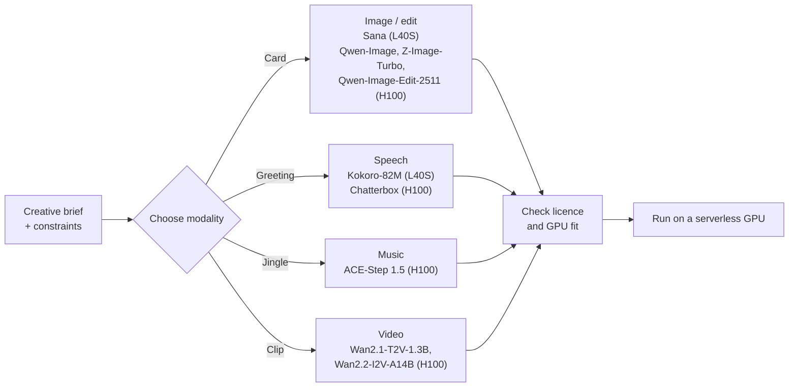

# 1.1 Landscape: Modalities and Model Families

In this lesson we map the generative media modalities, see why video costs the most, compare open and closed models, and check what a licence really allows. Then you pick a model for your Homework 1 idea. You're done when you have written a five-line **model decision record**.

[Homework 1](../cohorts/2026/homework/01-consistent-media-generation-on-serverless-gpus/homework.md) asks you to generate one asset for a creative idea of your own (a card, a product shot, a voice greeting, a jingle), measure it, and compare its cost with a per-call API. No idea yet? Follow our running example, Emma's card, and adapt it later.

Keep this template open while you read:

```text
1. Modality and model:      <task>, <model from the module table>
2. GPU:                     <the template GPU>, and why the model fits it
3. Licence:                 <link to the exact checkpoint and revision>, commercial use: <yes / with conditions / no>
4. Cost driver:             <why this modality costs what it costs, using the measured table>
5. API to compare in HW1:   <a hosted API for the same or a similar model, with its pricing link>
```

## Modalities

In the **Personalized Media Factory**, a brief holds a recipient record, a creative task, and constraints on format and budget. In our running example from the [Build a Media Agent workshop](https://github.com/DataTalksClub/build-media-agent-workshop), Emma, a fictional 7-year-old, wishes for a telescope. We want a personalized holiday card, a spoken greeting, and an optional short video.

| Task | Typical inputs | Output | What you inspect |
|---|---|---|---|
| **Text-to-image** | Prompt, size, seed | Image (`PNG`) | Subject, style, composition, no unwanted text |
| **Image editing** | Source image(s) + instruction, seed | Image (`PNG`) | The edit is applied; the rest is preserved |
| **Text-to-video** | Motion prompt, resolution, frames, fps, seed | Clip (`MP4`) | Smooth motion; objects persist |
| **Image-to-video** | Keyframe + motion prompt, duration, seed | Clip (`MP4`) | Identity kept from the first frame |
| **Text-to-speech** | Script, voice, speed | Audio (`MP3`/`WAV`) | Pronunciation, prosody, no clipping |
| **Text-to-music** | Style tags, lyrics or prompt, duration, seed | Audio (`MP3`/`WAV`) | Structure, tempo, no distortion |

Each model in this module has a deploy template in the [Serverless AI Cookbook](https://github.com/nebius/serverless-ai-cookbook/blob/main/templates/README.md), and the template sets the GPU:



<!-- c:M1-079 c:M1-081 c:M1-082 -->

## What changes between modalities

Switching modality changes four numbers at once: **latent size** (a 2D grid for images, a signal over time for audio, a 3D volume for video), **peak VRAM** (weights, text encoder, decoder and activations), **cold load** `load_s` (fetching weights and moving them onto the GPU), and **generation time** `t_gen` (one asset with the model warm).

We measured one reference model per modality on the course's default GPU (`gpu-l40s-a`, `1gpu-8vcpu-32gb`, 48 GB VRAM, `eu-north1`) `[measured: 2026-11-02, gpu-l40s-a, 1gpu-8vcpu-32gb, eu-north1]`:
<!-- verify before release: link the 2026-11-02 run artifacts (metrics.json per row). The Kokoro fetch + load parts recorded earlier (5.75 s + 6.66 s) don't add up to 10.55 s; re-read metrics.json. -->

| Modality | Model and settings | Peak VRAM | Cold load | `t_gen` | Output |
|---|---|---|---|---|---|
| Text-to-speech | `hexgrad/Kokoro-82M` (20-word script) | `0.73 GB` | `10.55 s` | `1.88 s` | `154 KB` MP3, 7.6 s |
| Text-to-image | `Efficient-Large-Model/Sana_1600M_1024px_diffusers` (`1024x1024`, 20 steps) | `10.91 GB` | `39.89 s` | `4.42 s` | `1.78 MB` PNG |
| Text-to-music | `ACE-Step/acestep-v15-xl-turbo-diffusers` (8 s motif) | `11.86 GB` | `99.50 s` | `2.88 s` | `194 KB` MP3, 8.0 s |
| Text/image-to-video | `Wan-AI/Wan2.2-TI2V-5B-Diffusers` (`832x480`, 121 frames, 50 steps) | `27.89 GB` | `495.57 s` | `157.49 s` | `103 KB` MP4, 5.0 s |

The video row is a reference model that fits the 48 GB L40S; it isn't in the module table. If your model wasn't measured here, use its modality row for line 4 of your record.

## Why video is expensive

On the same L40S, one 5-second clip from Wan2.2-TI2V-5B takes about **36 times** longer than one Sana image (`157.49 s` vs `4.42 s` `[calc]`). Three things drive the gap:

1. **Many more tokens.** Sana's autoencoder compresses each side 32x, so a 1024x1024 image becomes about 1,000 latent tokens. Wan2.2-TI2V-5B compresses time 4x and each side 32x, so our 121-frame `832x480` clip becomes about 12,000 tokens `[calc: 31 x 26 x 15]`. Sana uses linear attention, whose cost grows with the token count; Wan uses full attention, whose cost grows with its square. [Sana](https://arxiv.org/abs/2410.10629), [Wan2.2-TI2V-5B](https://huggingface.co/Wan-AI/Wan2.2-TI2V-5B-Diffusers) <!-- c:M1-044 c:M1-045 c:M1-067 -->
2. **More steps.** Our image run used 20 denoising steps; the video run used 50.
3. **Parameters aren't the memory bill.** TI2V-5B is about 10 GB of weights in `bfloat16` `[calc]`, yet it peaked at 27.89 GB: the text encoder, activations and the 3D decoder add the rest.

The catalog's [Wan2.2-I2V-A14B](https://huggingface.co/Wan-AI/Wan2.2-I2V-A14B-Diffusers) is larger again: two ~14B experts, 27B parameters in total, 14B active per step. Its official script at 720p needs at least 80 GB of VRAM, and its template runs on an H100. Don't carry the 36x figure over to it; it's a different model on a different GPU. <!-- c:M1-062 c:M1-064 c:M1-081 -->

In a pipeline, this gap shapes the design: generate and check the still keyframe first, animate only keyframes that pass, and in Homework 3 make video for a small sample of records only.

Fewer steps is the other lever. [Z-Image-Turbo](https://huggingface.co/Tongyi-MAI/Z-Image-Turbo) is distilled to 8 function evaluations, at the cost of less variety; [Wan2.2-Lightning](https://huggingface.co/lightx2v/Wan2.2-Lightning) LoRAs make video in 4 steps, with artifacts on very large motion (both vendor-reported). Module 3 measures what that does to cost. <!-- c:M1-170 c:M1-171 -->

## Model families

- **Sana** (~1.6B, image): fast at 1024px; can't render complex legible text. [Card](https://huggingface.co/Efficient-Large-Model/Sana_1600M_1024px_diffusers) <!-- c:M1-046 c:M1-047 -->
- **Qwen-Image** (20B, image) and **Qwen-Image-Edit-2511** (edits from one or more input images): large multimodal diffusion transformers. [Card](https://huggingface.co/Qwen/Qwen-Image) <!-- c:M1-049 c:M1-050 -->
- **Z-Image-Turbo** (6B, image): distilled for 8-step generation. [Card](https://huggingface.co/Tongyi-MAI/Z-Image-Turbo) <!-- c:M1-055 c:M1-056 -->
- **Wan2.1 / Wan2.2** (1.3B to 27B, video): text-to-video and keyframe-to-video. [Wan2.2 card](https://huggingface.co/Wan-AI/Wan2.2-I2V-A14B-Diffusers) <!-- c:M1-062 -->
- **Kokoro-82M** (speech): 54 preset voices in 8 languages; ships no voice cloning. [Card](https://huggingface.co/hexgrad/Kokoro-82M) <!-- c:M1-071 -->
- **Chatterbox** (0.5B, speech): clones a voice from a short reference clip and watermarks every output. Clone only voices you have consent to use. [Card](https://huggingface.co/ResembleAI/chatterbox) <!-- c:M1-073 c:M1-074 c:M1-121 -->
- **ACE-Step 1.5** (music): a language model plans the song and a diffusion transformer renders it. [Paper](https://arxiv.org/abs/2602.00744) <!-- c:M1-078 -->

## Open vs closed models

Closed models lead on image quality; open weights are close on video. [Artificial Analysis](https://artificialanalysis.ai/image/leaderboard/text-to-image) ranks models by blind pairwise preference votes (Elo), one board per task. Snapshot of 11 Nov 2026:

| Board | #1 (closed) | Best open weights | Elo gap `[calc]` |
|---|---|---|---|
| [Text-to-image](https://artificialanalysis.ai/image/leaderboard/text-to-image) | GPT Image 2.6 Sunburst (max), 1259 | Qwen-Image-2.1 (#23), 1046 | 213 |
| [Image editing](https://artificialanalysis.ai/image/leaderboard/editing) | GPT Image 2.6 Sunburst (max), 1209 | Fibo 2.0 (#26), 1086 | 123 |
| [Text-to-video, with audio](https://artificialanalysis.ai/video/leaderboard/text-to-video) | Wan 3.0, 1175 | MiniMax H3 (#3), 1161 | 14 |
| [Image-to-video, with audio](https://artificialanalysis.ai/video/leaderboard/image-to-video) | Seedance 2.5, 1161 | MiniMax H3 (#4), 1133 | 28 |
| [Text-to-speech, provider voices](https://artificialanalysis.ai/text-to-speech/leaderboard/provider-voice) | Eleven v4, 1337 | Fish Audio Drama 3 (#8), 1274 | 63 |

<!-- c:M1-123 c:M1-124 c:M1-125 c:M1-127 c:M1-128 c:M1-130 c:M1-131 c:M1-133 c:M1-134 c:M1-135 c:M1-136 -->

Compare gaps only within a board: each has its own Elo scale, the speech board uses public votes, and the 14-point video gap is inside the confidence interval. Video boards now come with and without audio, because models such as MiniMax H3 and [LTX-2](https://huggingface.co/Lightricks/LTX-2) generate the soundtrack with the picture. "Open" needs a qualifier here: MiniMax H3's licence requires organisations in the EU, UK, US and South Korea to apply for permission. <!-- c:M1-167 c:M1-164 c:M1-166 c:M1-149 -->

Our catalog models sit lower: Z-Image Turbo is #74 for images and Kokoro is #65 for speech. Kokoro's hosted price on the board is $0.65 per million characters, against $80 for Eleven v4. <!-- c:M1-126 c:M1-137 c:M1-135 -->

**Closed APIs are a moving target.** Hosted models are retired on a schedule:


Sources: [OpenAI deprecations](https://platform.openai.com/docs/deprecations), [Gemini API Veo](https://ai.google.dev/gemini-api/docs/veo) (Veo 3.1 GA remains on Google's enterprise platform), [fal](https://fal.ai/models/fal-ai/wan/v2.2-a14b/text-to-video). <!-- c:M1-138 c:M1-139 c:M1-140 c:M1-141 c:M1-142 c:M1-143 -->

**When to just use an API.** If you need the best still images, make a few hundred assets a month, and have no one to run GPUs, a per-call API is the sensible choice. Self-hosting pays off when you need a model version you control (pin the revision and keep a copy of the weights), licence terms fixed to that checkpoint, a custom or fine-tuned model, or a volume where your cost per asset beats the API. You'll measure that breakeven in Homework 1.

## Licences

Open weights don't mean free for any commercial use, and the licence belongs to the exact checkpoint you deploy.

- **Sana** checkpoints are Apache-2.0. Their card adds the Gemma terms for the text encoder and says the model is "intended for research purposes only". Read both before commercial use. [Card](https://huggingface.co/Efficient-Large-Model/Sana_1600M_1024px_diffusers) <!-- c:M1-041 c:M1-042 c:M1-043 -->
- **Wan** cards add to Apache-2.0 that use "must not involve sharing any content that violates applicable laws, causes harm". [Card](https://huggingface.co/Wan-AI/Wan2.1-T2V-1.3B-Diffusers) <!-- c:M1-059 c:M1-061 -->
- **Qwen-Image** is Apache-2.0; **Qwen-Image-2.1** is a different checkpoint with a research licence (below). [Card](https://huggingface.co/Qwen/Qwen-Image) <!-- c:M1-048 -->
- Cookbook template code is Apache-2.0; each model has its own licence. <!-- c:M1-084 -->

Several strong "open" models of 2026 come with conditions. This is a summary, not legal advice; read the linked text:

| Model | Licence | Main conditions |
|---|---|---|
| [Qwen-Image-2.1](https://huggingface.co/Qwen/Qwen-Image-2.1/blob/main/LICENSE) | Qwen Research License | No commercial use without a separate licence from Qwen |
| [FLUX.2 [dev]](https://huggingface.co/black-forest-labs/FLUX.2-dev) | FLUX Non-Commercial License | Weights non-commercial; outputs follow the licence's own terms |
| [FLUX 3 Image Klein](https://huggingface.co/black-forest-labs/flux-3-image-klein/blob/main/LICENSE.md) | FLUX Kommunity License | Output use for companies under US$5M revenue (with affiliates), with content filters or output review and AI disclosure; BFL's product page says product use needs a commercial licence, so confirm with BFL |
| [LTX-2.5](https://huggingface.co/Lightricks/LTX-2.5) | LTX-2.x Community License | No cost under US$10M revenue across the whole company group, subject to its use restrictions |
| [MiniMax H3](https://huggingface.co/MiniMaxAI/MiniMax-H3/blob/main/docs/QA-about-License.md) | MiniMax H3 Community License | EU, UK, South Korea and US organisations must apply; MiniMax may authorise |

<!-- c:M1-144 c:M1-147 c:M1-145 c:M1-148 c:M1-149 -->

One more trap for serverless: Black Forest Labs' standard commercial weights licence doesn't allow exposing the model through an external-facing API endpoint. [BFL](https://bfl.ai/open-weights) <!-- c:M1-146 -->

## What "consistent" means in this module

"Consistent" covers five problems. A fixed seed solves only the first:

| Kind | What it means | What breaks it | Where we handle it |
|---|---|---|---|
| **Reproducibility** | Same config and seed give the same output, within a tolerance | Another PyTorch release, GPU or attention backend; reusing a seeded generator | 1.2 and 1.4: pinned model and image, reseeded generator. Hashes match only on the same image, GPU and backend |
| **Identity** | The same character or product in a new scene | A seed doesn't carry identity; models paste the reference instead of re-rendering it | Qwen-Image-Edit-2511 with reference images; Module 2 judge loop |
| **Temporal** | No flicker within a clip, no drift when a clip is extended | Unstable frames; errors that accumulate when extending | Short Wan clips; Module 4 evaluation |
| **Cross-asset** | The card, the clip and the next shot show the same Emma | Assets made in isolation | Keyframe first, then image-to-video (Module 2) |
| **Voice** | The same voice in every clip | A changed voice ID; a reference clip in another language | Kokoro preset voices; one fixed reference clip for Chatterbox |

Sources: [Diffusers](https://huggingface.co/docs/diffusers/using-diffusers/reusing_seeds), [PyTorch](https://docs.pytorch.org/docs/2.15/notes/randomness.html), [OpenS2V-Eval](https://arxiv.org/abs/2505.20292), [FramePack](https://arxiv.org/abs/2504.12626), [Chatterbox](https://huggingface.co/ResembleAI/chatterbox). Watch the metric trap too: a model that pastes the reference scores high on identity similarity while looking wrong. <!-- c:M1-096 c:M1-098 c:M1-099 c:M1-101 c:M1-102 c:M1-106 c:M1-107 c:M1-113 c:M1-117 c:M1-121 c:M1-122 -->

## Real projects

- **Personalized video ads.** Bark.com and AWS built segment-level ads on open Wan 2.1 14B (8 GPUs) with a brand voice cloned from a 10-second sample. A 15–30 second ad takes about 12–15 minutes including checks and regeneration (reported). Removing reference-image propagation dropped their engagement score from 6.5 to 4.8 out of 10. Still under business evaluation. [AWS blog](https://aws.amazon.com/blogs/machine-learning/how-bark-com-and-aws-collaborated-to-build-a-scalable-video-generation-solution) <!-- c:M1-151 c:M1-152 c:M1-153 c:M1-154 -->
- **Product ad studio.** Amazon Ads Video Generator makes six videos from a product detail page in up to 5 minutes. [Amazon Ads guide](https://advertising.amazon.com/library/guides/ai-video-generator) <!-- c:M1-155 -->
- **Personalized narration.** The Washington Post's "Your Personal Podcast" (beta, Dec 2025) builds a short AI-voiced episode from a reader's topics and reading history; the team scored quality on accuracy, voice tone, attribution and engagement. [Help page](https://helpcenter.washingtonpost.com/hc/en-us/articles/44243916498587-Your-Personal-Podcast), [Digiday](https://digiday.com/media/the-washington-post-debuts-ai-personalized-podcasts-to-hook-younger-listeners/) <!-- c:M1-160 c:M1-161 -->

## Models used in this module

Copy the GPU from this table. Templates deploy as **preemptible** by default. Prices in eu-north1, 11 Nov 2026, from [Nebius pricing](https://docs.nebius.com/compute/resources/pricing); Serverless AI bills at these Compute rates:

- L40S (`gpu-l40s-a`, `1gpu-8vcpu-32gb`): `$1.5484/h` on-demand and `$0.7492/h` preemptible, a flat rate `[calc: GPU + 8 vCPU + 32 GiB]`.
- H100: `$4.50` per GPU-hour on-demand. Preemptible H100 is spot-priced: from `$0.79`, it changes during use and can exceed on-demand. Preemptible GPUs can also be interrupted.

<!-- c:M1-085 c:M1-086 c:M1-087 c:M1-088 c:M1-089 -->

| Task | Model | Template GPU | Checkpoint licence |
|---|---|---|---|
| Text-to-image *(default)* | [Sana](https://github.com/nebius/serverless-ai-cookbook/blob/main/templates/endpoint-sana/README.md) | L40S | [Apache-2.0 + Gemma terms](https://huggingface.co/Efficient-Large-Model/Sana_1600M_1024px_diffusers) |
| Text-to-image | [Qwen-Image](https://github.com/nebius/serverless-ai-cookbook/blob/main/templates/endpoint-qwen-image/README.md) | H100 | [Apache-2.0](https://huggingface.co/Qwen/Qwen-Image) |
| Text-to-image | [Z-Image-Turbo](https://github.com/nebius/serverless-ai-cookbook/blob/main/templates/endpoint-z-image-turbo/README.md) | H100 | [Apache-2.0](https://huggingface.co/Tongyi-MAI/Z-Image-Turbo) |
| Image editing | [Qwen-Image-Edit-2511](https://github.com/nebius/serverless-ai-cookbook/blob/main/templates/endpoint-qwen-image-edit-2511/README.md) | H100 | [Apache-2.0](https://huggingface.co/Qwen/Qwen-Image-Edit-2511) |
| Text-to-video | [Wan2.1-T2V-1.3B](https://github.com/nebius/serverless-ai-cookbook/blob/main/templates/endpoint-wan21-t2v-1-3b/README.md) | H100 | [Apache-2.0](https://huggingface.co/Wan-AI/Wan2.1-T2V-1.3B-Diffusers) |
| Image-to-video | [Wan2.2-I2V-A14B](https://github.com/nebius/serverless-ai-cookbook/blob/main/templates/endpoint-wan22-i2v-a14b/README.md) | H100 | [Apache-2.0](https://huggingface.co/Wan-AI/Wan2.2-I2V-A14B-Diffusers) |
| Text-to-speech | [Kokoro-82M](https://github.com/nebius/serverless-ai-cookbook/blob/main/templates/endpoint-kokoro-82m/README.md) | L40S | [Apache-2.0](https://huggingface.co/hexgrad/Kokoro-82M) |
| Text-to-speech | [Chatterbox](https://github.com/nebius/serverless-ai-cookbook/blob/main/templates/endpoint-chatterbox/README.md) | H100 | [MIT](https://huggingface.co/ResembleAI/chatterbox) |
| Text-to-music | [ACE-Step 1.5](https://github.com/nebius/serverless-ai-cookbook/blob/main/templates/endpoint-ace-step-1-5/README.md) | H100 | [MIT](https://huggingface.co/ACE-Step/Ace-Step1.5) |

<!-- c:M1-041 c:M1-048 c:M1-052 c:M1-054 c:M1-059 c:M1-061 c:M1-069 c:M1-072 c:M1-075 c:M1-076 c:M1-079 c:M1-081 c:M1-082 -->

Our measured music run used the larger `ACE-Step/acestep-v15-xl-turbo-diffusers` checkpoint, also [MIT](https://huggingface.co/ACE-Step/acestep-v15-xl-turbo-diffusers).

## Your model decision record

For Emma's card:

```text
1. Modality and model:      text-to-image, Sana (Sana_1600M_1024px_diffusers)
2. GPU:                     L40S; peaks at 10.91 GB, well inside 48 GB
3. Licence:                 https://huggingface.co/Efficient-Large-Model/Sana_1600M_1024px_diffusers/tree/ac0da2ff55fbe434795be0dce883042e4d49e2fc
                            Apache-2.0 + Gemma terms; card says "research purposes only": check before commercial use
4. Cost driver:             4.42 s per image warm; a 5 s video clip took ~36x longer on the same GPU
5. API to compare in HW1:   a hosted text-to-image API, e.g. Z-Image Turbo, listed at $5.00 per 1,000 images on
                            https://artificialanalysis.ai/image/leaderboard/text-to-image
```

The revision in line 3 is the commit pinned in [`code/generation.json`](code/generation.json). If Emma's brief needed the clip, line 1 would become Wan2.2-I2V-A14B, line 2 an 80 GB H100, and line 4 the token and step counts above. That's the trade-off to defend. <!-- c:M1-126 -->

## Common failures and recovery

| Symptom | Cause | Fix |
|---|---|---|
| Licence terms aren't what you expected | You linked the family, not the checkpoint | Link the exact repo and revision; read its card and `LICENSE` |
| Out of memory | Model plus activations exceed the GPU | Use the template GPU; lower resolution or frame count; enable offloading |
| Your hosted model is retired | The provider deprecated it | Keep a self-hosted fallback |
| A model repo is deleted, gated or relicensed | Hugging Face repos can change | Pin the revision and copy the weights to your own bucket |
| Same seed, different character in a new scene | A seed only repeats one prompt | Use reference-image editing (1.2, Module 2) |

Next, generate your first media asset in [1.2 First Media Generation in a Few Minutes](02-first-generation.md).
