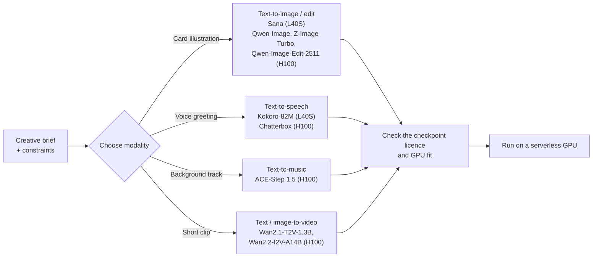
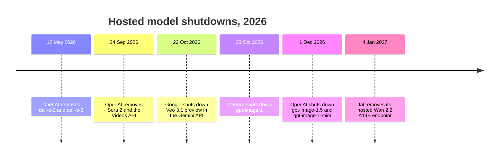

# 1.1 Landscape: Modalities and Model Families

In this lesson we map the generative media modalities and model families, see why video costs the most, compare open and closed models, and check what a licence really allows. Then you pick a model for your Homework 1 idea. You're done when you have a five-line **model decision record**: modality and model, target GPU, licence link to the exact checkpoint, why that modality costs what it costs, and one per-call API to compare against.

## Modalities

In the **Personalized Media Factory**, we start from a brief: a recipient record, a creative task, and constraints on format and budget. In our running example from the [Build a Media Agent workshop](https://github.com/DataTalksClub/build-media-agent-workshop), a 7-year-old named Emma wishes for a telescope, and we want a personalized holiday card illustration, a spoken voice greeting, and an optional short video.

Every generative media task maps an input (a prompt, a reference image, a script) to a media artifact:

| Task | Typical inputs | Output | What you inspect |
|---|---|---|---|
| **Text-to-image** | Prompt, negative prompt, size, seed | Still image (`PNG` / `JPEG`) | Subject accuracy, style, composition, no unwanted text |
| **Image editing** | Source image(s) + edit instruction, seed | Edited image (`PNG`) | The edit is applied and the rest of the scene is preserved |
| **Text-to-video** | Motion prompt, resolution, frames, fps, seed | Video clip (`MP4`) | Temporal coherence, smooth motion, objects that persist |
| **Image-to-video** | Keyframe image + motion prompt, duration, seed | Video clip (`MP4`) | Identity kept from the first frame, natural movement |
| **Text-to-speech (TTS)** | Script, voice preset, speed | Speech audio (`MP3` / `WAV`) | Pronunciation, word recall (via ASR), prosody, no clipping |
| **Text-to-music** | Style tags, lyrics or instrumental prompt, duration, seed | Music track (`MP3` / `WAV`) | Structure, tempo, clarity, no distortion |

Each model in this module has a 1-click template in the [Serverless AI Cookbook](https://github.com/nebius/serverless-ai-cookbook/blob/main/templates/README.md), and the template fixes the GPU:



<!-- c:M1-079 c:M1-081 c:M1-082 -->

## What changes between modalities

Switching from image to speech, music or video changes four engineering numbers at once:

1. **Latent size:** an image is a 2D grid of latent patches, audio is a 1D or 2D signal over time, video is a 3D volume (`frames x height x width`).
2. **Peak GPU memory (VRAM):** weights plus the text encoder, the VAE or audio decoder, and the attention activations during denoising.
3. **Cold load (`load_s`):** fetching weights (if not cached) and moving the pipeline onto the GPU.
4. **Generation time (`t_gen`):** time to denoise and decode one asset once the model is warm.

Here is what we measured on the course's default single-GPU configuration (`gpu-l40s-a`, `1gpu-8vcpu-32gb`, 48 GB VRAM, `eu-north1`) `[measured: 2026-11-02, gpu-l40s-a, 1gpu-8vcpu-32gb, eu-north1]`:
<!-- verify: link the 2026-11-02 run artifacts (metrics.json per row) before release -->

| Modality | Model and settings | Peak VRAM | Cold load (fetch + load) | Generation time (`t_gen`) | Output |
|---|---|---|---|---|---|
| **Text-to-speech** | `hexgrad/Kokoro-82M` (20-word script, seed 0) | `0.73 GB` | `10.55 s` (`5.75 s` + `6.66 s`) | `1.88 s` | `154 KB` (`MP3`, 7.6 s) |
| **Text-to-image** | `Efficient-Large-Model/Sana_1600M_1024px_diffusers` (`1024x1024`, 20 steps, seed 7) | `10.91 GB` | `39.89 s` (`26.60 s` + `13.29 s`) | `4.42 s` | `1.78 MB` (`PNG`) |
| **Text-to-music** | `ACE-Step/acestep-v15-xl-turbo-diffusers` (8 s motif, seed 11) | `11.86 GB` | `99.50 s` | `2.88 s` | `194 KB` (`MP3`, 8.0 s) |
| **Text/image-to-video** | `Wan-AI/Wan2.2-TI2V-5B-Diffusers` (`832x480`, 121 frames at 24 fps, 50 steps, seed 3) | `27.89 GB` | `495.57 s` | `157.49 s` | `103 KB` (`MP4`, 5.0 s) |

Speech, image and music each use under a quarter of the 48 GB L40S [L40S memory](https://docs.nebius.com/compute/virtual-machines/types) and finish a warm generation in 1.9–4.4 s. <!-- c:M1-092 -->

## Why video is expensive

On the same L40S, one 5-second `832x480` clip from Wan2.2-TI2V-5B takes `157.49 s`: about **36 times** the `4.42 s` of a `1024x1024` Sana image `[calc]`, at `27.89 GB` peak VRAM. Three things drive the gap:

1. **Space and time tokens.** An image transformer attends over one frame. A video transformer attends across frames too, so even a compressed 121-frame clip produces thousands of 3D latent tokens per step.
2. **More denoising steps.** Our image baseline used 20 steps; the video baseline used 50.
3. **Parameters are not the memory bill.** TI2V-5B has 5 billion parameters, about 10 GB in `bfloat16` `[calc]`, yet the run peaked at 27.89 GB: the text encoder, the activations across 121 frames and the 3D VAE decode add the rest.

The larger image-to-video model is bigger still. [Wan2.2-I2V-A14B](https://huggingface.co/Wan-AI/Wan2.2-I2V-A14B-Diffusers) is a mixture of two ~14B experts: 27B parameters in total, 14B active per step. Its official single-GPU command needs at least 80 GB of VRAM, which is why its template runs on an H100. <!-- c:M1-062 c:M1-064 c:M1-081 -->

In a production pipeline this gap shapes the architecture:

- **Gate video on image quality.** Generate and check the still keyframe first, then animate only keyframes that pass.
- **Sample video at scale.** In Homework 3 we generate text, image and voice for every record and video only for a small sample.

Fewer steps is the other lever. Step-distilled variants are now common: [Z-Image-Turbo](https://huggingface.co/Tongyi-MAI/Z-Image-Turbo) is distilled to 8 function evaluations, and the [Wan2.2-Lightning](https://huggingface.co/lightx2v/Wan2.2-Lightning) LoRAs generate video in 4 steps without classifier-free guidance (vendor-reported). Module 3 measures what that does to cost. <!-- c:M1-170 c:M1-171 -->

## Model families

The module's open-weights models fall into a few families:

- **Image transformers**
  - **Sana** (`Sana_1600M_1024px_diffusers`, ~1.6B): a 32x deep-compression autoencoder plus linear attention, so 1024x1024 images take few tokens. It can't render complex legible text. [Model card](https://huggingface.co/Efficient-Large-Model/Sana_1600M_1024px_diffusers) <!-- c:M1-044 c:M1-045 c:M1-047 -->
  - **Qwen-Image** (20B): a multimodal diffusion transformer (MMDiT) conditioned on Qwen2.5-VL, strong at prompt following and text rendering. **Qwen-Image-Edit-2511** edits from one or more input images. [Paper](https://arxiv.org/abs/2508.02324) <!-- c:M1-049 c:M1-050 -->
  - **Z-Image-Turbo** (6B): a single-stream transformer (S3-DiT) distilled for 8-step generation. [Model card](https://huggingface.co/Tongyi-MAI/Z-Image-Turbo) <!-- c:M1-055 c:M1-056 c:M1-057 -->
- **Video transformers**
  - **Wan2.1 / Wan2.2:** text-to-video and keyframe-conditioned image-to-video. The 1.3B and 5B models fit on a 48 GB GPU; Wan2.2-TI2V-5B runs on 24 GB with offloading. The A14B models need an 80 GB GPU. [Wan2.2-TI2V-5B card](https://huggingface.co/Wan-AI/Wan2.2-TI2V-5B-Diffusers) <!-- c:M1-067 c:M1-068 c:M1-064 -->
- **Speech**
  - **Kokoro-82M:** built on StyleTTS 2 and ISTFTNet, with 54 fixed preset voices in 8 languages. It ships no voice cloning. [Model card](https://huggingface.co/hexgrad/Kokoro-82M) <!-- c:M1-070 c:M1-071 -->
  - **Chatterbox** (0.5B): expressive English TTS that clones a voice from a short reference clip, and watermarks every output. [Model card](https://huggingface.co/ResembleAI/chatterbox) <!-- c:M1-073 c:M1-074 c:M1-121 -->
- **Music**
  - **ACE-Step 1.5:** a language model plans the song and a diffusion transformer renders it. [Paper](https://arxiv.org/abs/2602.00744) <!-- c:M1-078 -->

## Open vs closed models

Closed models still lead on image quality. Open weights are close on video. [Artificial Analysis](https://artificialanalysis.ai/image/leaderboard/text-to-image) ranks models by blind pairwise human preference votes (Elo), one board per task. Snapshot of 11 Nov 2026:

| Board | #1 (closed) | Best open weights | Elo gap |
|---|---|---|---|
| [Text-to-image](https://artificialanalysis.ai/image/leaderboard/text-to-image) | GPT Image 2.6 Sunburst, 1259 | Qwen-Image-2.1 (#23), 1046 | 213 |
| [Image editing](https://artificialanalysis.ai/image/leaderboard/editing) | GPT Image 2.6 Sunburst, 1209 | Fibo 2.0 (#26), 1086 | 123 |
| [Text-to-video, with audio](https://artificialanalysis.ai/video/leaderboard/text-to-video) | Wan 3.0, 1175 | MiniMax H3 (#3), 1161 | 14 |
| [Image-to-video](https://artificialanalysis.ai/video/leaderboard/image-to-video) | Seedance 2.5, 1161 | MiniMax H3 (#4), 1133 | 28 |
| [Text-to-speech](https://artificialanalysis.ai/text-to-speech/leaderboard) | Eleven v4, 1337 | Fish Audio Drama 3 (#8), 1274 | 63 |

<!-- c:M1-123 c:M1-124 c:M1-125 c:M1-127 c:M1-128 c:M1-130 c:M1-131 c:M1-133 c:M1-134 c:M1-135 c:M1-136 -->

Read it with three caveats: each board has its own Elo scale, so compare gaps only within a board; the video gap of 14 is inside the board's confidence interval; and the rankings change every few weeks. Video boards now come in "with audio" and "silent" versions with different leaders, because models such as MiniMax H3 and [LTX-2.5](https://huggingface.co/Lightricks/LTX-2.5) generate the soundtrack together with the picture. <!-- c:M1-150 c:M1-164 c:M1-165 c:M1-166 c:M1-167 -->

The models in our catalog sit well below the top: Z-Image Turbo is #74 for text-to-image and Kokoro is #65 for speech. Kokoro is also the cheapest model on the speech board, at $0.65 per million characters against $80 for Eleven v4 (prices as listed by Artificial Analysis). <!-- c:M1-126 c:M1-137 c:M1-135 -->

**Closed APIs are a moving target.** Hosted models are retired on a schedule, and the suggested replacement is sometimes retired soon after:



Sources: [OpenAI deprecations](https://platform.openai.com/docs/deprecations), [Gemini API Veo page](https://ai.google.dev/gemini-api/docs/veo), [fal Wan 2.2 A14B](https://fal.ai/models/fal-ai/wan/v2.2-a14b/text-to-video). <!-- c:M1-138 c:M1-139 c:M1-140 c:M1-141 c:M1-142 c:M1-143 -->

**When to just use an API.** If you need the best still images, generate a few hundred assets a month, and have no one to run GPUs, a per-call API is the sensible choice. Self-hosting open weights pays off when you need a pinned model version that won't be retired, a licence you can read, a custom or fine-tuned model, or volume where your cost per asset beats the API price. You'll measure that breakeven for your own model in Homework 1.

## Licences

Open weights don't mean free for any commercial use, and the licence belongs to the exact checkpoint you deploy, not to the model family.

- The Sana checkpoints are Apache-2.0, but their card adds the Gemma terms of use for the Gemma-2-2B text encoder. [Sana card](https://huggingface.co/Efficient-Large-Model/Sana_1600M_1024px_diffusers) <!-- c:M1-041 c:M1-042 c:M1-043 -->
- The Wan cards add use restrictions on top of Apache-2.0: no content that breaks laws or harms people. [Wan2.2-I2V-A14B card](https://huggingface.co/Wan-AI/Wan2.2-I2V-A14B-Diffusers) <!-- c:M1-059 c:M1-061 -->
- Template code in the Serverless AI Cookbook is Apache-2.0; each model checkpoint has its own licence on Hugging Face. <!-- c:M1-084 -->

In 2026, several strong "open" models come with conditions:

| Model | Licence | Condition |
|---|---|---|
| [Qwen-Image-2.1](https://huggingface.co/Qwen/Qwen-Image-2.1/blob/main/LICENSE) | Qwen Research License | No commercial use without a separate licence from Qwen |
| [FLUX.2 [dev]](https://huggingface.co/black-forest-labs/FLUX.2-dev) | FLUX Non-Commercial License | Weights are non-commercial; outputs follow the licence's own terms |
| [FLUX 3 Image Klein](https://huggingface.co/black-forest-labs/flux-3-image-klein/blob/main/LICENSE.md) | FLUX Kommunity License | Commercial use of outputs only under US$5M annual revenue, with content filters or output review |
| [LTX-2.5](https://huggingface.co/Lightricks/LTX-2.5) | LTX-2.x Community License | Free under US$10M annual revenue, counted across the whole company group |
| [MiniMax H3](https://huggingface.co/MiniMaxAI/MiniMax-H3/blob/main/docs/QA-about-License.md) | MiniMax H3 Community License | Organisations in the EU, UK, South Korea and US must apply for permission |

<!-- c:M1-144 c:M1-147 c:M1-145 c:M1-148 c:M1-149 -->

One more trap matters for serverless: Black Forest Labs' paid commercial weights licence doesn't allow exposing the model through an external-facing API endpoint. [BFL licensing](https://bfl.ai/open-weights) <!-- c:M1-146 -->

Before production, open the `LICENSE` of the exact Hugging Face repository and revision you deploy, and record the link.

## What "consistent" means in this module

"Consistent" covers five different problems. A fixed seed solves only the first:

| Kind | What it means | What breaks it | Where we handle it |
|---|---|---|---|
| **Reproducibility** | Same config and seed give the same output, within a tolerance | A different PyTorch release, GPU or attention backend; reusing a seeded generator across calls | 1.2 and 1.4: pinned image, reseeded generator, hash comparison |
| **Identity** | The same character or product appears in a new scene | A seed doesn't carry identity; models paste the reference instead of re-rendering it | Qwen-Image-Edit-2511 with reference images; Module 2 judge loop |
| **Temporal** | No flicker or drift within one clip | Errors pile up frame after frame | Short Wan clips; Module 4 evaluation |
| **Cross-asset** | The card, the clip and the next shot show the same Emma | Each asset generated in isolation | Keyframe first, then image-to-video (Module 2) |
| **Voice** | The same voice in every clip | A changed voice ID; a reference clip in the wrong language | Kokoro preset voices; one fixed reference clip for Chatterbox |

Sources: [Diffusers on reproducibility](https://huggingface.co/docs/diffusers/using-diffusers/reusing_seeds), [PyTorch randomness notes](https://docs.pytorch.org/docs/2.15/notes/randomness.html), [OpenS2V-Eval](https://arxiv.org/abs/2505.20292), [FramePack](https://arxiv.org/abs/2504.12626), [Chatterbox card](https://huggingface.co/ResembleAI/chatterbox). <!-- c:M1-096 c:M1-098 c:M1-099 c:M1-101 c:M1-102 c:M1-106 c:M1-113 c:M1-117 c:M1-121 c:M1-122 -->

Watch the metrics too: a model that pastes the reference image scores high on identity similarity while looking wrong. [OpenS2V-Eval](https://arxiv.org/abs/2505.20292) <!-- c:M1-107 -->

## Real projects

Three public examples of the workloads this course builds:

1. **Personalized video ads.** Bark.com and AWS built segment-personalized ads on open-weights Wan 2.1 14B (sharded across 8 GPUs) and a cloned brand voice from a 10-second sample. A 15–30 second ad takes about 12–15 minutes, including automated checks and regeneration. Removing reference-image propagation dropped their LLM-judged engagement score from 6.5 to 4.8, so consistency is measurable. The solution was still under business evaluation. [AWS blog](https://aws.amazon.com/blogs/machine-learning/how-bark-com-and-aws-collaborated-to-build-a-scalable-video-generation-solution) <!-- c:M1-151 c:M1-152 c:M1-153 c:M1-154 -->
2. **Product ad studio.** Amazon Ads Video Generator turns a product page into up to six video ads in three to four minutes, mixing Amazon Nova with other models (company-reported). [Interview](https://www.exchange4media.com/advertising-news/amazon-ads-brings-ai-video-generator-to-india-opening-new-doors-for-smbs-149247.html) <!-- c:M1-155 c:M1-157 -->
3. **Personalized narration.** The Washington Post's "Your Personal Podcast" builds a short AI-voiced podcast from each reader's history, and scores every episode on accuracy, voice tone, attribution and engagement. [Digiday](https://digiday.com/media/the-washington-post-debuts-ai-personalized-podcasts-to-hook-younger-listeners/) <!-- c:M1-160 c:M1-161 -->

## Models used in this module

The default course path is **Sana on L40S**. The cookbook templates deploy as preemptible by default: about `$0.74/h` on `gpu-l40s-a` / `1gpu-8vcpu-32gb`, or `$1.5484/h` on-demand `[calc]` (GPU, vCPU and RAM rates in eu-north1, [Nebius pricing](https://docs.nebius.com/compute/resources/pricing)). An H100 is `$4.50` per GPU-hour on-demand. Serverless AI bills at these Compute rates. <!-- c:M1-085 c:M1-086 c:M1-087 c:M1-089 -->

| Task | Model | Template GPU | Checkpoint licence |
|---|---|---|---|
| Text-to-image *(default)* | [Sana](https://github.com/nebius/serverless-ai-cookbook/blob/main/templates/endpoint-sana/README.md) | L40S | [Apache-2.0](https://huggingface.co/Efficient-Large-Model/Sana_1600M_1024px_diffusers) |
| Text-to-image | [Qwen-Image](https://github.com/nebius/serverless-ai-cookbook/blob/main/templates/endpoint-qwen-image/README.md) | H100 | [Apache-2.0](https://huggingface.co/Qwen/Qwen-Image) |
| Text-to-image | [Z-Image-Turbo](https://github.com/nebius/serverless-ai-cookbook/blob/main/templates/endpoint-z-image-turbo/README.md) | H100 | [Apache-2.0](https://huggingface.co/Tongyi-MAI/Z-Image-Turbo) |
| Image editing | [Qwen-Image-Edit-2511](https://github.com/nebius/serverless-ai-cookbook/blob/main/templates/endpoint-qwen-image-edit-2511/README.md) | H100 | [Apache-2.0](https://huggingface.co/Qwen/Qwen-Image-Edit-2511) |
| Text-to-video | [Wan2.1-T2V-1.3B](https://github.com/nebius/serverless-ai-cookbook/blob/main/templates/endpoint-wan21-t2v-1-3b/README.md) | H100 | [Apache-2.0](https://huggingface.co/Wan-AI/Wan2.1-T2V-1.3B-Diffusers) |
| Image-to-video | [Wan2.2-I2V-A14B](https://github.com/nebius/serverless-ai-cookbook/blob/main/templates/endpoint-wan22-i2v-a14b/README.md) | H100 | [Apache-2.0](https://huggingface.co/Wan-AI/Wan2.2-I2V-A14B-Diffusers) |
| Text-to-speech | [Kokoro-82M](https://github.com/nebius/serverless-ai-cookbook/blob/main/templates/endpoint-kokoro-82m/README.md) | L40S | [Apache-2.0](https://huggingface.co/hexgrad/Kokoro-82M) |
| Text-to-speech | [Chatterbox](https://github.com/nebius/serverless-ai-cookbook/blob/main/templates/endpoint-chatterbox/README.md) | H100 | [MIT](https://huggingface.co/ResembleAI/chatterbox) |
| Text-to-music | [ACE-Step 1.5](https://github.com/nebius/serverless-ai-cookbook/blob/main/templates/endpoint-ace-step-1-5/README.md) | H100 | [MIT](https://huggingface.co/ACE-Step/Ace-Step1.5) |

<!-- c:M1-048 c:M1-052 c:M1-054 c:M1-059 c:M1-061 c:M1-069 c:M1-072 c:M1-075 c:M1-076 c:M1-079 c:M1-081 c:M1-082 -->

Our measured music run used the larger `ACE-Step/acestep-v15-xl-turbo-diffusers` checkpoint, which is also [MIT](https://huggingface.co/ACE-Step/acestep-v15-xl-turbo-diffusers).

## Your model decision record

Write five lines for your Homework 1 idea. For Emma's card it looks like this:

```text
1. Modality and model: text-to-image, Sana (Sana_1600M_1024px_diffusers)
2. GPU: L40S, 1gpu-8vcpu-32gb. Peaks at 10.91 GB, well inside 48 GB
3. Licence: Apache-2.0 + Gemma terms for the text encoder
   https://huggingface.co/Efficient-Large-Model/Sana_1600M_1024px_diffusers
4. Cost driver: one image takes 4.42 s warm; video would take ~36x longer per asset
5. API to compare in HW1: <a hosted text-to-image API and its pricing page>
```

If Emma's brief needed the animated clip, line 1 would become image-to-video with Wan2.2-I2V-A14B, line 2 an 80 GB H100, and line 4 the video cost gap. That's the trade-off to defend.

## Common failures and recovery

| Symptom | Cause | Fix |
|---|---|---|
| Licence link shows different terms from what you expected | You linked the model family, not the exact checkpoint | Link the Hugging Face repo and revision you deploy |
| Out-of-memory error on L40S | The model or its activations need more than 48 GB | Use the GPU from the template table, or a smaller variant |
| Your hosted model disappears mid-project | The provider retired it | Keep a self-hosted fallback, or pin a model you can download |
| The same seed gives a different character in a new scene | A seed only makes one prompt repeatable | Use reference-image editing, covered in 1.2 and Module 2 |

## Notes

- Leaderboard figures are a snapshot of 11 November 2026 and will move.
- Funding and market figures for the companies above are out of scope for this lesson.

Next, generate your first media asset in [1.2 First Media Generation in a Few Minutes](02-first-generation.md).
