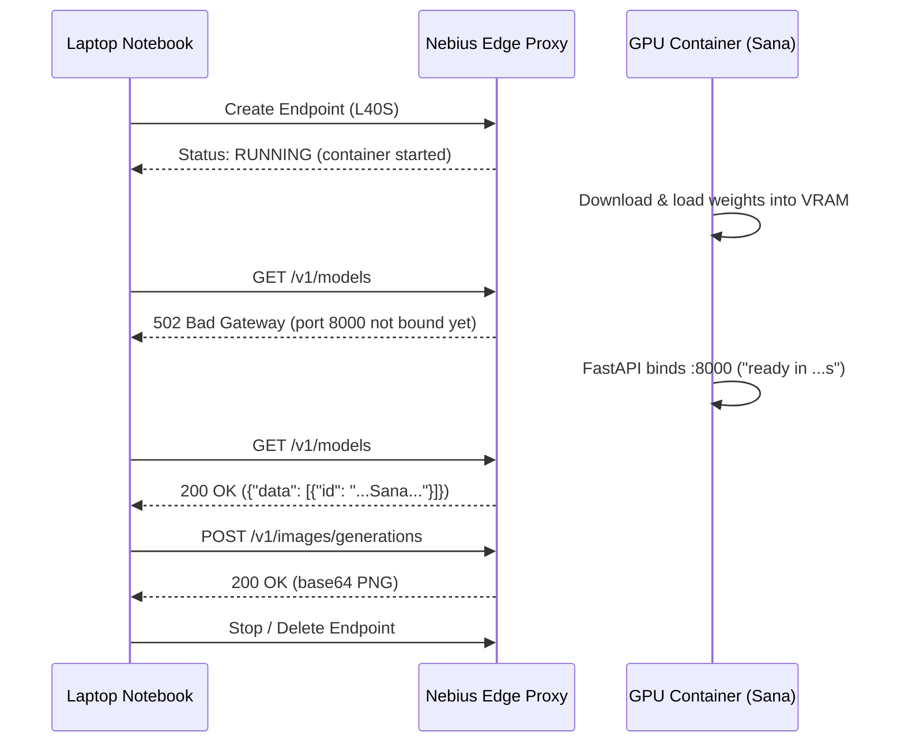

# 1.2 First Media Generation in a Few Minutes

In this lesson we generate a first image, video or audio asset in minutes: through an Endpoint deployed from a cookbook template (Option A, default with Sana on L40S), or in JupyterLab on a GPU (Option B). You're done when the asset is on your laptop and the Endpoint or JupyterLab is stopped.

Choose **one** option to get your first asset:

- **Option A (Recommended default):** Deploy a 1-click Endpoint template on Nebius Serverless AI and call it from a Jupyter notebook on your laptop. You don't need a local GPU or CUDA installation.
- **Option B (Optional alternative):** Launch a GPU DevLab (JupyterLab on a GPU VM) if you want to load Diffusers pipelines directly in GPU memory and inspect VRAM interactively.

## Option A: Endpoint and Jupyter on your laptop

Install the local notebook dependencies with `uv` from the repository root:

```bash
uv sync --extra notebooks
```

### Deploy an Endpoint from a template

Open the [Sana Endpoint template](https://github.com/nebius/serverless-ai-cookbook/blob/main/templates/endpoint-sana/README.md) in the Serverless AI Cookbook and click **Create Endpoint**.

The form pre-fills the container image, port `8000`, and the default L40S preset (`gpu-l40s-a`, `1gpu-8vcpu-32gb`). Leave **Token authentication** enabled, generate or enter a bearer token, and copy both the token and the container image string before clicking **Create**.

Once the Endpoint is created, copy its public HTTPS URL from the console and export `BASE_URL` and `TOKEN` in your terminal:

```bash
export BASE_URL="https://<your-endpoint-host>"
read -rs TOKEN
export TOKEN
```

### Endpoint lifecycle: RUNNING is not ready

When you watch the Endpoint in the console, its state moves from `PROVISIONING` to `IMAGE_PULLING` to `RUNNING`. However, **`RUNNING` only means the container process has started — it does not mean the model weights are loaded in GPU memory.**

While the container is downloading the ~9 GB Sana checkpoint and moving it onto the GPU, calling the Endpoint returns `502 Bad Gateway` (`failed to connect to local service`) because Uvicorn only binds port `8000` after `load_pipeline()` completes.



To handle this cleanly in code, `call_endpoint.py` polls `/v1/models` with a bounded timeout, retrying on `502`/`503`/`504` while failing immediately on authentication errors (`401`/`403`):

```python
def wait_ready(base, token, deadline_s=600):
    deadline = time.monotonic() + deadline_s
    while True:
        remaining = deadline - time.monotonic()
        if remaining <= 0:
            raise TimeoutError("Readiness deadline reached; inspect logs and stop the Endpoint")
        try:
            data = request(base, token, "/v1/models", timeout=min(30, remaining))
            if isinstance(data, dict) and isinstance(data.get("data"), list) and data["data"]:
                return data
        except urllib.error.HTTPError as exc:
            if exc.code not in (429, 502, 503, 504):
                raise
        except (urllib.error.URLError, TimeoutError, json.JSONDecodeError):
            pass
        time.sleep(min(2, max(0, deadline - time.monotonic())))
```

### Call the Endpoint from a notebook

In the [Build a Media Agent workshop](https://github.com/DataTalksClub/build-media-agent-workshop), we wrapped the image Endpoint in a small `ImageGenerator` class that posts the prompt to `/v1/images/generations`, decodes the `b64_json` response, and writes the PNG to disk.

We use that exact pattern in [code/call_endpoint.py](code/call_endpoint.py) and [code/endpoint_quickstart.ipynb](code/endpoint_quickstart.ipynb), adding Bearer token authentication and explicit generation parameters (`seed`, `size`, `num_inference_steps`, `guidance_scale`):

```python
class ImageGenerator:
    def __init__(self, endpoint: str, token: str | None, model: str):
        self.endpoint = endpoint.rstrip("/")
        self.token = token
        self.model = model

    def generate_image(
        self,
        prompt: str,
        *,
        seed: int = 7,
        size: str = "1024x1024",
        num_inference_steps: int = 20,
        guidance_scale: float = 4.5,
        negative_prompt: str = "",
        timeout: int = 300,
    ) -> bytes:
        request_data = {
            "model": self.model,
            "prompt": prompt,
            "size": size,
            "seed": seed,
            "n": 1,
            "response_format": "b64_json",
            "num_inference_steps": num_inference_steps,
            "guidance_scale": guidance_scale,
            "negative_prompt": negative_prompt,
        }
        payload = request(
            self.endpoint,
            self.token,
            "/v1/images/generations",
            request_data,
            timeout=timeout,
        )
        return base64.b64decode(payload["data"][0]["b64_json"], validate=True)
```

Our shared configuration file [code/generation.json](code/generation.json) holds Emma's holiday gift-card prompt (a glowing brass telescope on snow under a starry night sky, `seed=7`, `1024x1024`, `20` steps).

Launch Jupyter Lab on your laptop and open [code/endpoint_quickstart.ipynb](code/endpoint_quickstart.ipynb):

```bash
uv run jupyter lab
```

Or run the Endpoint client directly from the terminal to generate 3 samples and record `metrics.json`:

```bash
uv run python 01-consistent-media-generation-on-serverless-gpus/code/call_endpoint.py --n 3
```

Each run creates a fresh directory under `runs/01-consistent-media-generation-on-serverless-gpus/<run_id>/` containing `asset-000.png` through `asset-002.png`, `metrics.json`, and `trace.jsonl`. If you also deploy the `Qwen-Image` cookbook template, the notebook includes an optional comparison cell to run `ImageGenerator` against `Qwen/Qwen-Image` with the exact same prompt and seed.

### Save the asset and stop the Endpoint

Open `asset-000.png` to inspect your generated illustration and verify that `metrics.json` has `"status": "completed"` and three latency values in `"latency_s"`.

Then **immediately stop or delete the Endpoint in the Nebius console**. An Endpoint bills per second while it is `RUNNING` (`$1.5484/h` on-demand for `gpu-l40s-a` / `1gpu-8vcpu-32gb`), even when no requests are arriving. Confirm in the console that its state is no longer `RUNNING`.

## Option B: JupyterLab on a GPU

> [!NOTE]
> **Option B is optional.** Only follow this section if you want to spin up a GPU DevLab (JupyterLab on a GPU VM) and run Diffusers pipelines directly in GPU memory. If you completed Option A on your laptop, you can jump straight to [Seeds and reproducibility](#seeds-and-reproducibility).

### Start JupyterLab

In the Nebius console, create a [DevLab](https://docs.nebius.com/serverless/quickstart/devlabs) on an L40S GPU (`gpu-l40s-a`, `1gpu-8vcpu-32gb`) with a CUDA-enabled PyTorch image. Open a terminal inside JupyterLab, clone this repository, and open [code/jupyterlab_models.ipynb](code/jupyterlab_models.ipynb).

Set `HF_HOME` to a local directory in your home folder (`export HF_HOME=$HOME/hf`) so downloaded weights persist across runs within that DevLab session.

### Load models with Diffusers

Inside the GPU notebook (and in [code/generate.py](code/generate.py)), we load `SanaPipeline` from the pinned Hugging Face commit `ac0da2ff55fbe434795be0dce883042e4d49e2fc`:

```python
def load_pipeline(cfg):
    import torch
    from diffusers import SanaPipeline

    pipe = SanaPipeline.from_pretrained(
        cfg["model"],
        revision=cfg["model_revision"],
        variant=cfg["variant"],
        torch_dtype=torch.float16,
    ).to("cuda")
    # Sana recipe: fp16 transformer, bf16 text encoder and VAE to prevent black images.
    pipe.text_encoder.to(torch.bfloat16)
    pipe.vae.to(torch.bfloat16)
    pipe.set_progress_bar_config(disable=True)
    return pipe
```

Notice the mixed-precision setup: the diffusion transformer runs in `float16`, while `text_encoder` and `vae` are cast to `bfloat16` (the wider exponent range prevents numerical overflow that otherwise produces black images on Sana).

### Watch VRAM and time per asset

Because GPU operations execute asynchronously, we call `torch.cuda.synchronize()` before starting and stopping the timer, and we track peak GPU memory with `torch.cuda.max_memory_allocated()`:

```python
torch.cuda.reset_peak_memory_stats()
torch.cuda.synchronize()
start = time.perf_counter()

image = pipe(
    prompt=cfg["prompt"],
    **cfg["params"],
    generator=torch.Generator(device="cuda").manual_seed(cfg["seed"]),
).images[0]

torch.cuda.synchronize()
gen_s = time.perf_counter() - start
peak_vram_gb = round(torch.cuda.max_memory_allocated() / 1e9, 3)
```

On an L40S (`gpu-l40s-a`), Sana peaks at `10.91 GB` of the card's `48 GB` VRAM and generates a `1024x1024` image in `4.42 s` `[measured: 2026-11-02, gpu-l40s-a, 1gpu-8vcpu-32gb, eu-north1]`.

Two practical tips when iterating in a GPU DevLab:

1. **Keep the kernel alive while exploring:** Restarting the Jupyter kernel drops the pipeline from VRAM and forces you to re-pay the model load time (`~13 s` from local cache). Re-run only the generation cell when testing new prompts, seeds, or step counts.
2. **Free VRAM is not total VRAM:** If you open a second notebook without shutting down the first kernel, the first kernel still holds its `10.91 GB` allocation. Check `nvidia-smi` or shut down unused kernels if you hit `CUDA out of memory`.

### Write down the run configuration

Running `generate.run(CODE / "generation.json", n=3, mode="jupyterlab")` writes the three generated images alongside `metrics.json`, capturing both the input `config` and the hardware `env`:

```json
{
  "config": {
    "model": "Efficient-Large-Model/Sana_1600M_1024px_diffusers",
    "model_revision": "ac0da2ff55fbe434795be0dce883042e4d49e2fc",
    "variant": "fp16",
    "seed": 7,
    "params": {
      "width": 1024,
      "height": 1024,
      "num_inference_steps": 20,
      "guidance_scale": 4.5,
      "negative_prompt": ""
    }
  },
  "env": {
    "gpu": "NVIDIA L40S",
    "preset": "1gpu-8vcpu-32gb",
    "cuda": "13.0",
    "torch": "2.13.0",
    "diffusers": "0.39.0",
    "peak_vram_gb": 10.908
  }
}
```

Download your PNGs and `metrics.json` to your laptop, then **stop or delete the DevLab** in the console.

## Seeds and reproducibility

In `metrics.json`, every asset entry records its SHA-256 hash:

```json
"assets": [
  {
    "file": "asset-000.png",
    "bytes": 1781554,
    "sha256": "c4c308141fbb9a107a1faea13a72da7e4b2d5d51b653f3b9e6bdd4f46889b9af"
  }
]
```

What does fixing `"seed": 7` actually guarantee?

- **Same container, same GPU, same parameters → byte-identical output:** When we ran `Sana_1600M` (`seed=7`, `1024x1024`, 20 steps) three times on `gpu-l40s-a` with the same container image, all three runs produced the exact same `1,781,554` bytes (`sha256: c4c30814...`) `[measured: 2026-11-02, gpu-l40s-a, 1gpu-8vcpu-32gb, eu-north1]`.
- **Different GPU, driver, PyTorch/Diffusers build, or server wrapper → repeatable configuration, not guaranteed identical bytes:** As documented in [PyTorch's reproducibility guide](https://docs.pytorch.org/docs/stable/notes/randomness.html), floating-point kernel order can differ across hardware architectures or library versions even when initialized with the same seed.
- **Seed ≠ character consistency across different prompts:** Fixing the seed makes a given prompt repeatable; it does not keep the same character across brand-new scene prompts (which requires image conditioning or editing models like `Qwen-Image-Edit-2511`).

That is why `metrics.json` records both `config` (prompt, seed, model revision, steps) and `env` (GPU, CUDA, PyTorch, Diffusers, container image). Next, let's look inside the container image that packages this runtime in [1.3 Containers for Generative AI](03-containers.md).
