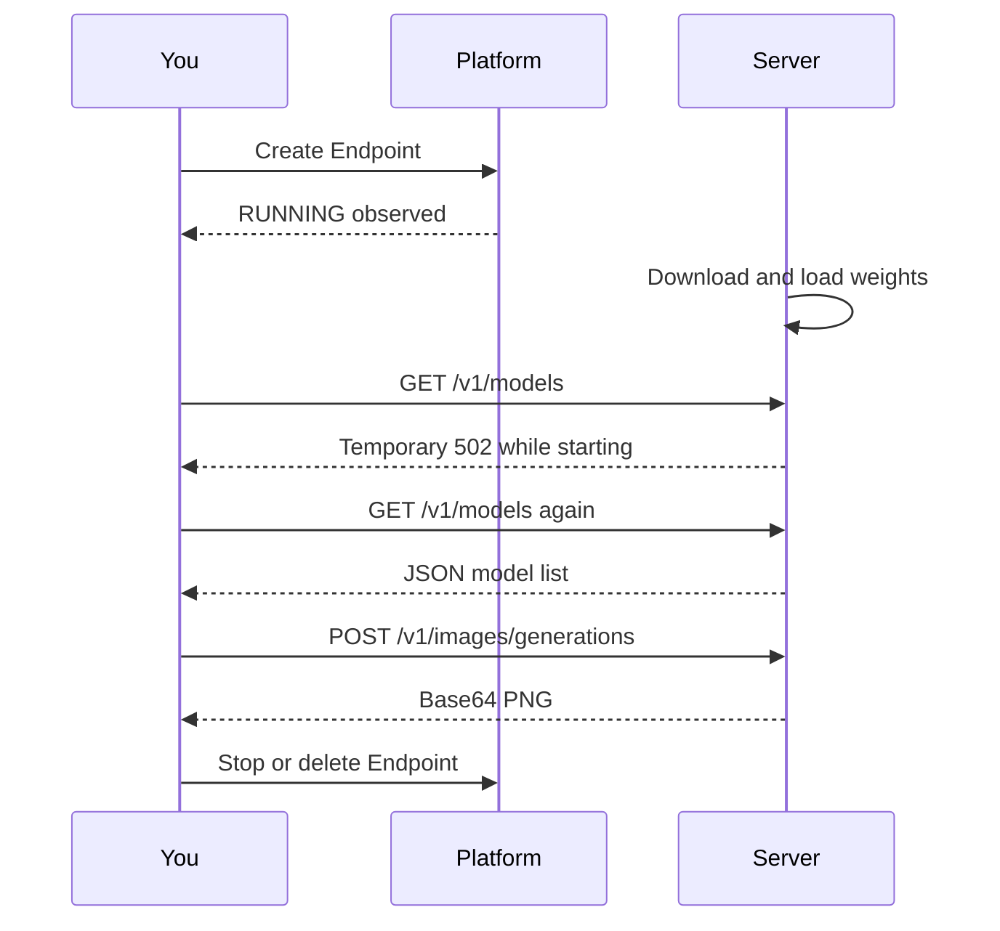

# 1.2 First Media Generation in a Few Minutes


We turn the fox brief into a PNG, save the configuration that produced it, and stop the GPU resource. Option A calls a template Endpoint from your laptop. Option B runs the model in a GPU JupyterLab. Choose one path first; you do not need both to complete this lesson.

## Prepare your local environment

You need Python 3.12, [uv](https://docs.astral.sh/uv/getting-started/installation/), a Nebius project with GPU access, and a terminal. All commands below run from the repository root. The [code guide](code/README.md) lists every file and environment variable.

```bash
uv sync --extra notebooks
```

The generation examples save PNGs, `metrics.json` and `trace.jsonl` in a new directory under `runs/01-consistent-media-generation-on-serverless-gpus/`.

## Option A: an Endpoint and a laptop notebook

Open the [Sana template](https://github.com/nebius/serverless-ai-cookbook/tree/main/templates/endpoint-sana) and select **Create Endpoint**. Review the project, region, GPU platform and preset. The course reference is L40S; choose regular/on-demand capacity for this first comparison and record your actual selection. The template link may preselect preemptible capacity, so inspect it rather than accepting every default.

Keep token authentication enabled. Save the token privately when it is displayed and copy the public base URL. Record a timezone-aware timestamp immediately before Create and another when you first observe RUNNING. Record the container image string as well. Do not copy credentials into a notebook or commit them.

```bash
export BASE_URL='https://YOUR-ENDPOINT-HOST'
# Read the bearer token without showing it in terminal history (bash/zsh):
read -rs TOKEN
export TOKEN
export ENDPOINT_IMAGE='copy-the-image-reference-from-your-deployment'
```

### RUNNING is not ready

RUNNING means the deployment has started, not that model weights are loaded. The [Sana template](https://github.com/nebius/serverless-ai-cookbook/blob/main/templates/endpoint-sana/README.md) documents temporary 502 responses before its API is available. Our client polls `/v1/models`, checks that it returns a nonempty model list, and stops waiting after a bounded deadline. Authentication errors fail immediately.



### Generate and save

Start Jupyter with `uv run jupyter lab`, then open [endpoint_quickstart.ipynb](code/endpoint_quickstart.ipynb). With `BASE_URL` and `TOKEN` configured, run it top to bottom to generate your images. The notebook imports the same function used by the command line:

```bash
uv run python 01-consistent-media-generation-on-serverless-gpus/code/call_endpoint.py --n 3
```

The core request has the workshop's shape: prompt in, image response out. We add authentication, explicit parameters, bounded waits and run metadata. The server returns `data[0].b64_json`, which we decode to PNG bytes:

```python
payload = request(base, token, "/v1/images/generations", body, timeout=300)
png = base64.b64decode(payload["data"][0]["b64_json"], validate=True)
```

The script sends three separate requests, each with `n=1` and the same seed. This gives independent latency samples. It does not request three images in one batch, which would answer a different timing question. A timed-out generation is not automatically retried: the server might still be working, and a retry could duplicate expensive work.

### Stop the resource

After saving and inspecting the PNGs, stop or delete the Endpoint in the console. Do this even if the notebook or request fails. Confirm it is no longer RUNNING and record the stop timestamp. The client did not create the Endpoint and cannot stop it for you. A local exception does not shut down remote compute.

You are done with Option A when you can open a PNG, identify its prompt and seed in `metrics.json`, and confirm the Endpoint has stopped.

## Option B: JupyterLab on a GPU

Use a [Devlab](https://docs.nebius.com/serverless/quickstart/devlabs) with a CUDA-enabled PyTorch environment. Clone this course there and open [jupyterlab_models.ipynb](code/jupyterlab_models.ipynb). The notebook includes a dependency installation cell and runs generation directly on the GPU. Check `torch.cuda.is_available()` before loading weights.

The worker separates model loading from generation. It loads once, then runs the pipeline repeatedly. Here is the important part of the loading function:

```python
pipe = SanaPipeline.from_pretrained(
    cfg["model"], revision=cfg["model_revision"],
    variant="fp16", torch_dtype=torch.float16,
).to("cuda")
pipe.text_encoder.to(torch.bfloat16)
pipe.vae.to(torch.bfloat16)
```

These precision choices follow the [Sana server implementation](https://github.com/nebius/serverless-ai-cookbook/blob/d1d9cf7530d79dd4d49023003575a36cb7fd0a3c/templates/endpoint-sana/serve.py). Do not assume a global “half precision” switch is correct for every component. Before and after generation, `torch.cuda.synchronize()` makes the CPU timer wait for queued GPU work. The worker also records peak memory allocated by PyTorch; that is not total device memory from `nvidia-smi`.

Download the outputs before stopping the Devlab. Stopping removes compute charges but can leave disk charges; delete resources you no longer need after retaining your work. The notebook's last cell reminds you to verify cleanup in the console.

The reference notebook implements Sana. Optional model-family changes require that model's documented pipeline and precision settings; changing only a name is not a general multimodal loader.

## A seed fixes one input, not the whole machine

A seed initializes the random generator. Hardware, software versions, scheduler, precision and deterministic settings also influence results. [PyTorch's reproducibility guidance](https://docs.pytorch.org/docs/stable/notes/randomness.html) does not guarantee identical output across releases and platforms.

Compare the three asset hashes, then look at the images. Equal hashes mean equal bytes. Different hashes do not explain whether the visual difference matters. Record what you observe rather than promising identical output from an Endpoint and a Job. Also distinguish reproducible configuration from keeping the same character across new scenes; the latter may need conditioning or editing beyond a fixed seed.

Try changing only the seed in a copy of `generation.json`, then run with `--config your-copy.json`. Explain which input changed and which stayed fixed. Keep paid experiments small and stop the resource afterward. Next, [inspect the container that makes this code portable](03-containers.md).
