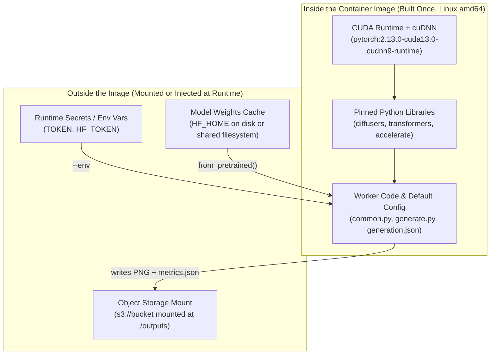

# 1.3 Containers for Generative AI

In this lesson we look at what goes into a container for generative AI and what stays out of it: weights, secrets and outputs. It's a reading lesson with no lab; optimization comes in 3.3. You're done when each problem in `Dockerfile.bad` is matched to its fix in `Dockerfile`.

## Template vs bring-your-own container

In Lesson 1.2 Option A, we deployed Sana from a 1-click template without writing a `Dockerfile`. When is a prebuilt template enough, and when do you build your own container image?

| Question | Use a 1-click Cookbook Template | Bring Your Own Container (BYOC) |
|---|---|---|
| **Entrypoint** | Long-lived HTTP server (`/v1/images/generations`) | Custom batch worker (`generate.py`), custom API, or multi-step pipeline |
| **Model & Revision** | Default model baked into template configuration | Pinned 40-character Hugging Face commit hash (`model_revision`) |
| **Dependencies** | Fixed by template author | Custom libraries, pinned versions, or extra pre/post-processing |
| **Best for** | Quickstarts, standard interactive Endpoints | Reproducible batch Jobs (Lesson 1.4), custom workflows, production pinning |



## CUDA and PyTorch base images

Generative media models rely on compiled CUDA kernels inside PyTorch. Two rules prevent the most common container failures:

1. **Always build for `linux/amd64`:** Cloud GPU nodes (L40S, H100) run on `x86_64` (`linux/amd64`). If you build on an Apple Silicon Mac without `--platform linux/amd64`, Docker produces an `arm64` image that fails to start on the GPU host.
2. **Start from a matched PyTorch + CUDA runtime base image:** Installing `torch` from the default CPU index (`https://download.pytorch.org/whl/cpu`) or an unpinned `python:latest` base gives you a container where `torch.cuda.is_available()` is `False` even when an L40S GPU is attached. Starting from `pytorch/pytorch:2.13.0-cuda13.0-cudnn9-runtime` provides a tested CUDA 13.0 runtime, cuDNN 9, and matching PyTorch build out of the box.

## Weights vs image

Model checkpoints are large: Sana 1.6B is ~9 GB, ACE-Step 1.5 is ~10 GB, and Wan 2.2 video models range from 10 GB to 35 GB.

Why shouldn't you run `snapshot_download(...)` inside `docker build` to bake the weights into the container image?

- **Image pull time dominates cold start:** Every Serverless GPU Job starts on a fresh node and pulls your container image over the network. Even for a runtime image without baked weights, `IMAGE_PULLING` took `127.13–148.06 s` inside a `225.17 s` total startup on `gpu-l40s-a` `[measured: 2026-11-02, gpu-l40s-a, 1gpu-8vcpu-32gb, eu-north1]`. Adding 10–35 GB of model weights to the image bloats every push, pull, and code rebuild.
- **Weight revisions change independently of code:** Keeping weights outside the image lets you pin `"model_revision": "ac0da2ff55fbe434795be0dce883042e4d49e2fc"` in `generation.json` and download them at runtime into `HF_HOME`.

What happens if you attach a persistent cache at `HF_HOME` across Jobs? We measured the exact same Sana 1.6B spec twice on `gpu-l40s-a` — first with a cold cache, then with a warm cache on a shared POSIX compute filesystem `[measured: 2026-11-02, gpu-l40s-a, 1gpu-8vcpu-32gb, eu-north1]`:

| Phase | Cold Cache | Warm Cache | What Changed |
|---|---|---|---|
| **Weight download** | `26.60 s` | `0.24 s` | Saved `26.37 s` (no network fetch from Hugging Face) |
| **Model load to GPU (`load_s`)** | `13.29 s` | `12.85 s` | Flat (`~13 s` in both runs to read weights into VRAM) |
| **Generation (`t_gen`)** | `4.46 s` | `4.37 s` | Flat (`~4.4 s` per `1024x1024` image, byte-identical output) |

This gives us an important mental model for Module 3: **caching weights removes the network download (`26.60 s → 0.24 s`), not the GPU memory load (`~13 s`)**.

> [!IMPORTANT]
> **Keep `HF_HOME` on container disk or a POSIX compute filesystem — never on an S3 Object Storage FUSE mount.** Hugging Face Hub caches rely on relative symlinks (`snapshots/<sha>` → `blobs/<sha>`), `chmod`, and atomic file renames (`os.replace`), which S3 FUSE mounts do not support. Use the mounted S3 bucket (`/outputs`) strictly for reading input records and writing finished outputs.

## Secrets

Never put API keys, Hugging Face tokens, or S3 credentials in a `Dockerfile`:

- Writing `ENV HF_TOKEN=...` bakes the secret into the image config and layer history (`docker inspect` and `docker history` show it in plain text to anyone who pulls the image).
- Running `COPY . /app` without a strict `.dockerignore` sweeps local `.env` files and credentials into the image layer.

Instead:

1. Use an allowlist `.dockerignore` (see [code/.dockerignore](code/.dockerignore)) that ignores `*` and explicitly permits only `common.py`, `generate.py`, and `generation.json`.
2. Pass secrets at runtime via `--env` or platform secret bindings when creating the Endpoint or Job.

## Inputs and outputs

A container filesystem is ephemeral: when a Job reaches `COMPLETED` or `FAILED`, everything written to `/tmp` or local container directories disappears with the container.

- **Inputs (`generation.json`):** Kept small, human-readable, and free of secrets. It defines the model ID, 40-char commit hash, prompt, seed, and resolution.
- **Outputs (`/outputs`):** The worker writes generated PNGs (`asset-000.png`), `metrics.json`, and `trace.jsonl` to `/outputs/...`. When we run the container as a Serverless Job in Lesson 1.4, we mount an Object Storage bucket at `/outputs` (`--volume "s3://${BUCKET}:/outputs:rw"`) so every artifact survives after the container exits.

## Bad Dockerfile vs production Dockerfile

Let's compare [code/Dockerfile.bad](code/Dockerfile.bad) and [code/Dockerfile](code/Dockerfile) line by line.

Here is [code/Dockerfile.bad](code/Dockerfile.bad):

```dockerfile
# DO NOT BUILD: intentionally bad teaching example. All tokens are fictitious.
FROM --platform=linux/arm64 python:latest
RUN pip install torch --index-url https://download.pytorch.org/whl/cpu
RUN pip install diffusers transformers
ENV HF_TOKEN=NOT_A_REAL_TOKEN
COPY . /app
WORKDIR /app
RUN python -c "from huggingface_hub import snapshot_download; snapshot_download('Efficient-Large-Model/Sana_1600M_1024px_diffusers')"
CMD ["python", "generate.py", "--out", "/tmp/results"]
```

And here is the corrected worker in [code/Dockerfile](code/Dockerfile):

```dockerfile
FROM pytorch/pytorch:2.13.0-cuda13.0-cudnn9-runtime
ENV PYTHONUNBUFFERED=1 PIP_NO_CACHE_DIR=1 PIP_BREAK_SYSTEM_PACKAGES=1 HF_HOME=/cache/huggingface
RUN pip install diffusers==0.39.0 transformers==5.13.1 accelerate==1.14.0 sentencepiece==0.2.1 protobuf==6.33.0
WORKDIR /app
COPY common.py generate.py generation.json /app/
RUN mkdir -p /cache /outputs
CMD ["python", "/app/generate.py", "--n", "1", "--out", "/outputs/run"]
```

Every flaw in `Dockerfile.bad` maps directly to its fix in `Dockerfile`:

| Line in `Dockerfile.bad` | Why It Breaks in Production | Fix in `code/Dockerfile` |
|---|---|---|
| `FROM --platform=linux/arm64 python:latest` | Wrong CPU architecture (`arm64` instead of `linux/amd64`), no CUDA runtime, and floating `:latest` tag. | `FROM pytorch/pytorch:2.13.0-cuda13.0-cudnn9-runtime` built with `docker buildx build --platform linux/amd64`. |
| `RUN pip install torch .../whl/cpu` | Installs CPU-only PyTorch; `torch.cuda.is_available()` returns `False` on the GPU node. | Inherit the matched CUDA 13.0 PyTorch pre-installed in the base image. |
| `RUN pip install diffusers transformers` | Unpinned libraries resolve to different versions on future builds and omit `accelerate` / `sentencepiece`. | Pin exact versions: `diffusers==0.39.0 transformers==5.13.1 accelerate==1.14.0 sentencepiece==0.2.1 protobuf==6.33.0`. |
| `ENV HF_TOKEN=NOT_A_REAL_TOKEN` | Bakes a secret into the image metadata and layer history. | Omit secrets from the image; inject `HF_TOKEN` at runtime via `--env` only if pulling gated weights. |
| `COPY . /app` | Copies `.env`, local `runs/`, and git metadata into the image if `.dockerignore` is missing. | `COPY common.py generate.py generation.json /app/` paired with an allowlist `.dockerignore`. |
| `RUN python -c "...snapshot_download(...)"` | Bakes ~9 GB of unpinned weights into the image layer, slowing every image push/pull. | Set `ENV HF_HOME=/cache/huggingface` and download the pinned `model_revision` at runtime. |
| `CMD ["python", "generate.py", "--out", "/tmp/results"]` | Writes outputs to ephemeral `/tmp/results`, which is lost as soon as the Job container exits. | Write to `/outputs/run`, where the Job mounts persistent Object Storage (`s3://${BUCKET}:/outputs:rw`). |

In Module 3 (`3.3 Optimizing Cost`), we will measure container cold-start optimizations in detail. Next, let's run `generate.py` as a batch Job and compare it with our Endpoint in [1.4 Serving vs Batch Inference](04-serving-vs-batch.md).
