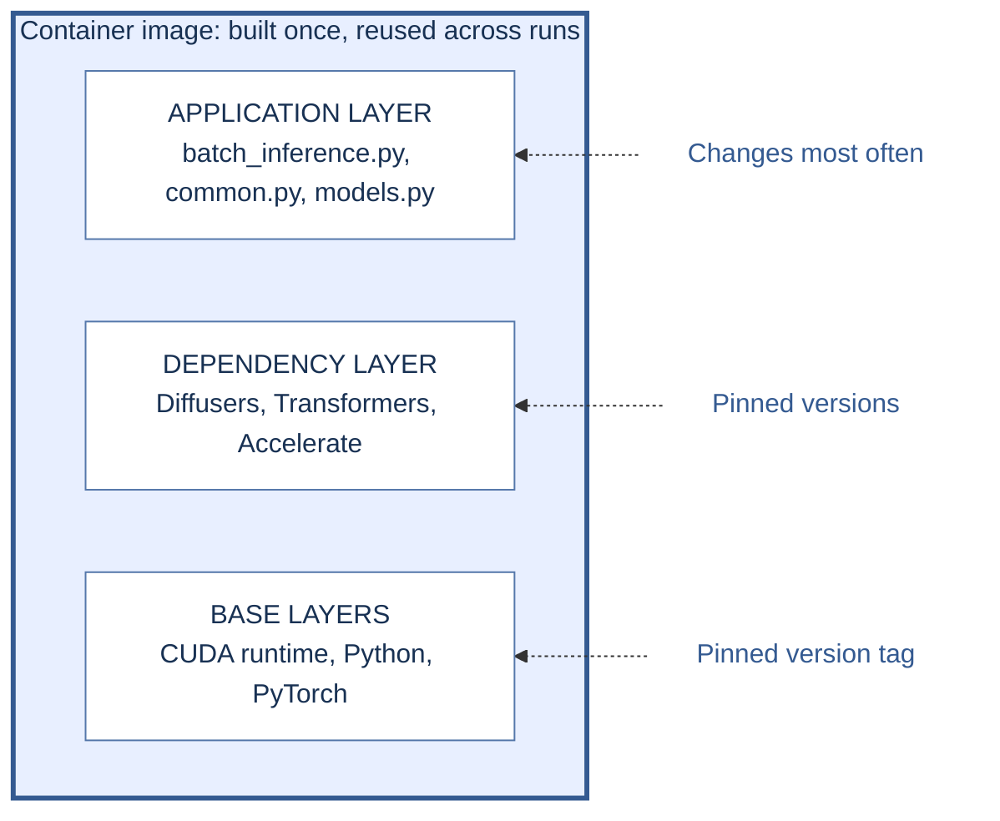
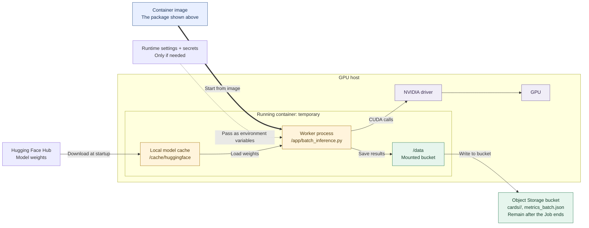

# 03 - Containers for Generative AI

> ⚠️ **Remove running resources to avoid bills.** Stop or delete every Endpoint, Job and DevLab you started, even after a failed run, and delete bucket data you no longer need. An Endpoint or DevLab bills while it runs, even when idle.

Your worker script runs fine on your laptop. On a cloud GPU, the same code can fail right after the image pull, ignore the GPU, or finish and save nothing. Almost every one of these failures traces back to a single line in the Dockerfile.

A GPU host runs only what's inside your container image. It doesn't see your laptop, your virtual environment or the token in your shell. So the image has to carry everything the worker needs, and nothing it shouldn't.

In this lesson we take a broken Dockerfile, match each failure to the line that causes it, and fix it.

- **Goal:** for each line of [code/docker/Dockerfile.bad](code/docker/Dockerfile.bad), you can say what goes wrong on a GPU host and how [code/docker/Dockerfile](code/docker/Dockerfile) fixes it.
- **Time:** about 20 minutes of reading. No GPU and no credits needed.
- **Optional:** build the fixed image yourself with the command in [The fixed Dockerfile](#the-fixed-dockerfile).

## Do you need your own image?

Usually not. To serve a catalog model, a template already has the image, port and GPU filled in.

| You want to | Use |
| --- | --- |
| Serve a catalog model (Sana, Wan, Kokoro and others) behind an HTTP API | A [cookbook template](https://github.com/nebius/serverless-ai-cookbook/tree/main/templates): image, port and GPU are filled in |
| Change the server, add a model the templates don't have, or pin your own libraries | Your own image |
| Run your own script once, then stop | Your own image. Lesson 04 shows the pipeline |

You can also build on top of a template's image: see [Build on a template image](#build-on-a-template-image). This lesson builds the worker from the PyTorch base instead, so you see every line a template hides.

## What's in the image, and what isn't

The image is the package you build once. The container is that package running on a GPU host. Some things belong in the package. Others arrive only when it runs.

**At build time, software is packaged in layers.**



*Read the image from bottom to top: base image, then libraries, then worker code. When only the code changes, Docker reuses the layers below it. These are conceptual groups: the base image itself has many filesystem layers.*

**At run time, the worker gets inputs, uses the host GPU and saves results.**



*The image brings the CUDA runtime. The host brings the NVIDIA driver and the GPU. Amber is temporary: the worker and its cache. Green is persistent: the output path to the bucket.*

Outside the image doesn't mean outside the container. At run time, downloaded weights sit in the container's cache, secrets are in the process environment, and the bucket appears at `/data`. None of them is baked into the image. When the container is removed, the cache is gone and the bucket outputs stay. [5. Outputs](#5-outputs) shows how `/data` becomes persistent.

## What breaks on a GPU host

These are the ways a container that works on your laptop fails on a GPU host. Most come from putting something in the wrong place in the picture above.

| You see | Cause | Fix |
| --- | --- | --- |
| The container fails right after the image pull | Image built for arm64 | [1. Base image and platform](#1-base-image-and-platform) |
| `torch.cuda.is_available()` is `False` on a GPU | CPU-only PyTorch, or no CUDA runtime in the image | [1. Base image and platform](#1-base-image-and-platform) |
| CUDA errors at the first GPU call, while the image looks fine | The image's CUDA is newer than the host driver supports | [1. Base image and platform](#1-base-image-and-platform) |
| It worked before; after a rebuild it breaks or the outputs change | Unpinned libraries | [2. Dependencies](#2-dependencies) |
| Every code edit reinstalls all libraries | Code copied before the install | [2. Dependencies](#2-dependencies) |
| Push and pull take forever; the image is huge | Weights baked into the image | [3. Model weights](#3-model-weights) |
| Every start waits for a download | Weights downloaded at start (a trade-off, not a bug) | [3. Model weights](#3-model-weights) |
| A token shows up in `docker history` | Secret in `ENV` or `ARG` | [4. Secrets and stray files](#4-secrets-and-stray-files) |
| The run finishes but nothing is saved | Outputs written inside the container | [5. Outputs](#5-outputs) |

## Five fixes, line by line

Every bad line below comes from [code/docker/Dockerfile.bad](code/docker/Dockerfile.bad). **Don't build it.**

```dockerfile
FROM --platform=linux/arm64 python:latest
ENV HF_TOKEN=NOT_A_REAL_TOKEN
COPY . /app
WORKDIR /app
RUN pip install torch --index-url https://download.pytorch.org/whl/cpu
RUN pip install diffusers transformers
RUN python -c "from huggingface_hub import snapshot_download; snapshot_download('Efficient-Large-Model/Sana_1600M_1024px_diffusers')"
CMD ["python", "batch_inference.py", "--out", "/tmp/results"]
```

### 1. Base image and platform

```dockerfile
# bad
FROM --platform=linux/arm64 python:latest
RUN pip install torch --index-url https://download.pytorch.org/whl/cpu

# fixed
FROM pytorch/pytorch:2.13.0-cuda13.0-cudnn9-runtime
```

| Bad line | What goes wrong | Fix |
| --- | --- | --- |
| `--platform=linux/arm64` | The GPU host is `linux/amd64`, so an arm64 image doesn't start | Build for `linux/amd64` |
| `python:latest` | `latest` moves, so next month's rebuild can start from a different Python. It's also plain Python, with no CUDA runtime | A CUDA runtime base, pinned to a version tag |
| `torch … /whl/cpu` | CPU-only PyTorch, so the GPU sits unused | Use the PyTorch build in the CUDA base image |

- **Build for `linux/amd64` on a Mac.** On Apple Silicon, Docker builds for arm64 unless you pass `--platform linux/amd64`.
- **Don't pick the newest CUDA.** The image brings the CUDA runtime and the host brings the driver. If the image's CUDA is newer than the driver supports, the container starts but fails at the first GPU call. Take the base image from a cookbook template or from this lesson (`cuda13.0`), and change it only when you know why. [NVIDIA CUDA release notes](https://docs.nvidia.com/cuda/cuda-toolkit-release-notes/index.html)
- **Use `runtime`, not `devel`.** A `-devel` image adds compilers and headers for compiling CUDA code. This course compiles none, so you'd only get a bigger image to pull.
- **Pin a version tag, not `latest`.** `2.13.0-cuda13.0-cudnn9-runtime` fixes the PyTorch, CUDA and cuDNN versions, so a rebuild next month starts from the same stack.

> 💡 **On Nebius Serverless AI:** images must be `linux/amd64`. [Nebius tutorial](https://docs.nebius.com/serverless/quickstart/endpoints), [Endpoints: manage](https://docs.nebius.com/serverless/endpoints/manage)

### 2. Dependencies

```dockerfile
# bad: code first, then unpinned installs
COPY . /app
WORKDIR /app
RUN pip install diffusers transformers

# fixed: pinned installs first, then code
WORKDIR /app
COPY code/docker/requirements.txt /app/requirements.txt
RUN pip install -r /app/requirements.txt
COPY code/common.py code/models.py code/batch_inference.py /app/
```

| Bad line | What goes wrong | Fix |
| --- | --- | --- |
| `pip install diffusers transformers` | Unpinned, so a rebuild can change outputs or break | Pin exact versions in `requirements.txt` |
| `COPY . /app` before `pip install` | Any code edit invalidates every layer after it, so every edit reinstalls every library | Install libraries first, copy code last |

- **Install libraries first, copy code last.** Docker reuses a cached layer until something above it changes. In the bad file the code sits above the installs and the weights download, so one code edit repeats all of them. In the fixed file, the same edit rebuilds only the last layers.
- **Pins cover your direct dependencies only.** [code/docker/requirements.txt](code/docker/requirements.txt) pins the libraries we install. Their own dependencies can still move. For a fully repeatable build, install from a lock file that pins those too, ideally with hashes. [pip: repeatable installs](https://pip.pypa.io/en/stable/topics/repeatable-installs/)

> 💡 **On Nebius Serverless AI:** you can't change an Endpoint's image, command or env vars after you create it. A rebuilt image means a new Endpoint, which is one more reason to pin. [Endpoints: manage](https://docs.nebius.com/serverless/endpoints/manage)

### 3. Model weights

```dockerfile
# bad
RUN python -c "from huggingface_hub import snapshot_download; snapshot_download('Efficient-Large-Model/Sana_1600M_1024px_diffusers')"

# fixed: no download at build; the worker downloads into this cache at start
ENV HF_HOME=/cache/huggingface
RUN mkdir -p /cache
```

| Bad line | What goes wrong | Fix |
| --- | --- | --- |
| `snapshot_download(...)` at build | About 9.7 GB of weights baked into the image: the sum of the fp16 files on the Hub | Download at start into a cache, or mount storage |

Baking weights in isn't a bug: the image runs. You pay in image size, push and pull time, and a rebuild for every model change. Downloading at start moves that cost to startup. Weights can live in three places:

| Option | Good | Watch out |
| --- | --- | --- |
| Baked into the image | One artifact | Huge image, slow push and pull, rebuild for every model change |
| On a bucket or shared filesystem mounted at run time | Download once, reuse across runs | Needs a mount. The Hugging Face cache uses symlinks. On storage without symlink support it copies files instead and shows a warning. [HF cache](https://huggingface.co/docs/huggingface_hub/guides/manage-cache) |
| Downloaded at start into a cache (our worker) | Simplest, small image | Every cold start downloads the weights again |

The cache at `/cache/huggingface` lives inside the container and disappears with it. LoRA files follow the same rules as base weights.

> 💡 **On Nebius Serverless AI:** `--volume` mounts a bucket or a shared filesystem into the container. The bucket mount doesn't fully support symlinks, so put a shared weights cache on a filesystem. 

### 4. Secrets and stray files

```dockerfile
# bad
ENV HF_TOKEN=NOT_A_REAL_TOKEN
COPY . /app

# fixed: no token in the Dockerfile; copy named files only
COPY code/common.py code/models.py code/batch_inference.py /app/
```

| Bad line | What goes wrong | Fix |
| --- | --- | --- |
| `ENV HF_TOKEN=…` | `ENV` and build args stay in the final image. [Docker: build secrets](https://docs.docker.com/build/building/secrets/) | Keep secrets out of the Dockerfile and pass them when the container starts |
| `COPY . /app` | Copies the whole build context. Without a `.dockerignore`, that includes `.env`, local runs and notebooks | Copy only the files the worker needs, and keep an allowlist `.dockerignore` |

**Pass secrets when the container starts.** Keep the token in your shell or a local file. `-e HF_TOKEN` copies its value from your shell into the container, so it never appears in the Dockerfile or the image. Avoid `-e HF_TOKEN=value`: it works, but the token lands in your shell history. [Docker: set environment variables](https://docs.docker.com/reference/cli/docker/container/run/#env)

```bash
export HF_TOKEN=...                                  # in your shell, not in the Dockerfile
docker run --rm -e HF_TOKEN santa-worker:local        # value taken from the shell
docker run --rm --env-file .env santa-worker:local    # or several from a file that stays out of git and out of the build context
```

**If a build step needs a secret, mount it for that step only.** Our worker downloads nothing at build, so it doesn't need one. A secret mount exists only during its `RUN` instruction and isn't stored in any layer. [Docker: build secrets](https://docs.docker.com/build/building/secrets/)

```dockerfile
RUN --mount=type=secret,id=hf_token \
    HF_TOKEN=$(cat /run/secrets/hf_token) python download_private_files.py
```

```bash
docker build --secret id=hf_token,env=HF_TOKEN .
```

**Allowlist the build context.** We build from the module folder because the worker needs files from `code/` and `assets/`. That folder also holds `code/.env` and your local runs. [.dockerignore](.dockerignore) decides what may enter the build: `*` excludes everything, then each `!path` lets one file or folder back in. The last matching line wins. [Docker: build context](https://docs.docker.com/build/concepts/context/)

```text
*
!code/common.py
!code/models.py
!code/batch_inference.py
!code/docker/requirements.txt
!assets/kids.csv
!assets/4_jingle.mp3
!assets/fonts/
```

Without its `!` line, `code/docker/requirements.txt` stays excluded and `COPY` can't read it. This file is also what would make `COPY . /app` safe here. Don't rely on it alone: name the files in the Dockerfile too.

> 💡 **On Nebius Serverless AI:** pass secrets with `--env-secret`. The value is read from SecretStash when the container starts. [Endpoints: manage](https://docs.nebius.com/serverless/endpoints/manage)

### 5. Outputs

```dockerfile
# bad
CMD ["python", "batch_inference.py", "--out", "/tmp/results"]

# fixed
RUN mkdir -p /data
ENTRYPOINT ["python", "/app/batch_inference.py"]
CMD ["--n", "1", "--out", "/data/run"]
```

| Bad line | What goes wrong | Fix |
| --- | --- | --- |
| `--out /tmp/results` | Outputs vanish when the container exits | Write to a bucket mounted at `/data` |

A `/data` directory in the image is just an empty folder. It becomes persistent only when whoever starts the container mounts a bucket there. Then files written to `/data` stay after the container is removed. The mount works both ways: lesson 04 reads the kids' profiles from `/data` and writes the cards back to it.

This matters for a container that runs once and exits. A server that returns its result in the HTTP response doesn't need it.

> 💡 **On Nebius Serverless AI:** mount a bucket or a shared filesystem at `/data` with `--volume`: `--volume <bucket>:/data:rw` for a bucket, `--volume <filesystem-id>:/data:rw` for a shared filesystem. Choose the filesystem if you need symlinks. [`nebius ai endpoint create`](https://docs.nebius.com/cli/reference/ai/endpoint/create)

## The fixed Dockerfile

All five fixes together are in [code/docker/Dockerfile](code/docker/Dockerfile). Build it from the module folder:

```bash
docker buildx build --platform linux/amd64 -f code/docker/Dockerfile -t santa-worker:local .
```

```dockerfile
FROM pytorch/pytorch:2.13.0-cuda13.0-cudnn9-runtime
ENV PYTHONUNBUFFERED=1 PIP_NO_CACHE_DIR=1 PIP_BREAK_SYSTEM_PACKAGES=1 HF_HOME=/cache/huggingface
WORKDIR /app
RUN apt-get update && apt-get install -y --no-install-recommends espeak-ng && rm -rf /var/lib/apt/lists/*
COPY code/docker/requirements.txt /app/requirements.txt
RUN pip install -r /app/requirements.txt
RUN mkdir -p /cache /data
COPY code/common.py code/models.py code/batch_inference.py /app/
COPY assets/kids.csv assets/4_jingle.mp3 /assets/
COPY assets/fonts /assets/fonts
ENTRYPOINT ["python", "/app/batch_inference.py"]
CMD ["--n", "1", "--out", "/data/run"]
```

- **`PYTHONUNBUFFERED=1`** flushes `stdout` and `stderr` immediately, so `nebius ai job logs --follow` shows progress live instead of waiting on a buffer.
- **`PIP_NO_CACHE_DIR=1`** skips saving downloaded `.whl` files under `/root/.cache/pip`, keeping them out of the image layer (saves ~150–180 MB here).
- **`PIP_BREAK_SYSTEM_PACKAGES=1`** lets `pip` install into the base image's system Python, where CUDA PyTorch is already installed. Ubuntu 24.04 blocks system-wide `pip install` by default (PEP 668) to protect OS utilities on a shared machine; in a single-purpose container, installing directly into that Python environment is safe.

We built the course image from this file for `linux/amd64` and published it as `docker.io/mnrozhkov/santa-worker:v0.1.0`. Lesson 04 runs that tag.

If you change the worker, build your own image, push it to a registry the Job can pull from, and put your reference in `WORKER_IMAGE`.

## Going further

Optional. The worker runs without these.

### Build on a template image

Instead of the PyTorch base, you can start from a template's image. The Sana template image already has the CUDA runtime, PyTorch and the pinned Diffusers stack, so your Dockerfile only adds your code. [Sana template Dockerfile](https://github.com/nebius/serverless-ai-cookbook/blob/main/templates/endpoint-sana/Dockerfile)

```dockerfile
FROM cr.eu-north1.nebius.cloud/e00gw2b7v3pxetvpy7/sana-serve:660347b
ENV HF_HOME=/cache/huggingface
COPY worker.py /app/
RUN mkdir -p /cache /data
CMD ["python", "/app/worker.py", "--out", "/data/run"]
```

`worker.py` stands for your own script that uses the Sana stack.

| You inherit | You add or change |
| --- | --- |
| CUDA runtime, PyTorch, pinned `diffusers`, `transformers`, `accelerate` | Your code and config |
| `serve.py`, `fastapi`, `uvicorn`, unused by the worker | `CMD`: without it, the container starts the template's server |
| The template's pins, not yours | The weights cache path and `/data` |

### Run the worker as a non-root user

The PyTorch base image runs as `root`. Our worker holds `HF_TOKEN`, imports third-party packages, loads model weights and writes to `/data`, all as the container user. As `root`, a compromised dependency or model file can change `/app`, system libraries or any other path in the container, not only `/cache` and `/data`.

A dedicated user such as UID `1001` can own `/cache` and `/data` and only read `/app` and `/assets`. That's all the access the worker needs. It doesn't hide `HF_TOKEN` or block writes to `/data`, so you still scope secrets and the bucket. It limits what the process can change everywhere else.

```dockerfile
RUN groupadd --system --gid 1001 app && \
    useradd --system --uid 1001 --gid 1001 --create-home app
RUN mkdir -p /cache /data && chown -R 1001:1001 /cache /data
COPY code/common.py code/models.py code/batch_inference.py /app/
COPY assets/kids.csv assets/4_jingle.mp3 /assets/
COPY assets/fonts /assets/fonts
USER 1001:1001
```

Check your mounts before you add `USER`. On GPU platforms, a bucket or shared filesystem at `/data` and the NVIDIA device nodes can be owned by `root`. If UID `1001` can't write to `/data` or open the GPU, the Job fails at the first write or the first CUDA call. Our worker image stays on `root` unless the mounted storage is writable by that UID.

### Cache `apt` and `pip` outside the image

Our Dockerfile sets `PIP_NO_CACHE_DIR=1` and deletes the apt lists to keep caches out of the image. The cost is rebuild speed: every change to `requirements.txt` downloads every wheel again.

BuildKit cache mounts keep the `apt` and `pip` caches on the build host, outside the image layers. A bind mount reads `requirements.txt` without a separate `COPY` layer. To switch, put `# syntax=docker/dockerfile:1` on the first line, drop `PIP_NO_CACHE_DIR=1`, and replace the install steps with:

```dockerfile
# syntax=docker/dockerfile:1
RUN --mount=type=cache,target=/var/cache/apt,sharing=locked \
    --mount=type=cache,target=/var/lib/apt,sharing=locked \
    apt-get update && apt-get install -y --no-install-recommends espeak-ng
RUN --mount=type=bind,source=code/docker/requirements.txt,target=/tmp/requirements.txt \
    --mount=type=cache,target=/root/.cache/pip \
    pip install -r /tmp/requirements.txt
```

## References

- [Docker: build secrets](https://docs.docker.com/build/building/secrets/), Docker
- [Docker: multi-platform builds](https://docs.docker.com/build/building/multi-platform/), Docker
- [Manage the huggingface_hub cache](https://huggingface.co/docs/huggingface_hub/guides/manage-cache), Hugging Face
- [How to rapidly build multi-architecture images with Buildx](https://www.docker.com/blog/how-to-rapidly-build-multi-architecture-images-with-buildx/), Docker blog (2022)
- [nvidia/container-images/cuda](https://gitlab.com/nvidia/container-images/cuda), NVIDIA
- [Slacker: Fast Distribution with Lazy Docker Containers](https://www.usenix.org/conference/fast16/technical-sessions/presentation/harter), USENIX FAST '16
- [Full Stack Deep Learning 2022, Lecture 5: Deployment](https://fullstackdeeplearning.com/course/2022/lecture-5-deployment/)

<!-- nav:start -->
[← Previous: 02 - First Media Generation in a Few Minutes](02-first-generation.md) · [Next: 04 - Serving vs Batch Inference: the Same Generation for Different Use Cases →](04-serving-vs-batch.md)
<!-- nav:end -->
