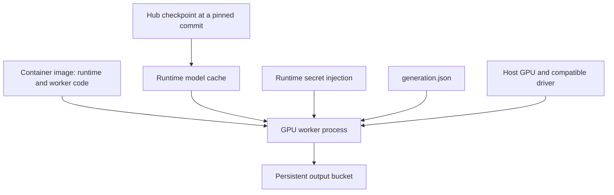

# 1.3 Containers for Generative AI


We read a broken Dockerfile and turn it into a GPU worker container. This is a reading lesson: no image build or paid resource is required. You are done when you can explain each problem in `Dockerfile.bad` and point to its correction or deployment requirement.

## A container packages the runtime

In the previous lesson, Python could call a remote model without local CUDA. The server was running a different environment: CUDA-enabled PyTorch, Diffusers, model weights and our inference code. A container makes the software environment distributable. The host still provides the GPU and its driver.



Three things have different lifecycles: the image can be built once; model weights can be downloaded and cached; outputs belong to individual runs. Keeping these separate lets you change prompts without rebuilding the runtime and retain results after a Job exits.

| Use a template when… | Bring your own container when… |
|---|---|
| Its model and API already meet your needs | You need a custom pipeline or worker entry point |
| You want the shortest path to a first asset | You need control of checkpoint loading and dependencies |
| You accept the template's runtime choices | You can maintain and validate the runtime yourself |

## Read the bad example

Open [Dockerfile.bad](code/Dockerfile.bad). It is deliberately unsafe and should not be built. The fake token is only a teaching placeholder.

```dockerfile
FROM --platform=linux/arm64 python:latest
RUN pip install torch --index-url https://download.pytorch.org/whl/cpu
RUN pip install diffusers transformers
ENV HF_TOKEN=NOT_A_REAL_TOKEN
COPY . /app
```

The first line forces an architecture that does not match our target L40S worker environment, and `latest` can change underneath us. A successful laptop build is not proof that an image will run on the target. Build the real image for `linux/amd64` and record its pushed digest.

The second line installs CPU PyTorch. A GPU attached to the machine cannot turn that package into a CUDA build. The unpinned installation on the third line can resolve differently later. Use a CUDA-enabled base and explicit dependency versions, then test them together.

An `ENV` token becomes image metadata. Deleting it in a later layer does not reliably remove it from history. Supply credentials at runtime through the platform's secret mechanism. `COPY .` can also bring `.env`, credentials and generated artifacts into the image. Our [.dockerignore](code/.dockerignore) allows only the worker files.

The bad file then downloads a floating checkpoint at build time and writes outputs to `/tmp/results`. This couples a large weight payload to the image and loses results when the container is discarded. Baking weights can be a deliberate deployment choice, but it is not our default. Here we pin the Hub revision in configuration and write to a persistent output mount.

## Read the corrected worker

Open [Dockerfile](code/Dockerfile). Its base and library versions follow the inspected cookbook runtime:

```dockerfile
FROM pytorch/pytorch:2.13.0-cuda13.0-cudnn9-runtime
ENV HF_HOME=/cache/huggingface
WORKDIR /app
COPY common.py generate.py generation.json /app/
CMD ["python", "/app/generate.py", "--n", "1", "--out", "/outputs/run"]
```

The full file installs explicit dependency versions and creates cache/output directories. `HF_HOME` chooses the cache location; it does not magically make that cache persistent. Likewise, `/outputs` is just a directory until the deployment mounts storage there. In 1.4, the Job mount supplies that persistence.

The Dockerfile is a course worker, not a claim of complete production hardening. Its base tag still needs a resolved digest in a release record; transitive dependencies and the host driver also affect the environment. The [validation checklist](VALIDATION.md) tracks the GPU build/run evidence still required. Image size, model download time and cold-start latency remain unmeasured.

## Follow the inputs and outputs

`generation.json` is a small, non-secret input. It fixes the prompt, seed and generation settings. `generate.py` reads it, loads the pipeline once, produces PNGs and writes metrics plus trace events. The worker contains no provider-specific GPU provisioning code. The same Python entry point works in a notebook environment or a container with a compatible runtime.

The container exits when Python exits. A Job uses that exit status to report success or failure. An Endpoint instead needs a long-lived HTTP server; putting the Job's one-shot command behind an Endpoint would not create a functioning API.

## Try it: explain the repair

For each bad line, write its failure mode and the corresponding fix. Your answer should include architecture, CUDA support, dependency versions, checkpoint revision, secrets, build context and persistent output. Then answer: “If I set `HF_HOME`, will the next Job automatically reuse the cache?” No: only a deliberately shared persistent cache would do that.

Container optimization and cache experiments come in Module 3. Next, [run the generation as a Job](04-serving-vs-batch.md).
