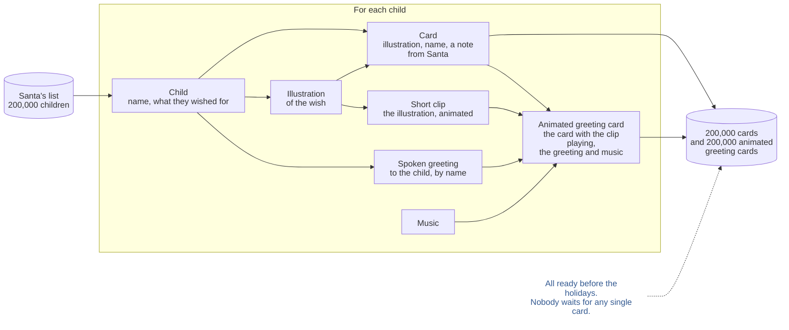
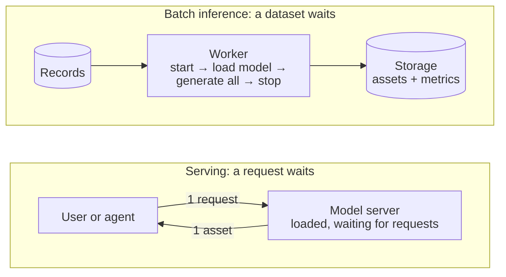
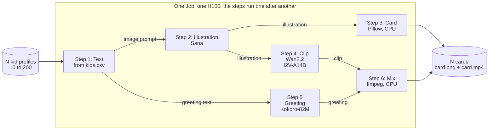
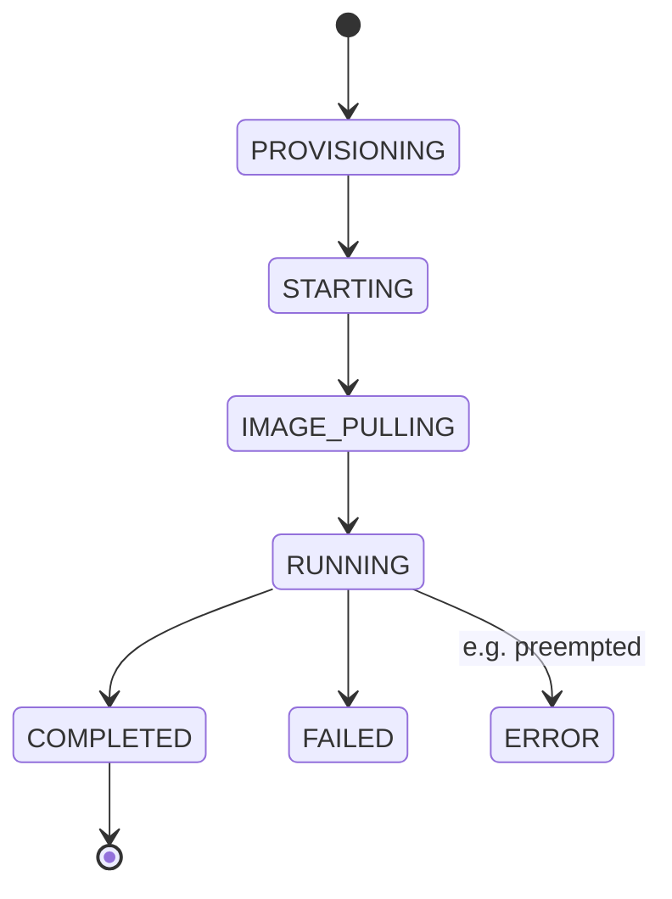

# 04 - Serving vs Batch Inference: the Same Generation for Different Use Cases

> ⚠️ **Read this first**
>
> 💸 **Prices here are examples only.** They come from our runs and price checks on the dates shown, and what you pay can differ: prices change, and spot prices can change every 15 minutes. For real prices, see [Compute pricing](https://docs.nebius.com/compute/resources/pricing) and [spot prices](https://docs.nebius.com/signup-billing/spot-prices).
>
> ⚠️ **Remove all running resources after the lesson to prevent bills.** Stop or delete every Endpoint, Job and DevLab you started, even after a failed run, and delete bucket data you no longer need. An Endpoint or DevLab keeps billing while it runs, even when idle.

Santa wants a personalized greeting card for each of the 200,000 children on his list. Each card shows an illustration of the child's wish, their name and a note from Santa. Then the card comes alive: the illustration animates into a short clip, with a spoken greeting and music. Nobody waits for any single card. All of them have to be ready before the holidays.



*What Santa needs. The box is the work for one child, and it repeats 200,000 times. Each child gets two results: the card and the animated greeting card. The only deadline is on the whole batch.*

A chat agent works the other way: a person waits for one image. Keeping a model loaded to answer requests one by one is **serving**. Running a model over a whole dataset and stopping when it's done is **batch inference**.

In this lesson we compare the two patterns, then build Santa's pipeline as a batch. One Job on one H100 GPU makes the cards for ten kids, step by step, and writes them to a storage bucket.

You're done when:

- you've made Emma's card step by step in the DevLab notebook;
- your Job is `COMPLETED` and stopped by itself;
- every kid in the run has a folder in your bucket with the card (`card.png`) and the animated greeting card (`card.mp4`), and you've watched Emma's;
- nothing you created is still `RUNNING`.

**Time and cost.** This is the most expensive run of the module. The Job runs on an H100 and starts by downloading 127 GB of weights for Sana, Wan2.2 and Kokoro. For ten kids, expect about 35 minutes from **Create** to `COMPLETED`. Projected from our 20-kid run on 2026-11-14 (`gpu-h100-sxm`, `1gpu-16vcpu-200gb`, eu-north1):

- ~158 s of startup;
- ~1,143 s of model loads, mostly that download;
- ~10 × 79 s per card;
- ~$2.60 of compute at the regular price ($4.50 per hour, read 2026-11-15), or ~$1.20 at a spot price snapshot ($2.07 per hour, 2026-11-14 15:05 UTC) `[calc: 2,088 s × the price]`.

Spot prices aren't capped (see [Pick the price](#pick-the-price)), so check [today's spot price](https://docs.nebius.com/signup-billing/spot-prices) and [Compute pricing](https://docs.nebius.com/compute/resources/pricing) before you run. The DevLab in [Step 1](#step-1-build-it-in-a-devlab) bills on top of that, at the regular price, for as long as it runs.

> **About our numbers.** Times and sizes in this lesson come from our own runs on H100 GPUs, 14–16 November 2026. The run files are in [assets/example_runs/](assets/example_runs/). Yours will differ with the GPU, region and model version.

## Serving vs batch inference

The same model can run in two ways. The choice decides who waits, what you tune and what you pay for while nothing happens.



*Conceptual. Top: someone waits for every asset, so the server stays loaded between requests. Bottom: nobody waits, so the worker runs once over all records and stops.*

Here is the image step done both ways: Sana at 512×512, 20 steps, on one H100. The Endpoint is the default template, called one request at a time. The Job is our worker, with the model loaded once.

| Images | Endpoint: one request at a time | Job: model loaded once |
| --- | --- | --- |
| 1 | 1.17 s, network included | 0.78 s, no network |
| 10 | 12 s | 7.8 s |
| 200 | 3.9 min | 2.6 min |
| 200,000 | 65 h | 44 h |

In this setup the Endpoint pays about 0.4 s more per image. That time goes to the network round trip, packing the image into the response, and the template's server. It's a property of the default settings with one request at a time, not of serving. An Endpoint that groups requests on the GPU, or takes requests from several clients at once, can close the gap. 

|                      | Serving                                  | Batch inference                              |
| -------------------- | ---------------------------------------- | -------------------------------------------- |
| **Also called**          | Online or real-time inference            | Offline inference, batch prediction          |
| **What starts the work** | A request arrives                        | A dataset is ready                           |
| **Who waits**            | A person or an agent, for every result   | Nobody, for any single result                |
| **What you tune**        | Time per request                         | Assets per hour and cost per asset           |
| **The model is loaded**  | All the time, waiting between requests   | For the run only                             |
| **Where results go**     | Back in the response                     | To storage                                   |
| **How it scales**        | More copies of the server behind one URL | The dataset split across more workers        |
| **Typical use**          | Chat agent, editor, live preview         | Campaign, catalogue, dataset, evaluation run |


## The task: Santa's animated greeting cards

The task comes from the [Santa Scale Challenge](https://github.com/mnrozhkov/santa-scale-challenge), a reference project for making personalized greeting cards at scale. In the animated greeting card, the camera drifts slowly over the illustration, snow falls and lights twinkle, while music plays under the greeting.

A record is one child. The wish, the greeting and the illustration prompt are already in the row. So this lesson writes no text and calls no language model.

Emma's row, one field per line:

```text
id:       k01
name:     Emma
age:      7
wishlist: a telescope
wish:     Dear Emma, at 7 you are full of wonder. I heard you wished for a telescope,
          and my elves are already busy. Merry Christmas!
greeting: Merry Christmas, Emma! Santa heard you wished for a telescope.
prompt:   A magical Christmas storybook illustration … The hero object: a telescope …
          No people, no faces, no text …
```

The list is [assets/kids.csv](assets/kids.csv): 200 kids, Emma first.

We build it as a deterministic pipeline: every kid goes through the same steps in the same order. Nothing decides, judges or retries along the way. That's what an agent adds, in Module 2. [code/batch_inference.py](code/batch_inference.py) has one function per step:

| Step | Reads | Makes for Emma | Runs on |
| --- | --- | --- | --- |
| 1. Text | The row | `card.json`: the wish, the greeting, the illustration prompt | No model: it copies the row |
| 2. Illustration | The prompt from the row | `illustration.png`, 512×512: the gift on snow under a starry sky. No people and no text: it gets animated later | GPU: Sana |
| 3. Card | The illustration, the name, the wish | `card.png`, 1024×1224: the illustration scaled and cropped to 944×544 (the clip's shape) on top, the name and the wish below | CPU: Pillow |
| 4. Clip | The illustration, cropped to 832×480 as the first frame | `clip.mp4`, 832×480, 81 frames at 16 fps (about 5 s), silent: slow camera drift, falling snow, twinkling lights | GPU: Wan2.2-I2V-A14B, image-to-video |
| 5. Greeting | The greeting text | `greeting.wav`, mono, 24 kHz: "Merry Christmas, Emma! Santa heard you wished for a telescope." | GPU: Kokoro-82M |
| 6. Mix | The card, the clip, the greeting, a music track | `card.mp4`, 1024×1224: the card with the clip playing where the illustration is, the greeting and quiet music; as long as the clip, or the greeting plus half a second if that's longer | CPU: ffmpeg |

|                                                                                                                                                                                                                                    |                                                                                                                                                                  |
| ---------------------------------------------------------------------------------------------------------------------------------------------------------------------------------------------------------------------------------- | ---------------------------------------------------------------------------------------------------------------------------------------------------------------- |
|  |  |
| **2. Illustration.** Sana, 512×512, 20 steps, seed 7. `0.78 s` per illustration                                                                                                                                                    | **4. Clip.** Wan2.2-I2V-A14B, 832×480, 81 frames at 16 fps, about 5 s, silent: the mix step adds the greeting and the music. `76.7 s` per clip. MP4              |
|                                                                                                                                                                                                                                    |                                                                                                                                                                  |

*Emma's illustration and clip from our run for 20 kids. Times are the median per kid across the run.*

<!-- v1.1: embed Emma's card.png and card.mp4 from a santa-worker:v0.1.0 run (the 2026-11-14 run used the older 1024x1400 card layout). -->

## Pick the tool: Endpoint or Job?

On Nebius Serverless AI each pattern has its own tool. An **Endpoint** is a long-running container that serves HTTP requests at a URL: serving. A **Job** starts, runs a script to completion, writes the results to storage and stops billing: batch inference.

|                       | Endpoint                                                         | Job                                               |
| --------------------- | ---------------------------------------------------------------- | ------------------------------------------------- |
| What starts the work  | An HTTP request                                                  | Creating the Job                                  |
| Where outputs go      | The HTTP response                                                | A mounted bucket                                  |
| When it stops billing | When you stop it: it bills while `RUNNING`, idle or not          | By itself, at the end of the run                  |
| Scaling               | None: one VM, no scale-up under load, no scale-to-zero when idle | One run per Job; more work = more Jobs (Module 3) |
| Best for              | Someone waiting for the answer                                   | A batch nobody waits for                          |

[Serverless AI overview](https://docs.nebius.com/serverless/overview)

The pattern doesn't force the tool. You can run a batch through an Endpoint: a client loops over the list and sends one request per image. The two tools differ in how they behave over a long run:

- **Endpoint:** for 200,000 images the client sends 200,000 requests, receives 200,000 responses and stays online for the whole run. That's about 65 hours at 1.17 s per request `[calc: 200,000 × 1.17 s]`. If the client stops, the run stops. The Endpoint bills until you stop it, whether requests are arriving or not.
- **Job:** no client. The worker generates the images, writes them to the bucket, and the Job ends by itself.

So we run Santa's pipeline as a Job.

## How the pipeline works

[code/batch_inference.py](code/batch_inference.py) is what runs inside the Job. `run()` takes the first `--n` kids through the six steps from the task and writes everything under `--out`. `--help` lists the options: `--n`, `--out` and `--step`.

The point of a batch is to load each model **once**. Each step loads its model, makes its file for every kid, frees the GPU and moves on. Ten separate Jobs for ten kids would pay startup and every model load ten times.



*Conceptual. Each step makes its file for all N kids before the next step starts. Every model runs on the same H100.*

Steps hand over only through the bucket. Each step saves its file to the kid's folder, and the next step reads its inputs from there. So you can rerun a step, or move it to another machine, without touching the others. [How the results are stored](#how-the-results-are-stored) shows the layout, and why the worker needs no upload code.

Two more things to know before you run it:

- **The clip step decides the GPU.** Wan2.2 image-to-video is the largest model in the pipeline: it needs an H100. In this worker it doesn't fit an L40S's 48 GB. The three models together are 127 GB, downloaded when the run starts.
- **The text step copies the row.** The wish, the greeting and the illustration prompt come from [assets/kids.csv](assets/kids.csv). Nothing calls a language model. The music is one track from the module's shared media, [assets/4_jingle.mp3](assets/4_jingle.mp3). Add `<mood>.mp3` files next to it to get a track per mood.

The worker image, `mnrozhkov/santa-worker:v0.1.0`, is built from [code/docker/Dockerfile](code/docker/Dockerfile), the one lesson 03 walks through. The build context is this module's folder: the scripts come from `code/`, the kids list, the fonts and the music from `assets/`. Weights, secrets and outputs stay out; the module's [.dockerignore](.dockerignore) lets nothing else in.

**What this setup wastes.** All six steps run inside one Job, on one GPU, one after another. It's the simplest setup that works, and it wastes time in ways we can name:

- the GPU waits during the card and mix steps, which need no GPU;
- steps that don't depend on each other can't run at the same time;
- the GPU has to fit the largest model, so the small models run on an H100 too.

Fixing these is optimization and scaling: Module 3. [What this lesson leaves out](#what-this-lesson-leaves-out) lists the rest.

## Build, then run

You run the pipeline in two steps:

1. **Build it in a DevLab.** JupyterLab on a GPU, the same setup as lesson 02. You run each step yourself, see and hear what it makes, and fix what breaks. Use it for development and debugging.
2. **Run the batch as a Job.** One CLI command runs the same script on a GPU, and the GPU stops billing when the run ends. This is the recommended way, and the one you'd automate for production runs.

## Step 1: Build it in a DevLab

A DevLab is JupyterLab on a GPU VM, the same setup as in lesson 02. It's the easiest way to see the pipeline work, and the place to develop and debug the worker before it goes into a Job. Nothing is submitted here. You call the pipeline's functions yourself in your DevLab's Python environment, look at each result, and only then run the script. You need only the web console: no CLI, no bucket, no access key.

A DevLab can't be preemptible. It bills at the regular price while it runs, including while you read and type, and a stopped DevLab still bills its disk until you delete it. Plan the session.

**Where Step 1 writes.** Everything stays on the DevLab's own disk. The JupyterLab template mounts that disk at `/home`, and the repository you clone sits on it, at `/home/jovyan/production-ai-agents-for-media-generation`. Files there survive a stop and a restart. Deleting the DevLab deletes the disk, and the files with it.

| What | Where, in the module folder of the cloned repository |
| --- | --- |
| The notebook's one-kid card | `code/runs/santa-dev/cards/<kid id>/` |
| The notebook's three-kid batch | `code/runs/santa-dev-batch/` |
| The script in step 4 | `runs/batch_inference/devlab-001/` |

1. Create a DevLab from the **JupyterLab** template in the web console: [DevLabs quickstart](https://docs.nebius.com/serverless/quickstart/devlabs#web-console).
   - **Platform:** an H100, with a preset of one GPU, 16 vCPU and 200 GB of memory.
   - **Container disk size:** **500 GB**. The models are 127 GB, and a larger disk writes faster, so the download finishes sooner than on the default disk. [Disk performance](https://docs.nebius.com/compute/storage/types)
   - **Jupyter token:** copy and keep it. That's what you type to open Jupyter.
   - **Bearer token authentication:** leave it off. It sits in front of Jupyter. With it on, the browser shows `Unauthorized` and the Jupyter token never gets a chance to sign you in.
2. Open the DevLab's HTTPS URL, sign in with your Jupyter token, and open a **Terminal**. Run this once. The first commands are the same as in lesson 02: they install `uv`, clone the course repository, and create the GPU kernel. The last command adds the packages for the clip, greeting and mix steps. [Install uv](https://docs.astral.sh/uv/getting-started/installation/)
   ```bash
    curl -LsSf https://astral.sh/uv/install.sh | sh
    source "$HOME/.local/bin/env"

    git clone https://github.com/DataTalksClub/production-ai-agents-for-media-generation.git
    cd production-ai-agents-for-media-generation

    uv sync --extra gpu --extra notebooks
    uv run python -m ipykernel install --user --name course-gpu --display-name "course (GPU)"

    # lesson 04 only: the same versions as the worker image
    uv pip install kokoro==0.9.4 ftfy==6.3.1 imageio==2.38.1 imageio-ffmpeg==0.8.1 \
      https://github.com/explosion/spacy-models/releases/download/en_core_web_sm-3.8.0/en_core_web_sm-3.8.0-py3-none-any.whl
   ```

    The last line pins the versions [the worker image](https://hub.docker.com/r/mnrozhkov/santa-worker) uses, so the notebook and the Job run the same libraries. Kokoro's English voice needs the spaCy model `en_core_web_sm`; installing it here means nothing downloads it at run time. Unknown words fall back to `espeakng-loader`, which comes with Kokoro. The DevLab account cannot install system packages.
3. Open [code/nb-santa-cards.ipynb](code/nb-santa-cards.ipynb), choose the **course (GPU)** kernel and run it top to bottom. It makes Emma's card one step at a time and shows the text, the illustration, the card, the clip, the greeting and the final video. Its last cell runs the batch for three kids. Both write to the DevLab's disk (see the table above). The first cell prints that there's no writable bucket at `/data`: that's expected, since Step 1 doesn't use one.
4. Run the script, the same file the Job runs. One kid is enough to check it. The ten-kid run is the Job in Step 2, which can use a preemptible GPU and stops billing by itself.
   <!-- release QA: run this exact command once in a fresh DevLab -->
   ```bash
    cd 01-consistent-media-generation-on-serverless-gpus
    uv run --no-sync python code/batch_inference.py --n 1 \
      --out runs/batch_inference/devlab-001
   ```

    It reads the kids' list from `assets/kids.csv` in the repository. It prints a line per asset and the path of the `cards` folder at the end.
5. Download anything you want to keep from the file browser, then delete the DevLab. Its files go with it.

## Step 2: Run the batch as a Job

One command creates the Job. Nebius starts a GPU VM, runs the worker's container on it, and deletes the VM when the Job ends, so the GPU stops billing then. The script reads the kids and writes the cards through your bucket, mounted at `/data`.

This is the recommended way to run the batch: one command, no notebook, and nothing to remember to stop. It's what you'd automate for production runs.

<a id="path-b-a-job-from-your-laptop"></a>

### Set up the CLI and the bucket

You need the Nebius CLI, an Object Storage bucket and, for the `aws s3` commands, an access key. Set them up once. Run every command in this lesson from the module folder, `01-consistent-media-generation-on-serverless-gpus/`.

1. Install and log in to the [Nebius CLI](https://docs.nebius.com/cli/install).
2. Create a bucket: `nebius storage bucket create --name <your-bucket>`. [How to create buckets](https://docs.nebius.com/object-storage/buckets/manage#how-to-create-buckets)
3. Create an access key for a service account and configure the AWS CLI with it, following the [Object Storage quickstart](https://docs.nebius.com/object-storage/quickstart). The endpoint is `https://storage.<region>.nebius.cloud`, for example `https://storage.eu-north1.nebius.cloud`. This step is optional: the key lets you put the kids' list in the bucket and look at the results from your laptop. The web console does all of that too ([Use the web console instead](#use-the-web-console-instead-of-the-aws-cli)).
4. Set three variables in your shell:

```bash
# the course's prebuilt worker, pinned to a release tag
export WORKER_IMAGE=docker.io/mnrozhkov/santa-worker:v0.1.0
export BUCKET=<your-bucket>
export RUN_ID=job-001
```

The image is public on [Docker Hub](https://hub.docker.com/r/mnrozhkov/santa-worker), built for `linux/amd64`. You don't need Docker to use it.

5. Upload the kids' list to the bucket. The Job reads it from there, so you can change the list without rebuilding the image:

```bash
aws s3 cp assets/kids.csv s3://$BUCKET/inputs/kids.csv \
  --endpoint-url https://storage.eu-north1.nebius.cloud
```

### Pick the price

The pipeline needs an H100 for the clip step.

**By default, follow the spot price.** Our command uses `--preemptible --follows-spot-price`. A preemptible VM costs less, but Compute can stop it at any time. `--follows-spot-price` accepts the current spot price with no maximum, so it [can rise above the regular price](https://docs.nebius.com/compute/resources/pricing), during the run too. Check [today's spot price](https://docs.nebius.com/signup-billing/spot-prices) before you submit.

**If there's no preemptible H100, use on-demand.** The Job then stays in `PROVISIONING` and ends in `ERROR` with `NotEnoughResources`. Create it again with `--on-demand` in place of `--preemptible --follows-spot-price`. That runs on a regular VM, at the fixed regular price, and Compute doesn't take it back.

The three flags don't mix: `--preemptible` needs `--follows-spot-price` or `--spot-pricing-policy-id`, and `--on-demand` can't be combined with any of them. For a reference, see [Jobs: manage](https://docs.nebius.com/serverless/jobs/manage).

### Create the Job

Check the request first: `--dry-run` validates it without creating anything.

```bash
nebius ai job create --dry-run --name "$RUN_ID" --image "$WORKER_IMAGE" \
  --platform gpu-h100-sxm --preset 1gpu-16vcpu-200gb \
  --disk-size 500Gi \
  --preemptible --follows-spot-price \
  --timeout 2h --restart-policy never \
  --volume "$BUCKET:/data:rw" \
  --container-command bash --args "-c 'python /app/batch_inference.py --kids /data/inputs/kids.csv --n 10 --out /data/runs/batch_inference/$RUN_ID --region eu-north1 --platform gpu-h100-sxm --preset 1gpu-16vcpu-200gb --billing preemptible'"
```

- **`--platform` and `--preset` always**, so you know which GPU you pay for.
- **`--disk-size 500Gi`** is the container disk. The weights are 127 GB, and a larger disk writes faster, so 500 GB finishes that download sooner than the 250 GiB default. [Disk performance](https://docs.nebius.com/compute/storage/types)
- **`--preemptible --follows-spot-price`**: a preemptible GPU at the current spot price, the default from [Pick the price](#pick-the-price). If Compute stops the VM, the Job ends in `ERROR` and isn't retried: run it again. [Jobs: manage](https://docs.nebius.com/serverless/jobs/manage), [auto-restarts](https://docs.nebius.com/serverless/jobs/auto-restarts)
- **`--timeout 2h`** is the hard stop if anything hangs. The shortest allowed is `1h`. Ten kids (`--n 10`) take about 35 minutes, so `2h` leaves room. 
- **`--restart-policy never`**: a failed run fails once, it doesn't loop.
- **`--volume "$BUCKET:/data:rw"`** mounts your bucket into the container at `/data`, for reading and writing. The script reads the kids from `/data/inputs/kids.csv`, the file you uploaded. Whatever it saves under `/data` is in S3.

Then run the same command without `--dry-run`. It prints the Job's ID.

The CSV has more rows if you want to experiment on your own; this lesson does not ask you to raise `--n`.

### Watch it

Follow the run with the ID the create command printed:

```bash
nebius ai job get <job_ID>
nebius ai job logs <job_ID> --follow
```



*Conceptual; state names from the [lifecycle docs](https://docs.nebius.com/serverless/lifecycle). Your run should end in `COMPLETED`.*

The logs show where the script is: one line when a model has loaded, one for every finished asset. Here is an excerpt with the load and per-kid times from our 20-kid H100 run. Clock times are left out; yours will differ.

```text
10 kids from /data/inputs/kids.csv, steps: text, illustration, card, clip, greeting, mix, out: /data/runs/batch_inference/job-001/cards
text 1/10 k01 0.0 s
...
illustration model loaded in 89.9 s
illustration 1/10 k01 6.0 s
illustration 2/10 k02 0.8 s
...
clip model loaded in 1046.0 s
clip 1/10 k01 77.7 s
...
mix 10/10 k10 0.6 s
finished: /data/runs/batch_inference/job-001/cards (metrics: /data/runs/batch_inference/job-001/metrics_batch.json)
```

The first illustration is slower than the rest: the model warms up on its first call. The clip model's load includes downloading its weights.

### How the results are stored

The worker never uploads anything. It writes ordinary files to a folder that happens to be your bucket:

1. The Job command mounts the bucket: `--volume "$BUCKET:/data:rw"`.
2. The worker runs with `--kids /data/inputs/kids.csv`: it reads the list you uploaded, as an ordinary file.
3. It runs with `--out /data/runs/batch_inference/$RUN_ID`: `run()` creates `cards/<kid id>/` under that path, and each step saves its file there with ordinary Python and ffmpeg writes.

What's in the bucket after one run, `RUN_ID=job-001`:

```text
inputs/
└── kids.csv                   you upload it once; every run reads it
runs/batch_inference/job-001/
├── metrics_batch.json         model load times and per-kid latencies for every step
└── cards/
    ├── k01/
    │   ├── card.json          1. text: the kid's profile, gifts, wish, mood, greeting, image prompt
    │   ├── illustration.png   2. Sana
    │   ├── card.png           3. the card image (final)
    │   ├── clip.mp4           4. Wan2.2, silent
    │   ├── greeting.wav       5. Kokoro
    │   └── card.mp4           6. card + clip + greeting + music (final)
    ├── k02/
    └── ...
```

- **Two finals per kid:** `card.png` and `card.mp4`. The other four files are intermediates. They're kept so the next step can read its inputs and so you can inspect each step.
- **Each step reads the previous step's file.** The illustration step reads the image prompt from `card.json`, the clip step reads `illustration.png`, and so on.
- **Each file is written once and never edited.** That's what makes a bucket mount work as the output folder. PNG and JSON files are written to it directly. MP4 and WAV writers jump back inside a file to finish its header, which a bucket mount doesn't support. So the worker writes `clip.mp4`, `greeting.wav` and `card.mp4` to local disk first and copies each finished file over (`staged()` in [code/batch_inference.py](code/batch_inference.py)).
- **`metrics_batch.json` records the run's times:** `started_at`, `finished_at`, `runtime_s`, and each step's `load_s` and per-kid `latency_s`. It also records `region`, `platform` (the GPU type), `preset` and `billing` (`regular` or `preemptible`) from the flags in the Job command. 
- **Each card keeps its input.** `card.json` holds the kid's full row from `kids.csv`, so you can tell which profile made each card even after you change the list.

### See the results in the bucket

The files stay in the bucket after the Job's VM is deleted. List the run from your terminal:

```bash
aws s3 ls --recursive s3://$BUCKET/runs/batch_inference/$RUN_ID/ \
  --endpoint-url https://storage.eu-north1.nebius.cloud
```

Get Emma's animated greeting card and play it:

```bash
aws s3 cp s3://$BUCKET/runs/batch_inference/$RUN_ID/cards/k01/card.mp4 emma.mp4 \
  --endpoint-url https://storage.eu-north1.nebius.cloud
```

<!-- v1.1: embed Emma's card.mp4 from a santa-worker:v0.1.0 run. -->

You should also see `metrics_batch.json` next to the six files for every kid from the tree above. It records how long the Job spent on each step: the clip step, for example, adds about 77 s for each kid. We'll explore these metrics in the next lesson.

#### Use the web console instead of the AWS CLI

Everything in this lesson that touches the bucket also works in the web console, under **Storage** → **Object Storage**.

- **Create the bucket:** **Create resource** → **Bucket**. [How to create buckets](https://docs.nebius.com/object-storage/buckets/manage#how-to-create-buckets)
- **Upload the kids' list:** open the bucket, click **Add** → **Folder** and create `inputs`. Then open the folder and click **Add** → **Object** to upload `kids.csv`. [Uploading objects](https://docs.nebius.com/object-storage/objects/upload-download#how-to-upload)
- **See and download the results:** open your bucket and click through the folders to `runs/batch_inference/<RUN_ID>/`. To download a file, open the menu in its row and choose **Download**. [Managing objects](https://docs.nebius.com/object-storage/objects/manage), [Uploading and downloading objects](https://docs.nebius.com/object-storage/objects/upload-download)


## Clean up

A Job stops by itself. A DevLab doesn't: delete the one from Step 1 if it's still running.

The bucket bills for what it stores, so delete the Job's run once you have what you need:

```bash
aws s3 rm --recursive s3://$BUCKET/runs/batch_inference/$RUN_ID \
  --endpoint-url https://storage.eu-north1.nebius.cloud
```

Check that nothing is still `RUNNING`:

```bash
nebius ai job list
nebius ai endpoint list
nebius ai devlab list
```

## What breaks and how to fix it

**At create**

- **`QuotaExceeded`**: default quotas are small on new accounts. Use one GPU; [check your quotas](https://docs.nebius.com/serverless/pricing-quotas).
- **`--timeout` rejected**: below the 1h minimum. Use `1h` or more.

**Before it runs**

- **Stuck in `PROVISIONING`, then `ERROR` with `NotEnoughResources`**: no capacity; Serverless keeps trying for up to 30 minutes. Use `--on-demand`, another region, or try later.
- **Doesn't start with `--spot-pricing-policy-id`**: the policy's max price is below the current spot price, so the policy is blocked. Raise the max price, wait for spot to drop, or use `--on-demand`.
- **`FAILED` right after `IMAGE_PULLING`**: wrong architecture or a private image. Build for `linux/amd64`; use a public image or your project's registry.

**Fails at once (input problems)**

- **`Invalid value for '--kids'` in the logs**: `kids.csv` isn't at that path in the bucket. Upload it to `inputs/kids.csv` ([Set up the CLI and the bucket](#set-up-the-cli-and-the-bucket), step 5) and check the `--kids` path.
- **Validation error**: a row in your `kids.csv` is missing a column or has an age outside 1–18. Fix the row; the error names it.

**While running**

- **`ERROR` after running a while**: preempted, or, with a pricing policy, the spot price went above your max price. Run the Job again.
- **`CUDA out of memory` in the clip step**: the video model on a GPU smaller than an H100. Use an H100.
- **The Job ends before the cards are done**: the weights download and the clips took longer than `--timeout`. Raise `--timeout`.

**After it finishes**

- **`COMPLETED` but the bucket is empty**: output was written outside `/data`. Check `--out` and the `--volume` mount.

**In the DevLab**

- **The notebook's cards are gone after you delete the DevLab**: Step 1 writes to the DevLab's own disk, and deleting the DevLab deletes that disk. Download what you want to keep from the file browser first.

## What bills

| Resource           | Billed while                                                |
| ------------------ | ----------------------------------------------------------- |
| Job                | Running; the VM is deleted at the end                       |
| DevLab             | Running, at the regular price; its disk until you delete it |
| Endpoint           | `RUNNING`, idle or not; nothing while stopped               |
| Bucket             | Stored data, all the time; egress to the internet           |
| Container Registry | Free                                                        |

Rates: [Nebius pricing](https://docs.nebius.com/compute/resources/pricing), [Object Storage pricing](https://docs.nebius.com/object-storage/resources/pricing).

## What this lesson leaves out

One Job on one GPU is the simplest batch that works. Santa's list has 200,000 kids, and that needs more:

| Left out here                   | Why it matters at 200,000                                                                                                                                   | Where we deal with it                                              |
| ------------------------------- | ----------------------------------------------------------------------------------------------------------------------------------------------------------- | ------------------------------------------------------------------ |
| Parallel workers                | One GPU makes one card after another: about 4,400 GPU-hours, half a year, for 200,000 cards `[calc: 200,000 × 79 s per card]` | Module 3                                                           |
| Hardware per step               | The CPU steps hold a GPU, and the GPU is sized for the largest model                                                                                        | Module 3                                                           |
| Weights downloaded on every run | Each Job starts by downloading 127 GB for Sana, Wan2.2 and Kokoro before it makes anything, and pays GPU time for the wait | Module 3 (keeping weights close to the GPU)                        |
| Surviving an interruption       | A preempted Job starts again from the first kid                                                                                                             | Module 3                                                           |
| Cost and limits                 | You want the price before the run, and a stop when it goes over                                                                                             | Module 3                                                           |
| Checking the cards              | The pipeline never looks at what it made, and nobody can look at 200,000 cards                                                                              | Module 2 (a judge that retries), Module 4 (evaluation and tracing) |

> ⚠️ **Remove all running resources after the lesson to prevent bills.** Stop or delete every Endpoint, Job and DevLab you started, even after a failed run, and delete bucket data you no longer need. An Endpoint or DevLab keeps billing while it runs, even when idle.

## References

- [Serverless AI: jobs](https://docs.nebius.com/serverless/jobs/manage), Nebius
- [Serverless AI: lifecycle](https://docs.nebius.com/serverless/lifecycle), Nebius
- [Inference options in Amazon SageMaker AI](https://docs.aws.amazon.com/sagemaker/latest/dg/deploy-model-options.html), AWS
- [Real-time machine learning: challenges and solutions](https://huyenchip.com/2022/01/02/real-time-machine-learning-challenges-and-solutions.html), Chip Huyen (2022)
- [Full Stack Deep Learning 2022, Lecture 5: Deployment](https://fullstackdeeplearning.com/course/2022/lecture-5-deployment/)
- [Santa Scale Challenge](https://github.com/mnrozhkov/santa-scale-challenge): the pipeline this lesson adapts
- [Kokoro-82M](https://huggingface.co/hexgrad/Kokoro-82M) and [Wan2.2-I2V-A14B](https://huggingface.co/Wan-AI/Wan2.2-I2V-A14B-Diffusers), model cards

<!-- nav:start -->
[← Previous: 03 - Containers for Generative AI](03-containers.md) · [Next: 05 - Measuring Startup, Load and Generation Costs →](05-measuring-costs.md)
<!-- nav:end -->
