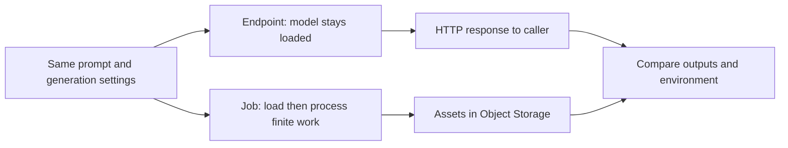
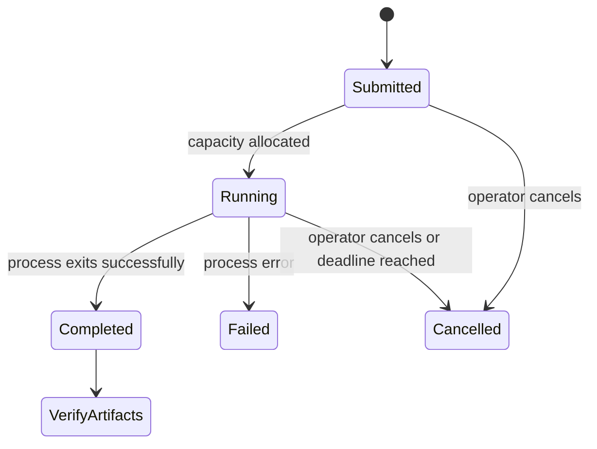

# 1.4 Serving vs Batch Inference: the Same Generation for Different Use Cases


We run the fox illustration as a finite Job and save its output in Object Storage. Then we compare it with the Endpoint result from 1.2. You are done when the Job has reached a successful terminal state, its PNGs and metrics exist in your bucket, and you can explain which execution mode fits your application.

## Same generation, different lifecycle

An Endpoint keeps a server available for requests. A Job starts a program, lets it perform finite work, and terminates. Both can run GPU inference. “Serverless” means you do not manage a cluster; it does not remove startup time or ongoing resource charges.



| Question | Endpoint | Job |
|---|---|---|
| What starts work? | A request to an already deployed server | Submission of a program |
| Where does the result go? | Response, then the client saves it | Persistent storage written by the worker |
| What ends compute use? | Explicit stop/delete | Program finishes, fails, or is cancelled |
| What use case fits? | Interactive generation and repeated calls | Offline processing with a known amount of work |

Our first Job generates three images sequentially, loading the model only once. Three separate Jobs would repeat startup and model load. Parallelism, retries and spot recovery come in Module 3.

## Get a worker image

Use the [code guide](code/README.md#worker-image) to build and publish the provided worker, or use an instructor-provided digest that has passed [live validation](VALIDATION.md). No public course worker digest has been published with this draft. The commands are supplied so you can prepare your own; the module does not pretend that a placeholder registry already contains the image.

The entry point is the same as in the GPU notebook:

```bash
python /app/generate.py --config /app/generation.json --n 3 --out /outputs/runs/01-consistent-media-generation-on-serverless-gpus/my-run
```

An existing run directory causes an error rather than silently overwriting earlier evidence. Use a new run ID for every attempt.

## Give the Job durable storage

Create a bucket in your project using the [Object Storage quickstart](https://docs.nebius.com/object-storage/quickstart). Configure a scoped access key in your local AWS-compatible `default` profile using the [AWS CLI setup guide](https://docs.nebius.com/object-storage/interfaces/aws-cli). The Nebius CLI's S3 volume option uses that profile; a Nebius login alone is not an S3 credential.

Keep the bucket private. Configure the region's S3 endpoint as described in the storage guide. In the Job request, mount the bucket read/write at `/outputs`:

```bash
--volume "s3://${BUCKET}:/outputs:rw"
```

The [CLI reference](https://docs.nebius.com/cli/reference/ai/job/create) also supports explicit profiles and secret selectors. The worker itself writes ordinary files and does not need embedded access keys. Keep the model cache on the container disk; a mounted bucket is not a general replacement for a filesystem cache full of small files and links.

## Submit one bounded Job

From the repository root:

```bash
export WORKER_IMAGE='your-registry/sana-worker@sha256:YOUR_PUSHED_DIGEST'
export BUCKET='your-existing-bucket'
export RUN_ID="fox-$(date -u +%Y%m%dT%H%M%SZ)"
bash 01-consistent-media-generation-on-serverless-gpus/code/submit_job.sh --dry-run
# After checking the validated resource request:
bash 01-consistent-media-generation-on-serverless-gpus/code/submit_job.sh
```

The wrapper selects one L40S, regular capacity, no automatic restarts and an explicit timeout. The CLI reference inspected for this draft documents a minimum timeout of one hour, although the cookbook quickstart uses 15 minutes. Check your installed CLI's `nebius ai job create --help`; the wrapper defaults to `1h` to follow the reference. A timeout is a final failure bound, **not a lesson spending cap**. Cancel stalled work well before it if your budget requires that.

Record the time immediately before submission, when you first observe RUNNING and when you observe a terminal state. Copy the Job ID from the response:

```bash
nebius ai job get "$JOB_ID"
nebius ai logs "$JOB_ID"
# If it is stuck, failed work is no longer useful, or your budget is reached:
nebius ai job cancel "$JOB_ID"
```



This diagram uses conceptual states; inspect the actual CLI response rather than assuming every version uses these exact strings. Do not wait indefinitely for a state. Inspect status and logs while the Job runs; if startup exceeds your chosen budget or capacity never arrives, cancel and investigate. The worker saves failure metadata when Python can handle the error, but a killed process or OOM can prevent that final write.

## Verify the bucket, not just the status

In Object Storage, open:

```text
runs/01-consistent-media-generation-on-serverless-gpus/<RUN_ID>/
  asset-000.png
  asset-001.png
  asset-002.png
  metrics.json
  trace.jsonl
```

Download the files through the console or the configured S3 client. Open the images and check `status: completed` in metrics. A completed Job with missing objects is a storage/configuration problem, not a successful lesson. The worker emits `asset.saved` events as it progresses so logs and files can be compared.

## Compare with the Endpoint

Use the same `generation.json` for both runs. Compare prompt, seed, size, steps, guidance and negative prompt first. Then compare the model revision, image, GPU and library versions. The stock Sana Endpoint does not report its resolved revision, so its metrics use `model_revision: null` and preserve the requested revision separately. Never relabel it as pinned because the client sent the same model ID.

View the images side by side and compare their SHA-256 hashes. Explain any known configuration or environment differences and mark the unknowns. This is evidence of a repeatable experiment, not proof of cross-runtime bitwise reproducibility.

## What bills, and what to clean up

[Serverless pricing](https://docs.nebius.com/serverless/pricing-quotas) uses Compute pricing. Running resources accrue compute/storage charges, including idle Endpoints. Stopped Endpoints do not accrue those compute/storage charges; a stopped Devlab can retain billable disk. Buckets and shared storage have separate lifecycles and charges.

After verifying the output, cancel any remaining active Job, stop the Endpoint, and remove resources you no longer need. Retain the bucket evidence for homework or download it before deleting objects. Verify state in the console; exiting your terminal does not cancel remote compute.

Try it: would a user waiting for an interactive illustration prefer a warm Endpoint? Would a nightly list of illustrations fit a Job? State the latency requirement and the amount of idle time in each case. Next, [measure those tradeoffs](05-measuring-costs.md).
