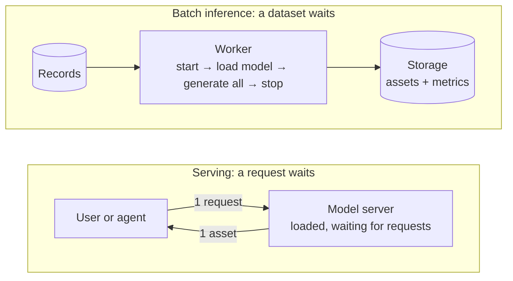
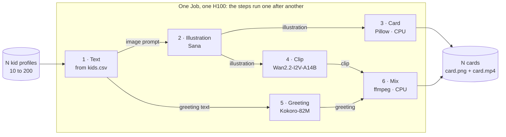
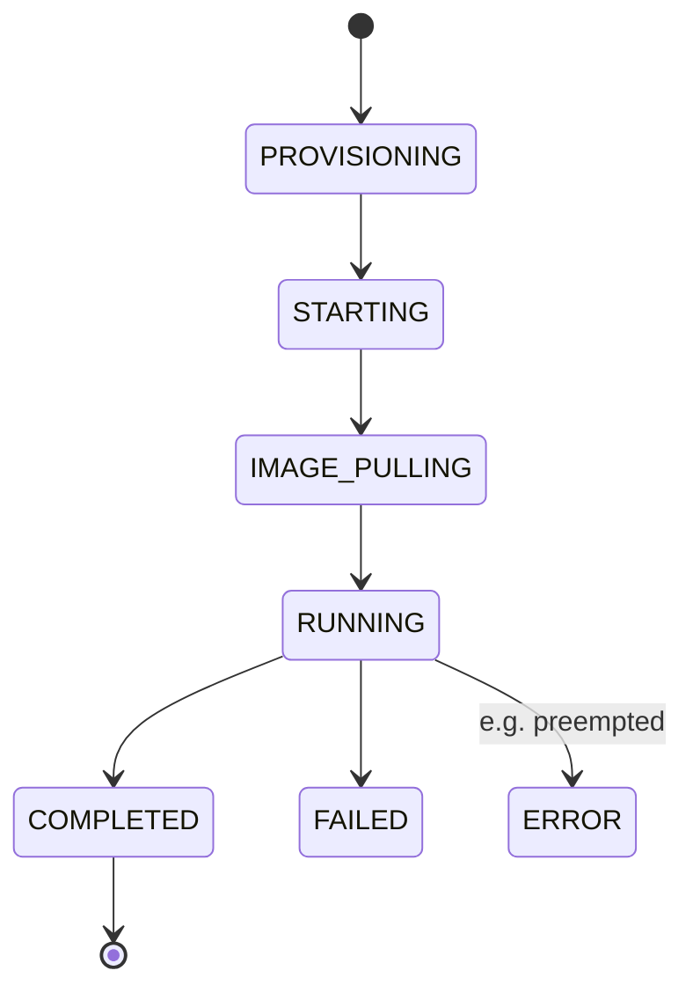

# 04 - Serving vs Batch Inference: the Same Generation for Different Use Cases

> ⚠️ **Read this first**
>
> 💸 **Prices here are examples only.** They come from our runs and price checks on the dates shown, and what you pay can differ: prices change, and spot prices can change every 15 minutes. For real prices, see [Compute pricing](https://docs.nebius.com/compute/resources/pricing) and [spot prices](https://docs.nebius.com/signup-billing/spot-prices).
>
> 🧹 **Remove all running resources after the lesson to prevent bills.** Stop or delete every Endpoint, Job and DevLab you started, even after a failed run, and delete bucket data you no longer need. An Endpoint or DevLab keeps billing while it runs, even when idle.


Say Santa wants a personalized animated gift card for each of the 200,000 children on his list: an illustrated card with a wish, animated into a short clip with a spoken greeting and music. Nobody waits for any single card; all of them have to be ready before the holidays. That's a different way of running a model from a chat agent, where a person waits for one image. Keeping a model loaded to answer requests one by one is **serving**. Running a model over a whole dataset and stopping when it's done is **batch inference**. In this lesson we compare the two patterns, then build Santa's pipeline as a batch: one Job on one H100 GPU makes the cards for ten kids, step by step, and writes them to a storage bucket.




*Conceptual.*

How long the image step takes each way: Sana at 512×512, 20 steps, on one H100, with the default Endpoint template vs our worker in a Job:

| Images | Endpoint: one request at a time | Job: model loaded once |
| --- | --- | --- |
| 1 | 1.17 s, network included | 0.78 s, no network |
| 10 | 12 s | 7.8 s |
| 200 | 3.9 min | 2.6 min |
| 200,000 | 65 h | 44 h |

Generation time only `[calc: images × the time for one image]`. Endpoint: median of 3 requests from a laptop to the Sana template on an H100, the same 512×512, 20-step settings, in lesson 02's notebook `[measured: 2026-11-16, H100; [assets/example_runs/lesson02/endpoint-h100-2026-11-16.json](assets/example_runs/lesson02/endpoint-h100-2026-11-16.json)]`. Job: median of 20 illustrations in our worker `[measured: 2026-11-14, H100; assets/example_runs/h100.json]`. Startup and model load come on top of both; lesson 05 splits a run into those parts.

In this setup the Endpoint pays about 0.4 s more per image: the network round trip, packing the image into the response, and the template's server. That's a property of the default settings with one request at a time, not of serving. An Endpoint that groups requests on the GPU, or takes requests from several clients at once, can close the gap; Module 3 covers that.

You're done when:

- your Job is `COMPLETED` and stopped by itself;
- every kid in the run has a folder in your bucket with the card (`card.png`) and the animated card (`card.mp4`), and you've watched Emma's;
- you've downloaded the run's `metrics_batch.json` for lesson 05;
- nothing you created is still `RUNNING`.

Time and cost: this is the most expensive run of the module. The Job runs on an H100 and starts by downloading 127 GB of weights for Sana, Wan2.2 and Kokoro `[measured: 2026-11-14, DevLab]`. For ten kids, expect about 35 minutes from **Create** to `COMPLETED`: 158 s startup, 1,143 s of model loads (mostly that download) and 10 × 79 s per card `[calc: from our 20-kid H100 run, assets/example_runs/h100.json]`. What that cost at the prices we read:

| Ten kids, one H100 (`gpu-h100-sxm`, `1gpu-16vcpu-200gb`, eu-north1), times from our 2026-11-14 run | Price per hour | Projected compute |
| --- | --- | --- |
| Regular price, read 2026-11-15 | $4.50 | about $2.60 |
| Spot price snapshot, 2026-11-14 15:05 UTC | $2.07 | about $1.20 |

*Projected `[calc]`: 2,088 s × the price; the 500 GB disk adds about $0.03. Not a bill.*

Spot prices change every 15 minutes and aren't capped (see "Pick the price"), so check [today's spot price](https://docs.nebius.com/signup-billing/spot-prices) and [Compute pricing](https://docs.nebius.com/compute/resources/pricing) before you run. The DevLab in path A bills on top of that, at the regular price, for as long as it runs.

## Serving vs batch inference

| | Serving | Batch inference |
| --- | --- | --- |
| Also called | Online or real-time inference | Offline inference, batch prediction |
| What starts the work | A request arrives | A dataset is ready |
| Who waits | A person or an agent, for every result | Nobody, for any single result |
| What you tune | Time per request | Assets per hour and cost per asset |
| The model is loaded | All the time, waiting between requests | For the run only |
| Where results go | Back in the response | To storage |
| How it scales | More copies of the server behind one URL | The dataset split across more workers |
| Typical use | Chat agent, editor, live preview | Campaign, catalogue, dataset, evaluation run |

AWS describes the same split: real-time inference is "ideal for online inferences that have low latency or high throughput requirements" and runs on a persistent endpoint; batch is "suitable for offline processing when large amounts of data are available upfront and you don't need a persistent endpoint". [Inference options in Amazon SageMaker AI](https://docs.aws.amazon.com/sagemaker/latest/dg/deploy-model-options.html)  Latency is the dividing line: "with batch prediction, you don't need to worry about the inference latency. With online prediction, however, inference latency is crucial." [Chip Huyen](https://huyenchip.com/2022/01/02/real-time-machine-learning-challenges-and-solutions.html) 

## The task: Help Santa to Create Christmas Gift Cards

The task comes from the [Santa Scale Challenge](https://github.com/mnrozhkov/santa-scale-challenge), a reference project for making personalized gift cards at scale. The story: Santa writes every child a card. The card gets an illustration of the gift, and then it's animated: the camera drifts slowly, snow falls, lights twinkle, and a short piece of music plays under a spoken greeting. One child, one animated card.

A record is one child. The wish, the greeting and the illustration prompt are already in the row, so this lesson does no writing and calls no language model.

Emma's row, one field per line:

```text
id:       k01
name:     Emma
age:      7
wishlist: a telescope
wish:     Dear Emma, at 7 you are full of wonder. I heard you wished for a telescope,
          and my elves are already busy. Merry Christmas!
greeting: Merry Christmas, Emma! Santa heard you wished for a telescope.
prompt:   A magical Christmas storybook illustration … The hero object: a telescope …
          No people, no faces, no text …
```

The list is [assets/kids.csv](assets/kids.csv): 200 kids, Emma first.

We build it as a deterministic pipeline: every kid goes through the same steps in the same order. Nothing decides, judges or retries along the way; that's what an agent adds, in Module 2. [code/batch_inference.py](code/batch_inference.py) has one function per step:

| Step | Reads | Makes for Emma | Runs on |
| --- | --- | --- | --- |
| 1. Text | The row | `card.json`: the wish, the greeting, the illustration prompt | No model: it copies the row |
| 2. Illustration | The prompt from the row | `illustration.png`, 512×512: the gift on snow under a starry sky. No people and no text: it gets animated later | GPU: Sana |
| 3. Card | The illustration, the name, the wish | `card.png`, 1024×1224: the illustration scaled and cropped to 944×544 (the clip's shape) on top, the name and the wish below | CPU: Pillow |
| 4. Clip | The illustration, cropped to 832×480 as the first frame | `clip.mp4`, 832×480, 81 frames at 16 fps (about 5 s), silent: slow camera drift, falling snow, twinkling lights | GPU: Wan2.2-I2V-A14B, image-to-video |
| 5. Greeting | The greeting text | `greeting.wav`, mono, 24 kHz: "Merry Christmas, Emma! Santa heard you wished for a telescope." | GPU: Kokoro-82M |
| 6. Mix | The card, the clip, the greeting, a music track | `card.mp4`, 1024×1224: the card with the clip playing where the illustration is, the greeting and quiet music; as long as the clip, or the greeting plus half a second if that's longer | CPU: ffmpeg |

|                                                                                                                                                                                                                                    |                                                                                                                                                                  |
| ---------------------------------------------------------------------------------------------------------------------------------------------------------------------------------------------------------------------------------- | ---------------------------------------------------------------------------------------------------------------------------------------------------------------- |
|  |  |
| **2. Illustration.** Sana, 512×512, 20 steps, seed 7. `0.78 s` per illustration                                                                                                                                                    | **4. Clip.** Wan2.2-I2V-A14B, 832×480, 81 frames at 16 fps, about 5 s, silent: the mix step adds the greeting and the music. `76.7 s` per clip. MP4              |

*Emma's illustration and clip from our run for 20 kids. Times are the median per kid across the run `[measured: 2026-11-14, H100 gpu-h100-sxm 1gpu-16vcpu-200gb, preemptible, eu-north1; assets/example_runs/h100.json]`.*

<!-- v1.1: embed Emma's card.png and card.mp4 from a santa-worker:v0.1.0 run (the 2026-11-14 run used the older 1024x1400 card layout). -->


## Pick the tool: Endpoint or Job?

On Nebius Serverless AI each pattern has a tool built for it. An **Endpoint** is a long-running container that serves HTTP requests at a URL: serving. A **Job** starts, runs a script to completion, writes the results to storage and stops billing: batch inference. 

|                       | Endpoint                                                         | Job                                               |
| --------------------- | ---------------------------------------------------------------- | ------------------------------------------------- |
| Pattern               | Serving                                                          | Batch inference                                   |
| What starts the work  | An HTTP request                                                  | Creating the Job                                  |
| Where outputs go      | The HTTP response                                                | A mounted bucket                                  |
| When it stops billing | When you stop it: it bills while `RUNNING`, idle or not          | By itself, at the end of the run                  |
| Scaling               | None: one VM, no scale-up under load, no scale-to-zero when idle | One run per Job; more work = more Jobs (Module 3) |
| Best for              | Someone waiting for the answer                                   | A batch nobody waits for                          |

[Serverless AI overview](https://docs.nebius.com/serverless/overview) 

The pattern doesn't force the tool. You can run a batch through an Endpoint: a client loops over the list and sends one request per image. The difference is in how the two tools behave over a long run:

- **Endpoint:** for 200,000 images the client sends 200,000 requests, receives 200,000 responses and stays online for the whole run, about 65 hours at 1.17 s per request `[calc: 200,000 × 1.17 s]`. If the client stops, the run stops. The Endpoint bills until you stop it, whether requests are arriving or not.
- **Job:** no client. The worker generates the images, writes them to the bucket, and the Job ends by itself. 

So we run Santa's pipeline as a Job.

## Before you start

You need the Nebius CLI and an Object Storage bucket. An S3 access key is optional: it lets you put the kids' list in the bucket and look at the results from your laptop with the AWS CLI. Do this once.

1. Install and log in to the [Nebius CLI](https://docs.nebius.com/cli/install).
2. Create a bucket: `nebius storage bucket create --name <your-bucket>`. Or in the web console: **Storage** → **Object Storage** → **Create resource** → **Bucket**. [How to create buckets](https://docs.nebius.com/object-storage/buckets/manage#how-to-create-buckets) 
3. Optional: create an access key for a service account and configure the AWS CLI with it, following the [Object Storage quickstart](https://docs.nebius.com/object-storage/quickstart). The endpoint is `https://storage.<region>.nebius.cloud`, for example `https://storage.eu-north1.nebius.cloud`.  You need it only for the `aws s3` commands in this lesson. If you use the web console for the bucket, skip it; the one thing the console can't do is the optional download of all the media at once.
4. Set three variables in your shell:

```bash
# the course's prebuilt worker, pinned by digest: the tag is for reading, the digest is what runs
export WORKER_IMAGE=docker.io/mnrozhkov/santa-worker:v0.1.0@sha256:64aae5c286fa3e1d7f018591050db17087ce080595d160759f792492375d6bc0
export BUCKET=<your-bucket>
export RUN_ID=job-001
```

The image is public on [Docker Hub](https://hub.docker.com/r/mnrozhkov/santa-worker), built from [code/docker/Dockerfile](code/docker/Dockerfile) (lesson 03) for `linux/amd64`. You don't need Docker to use it.

5. Upload the kids' list to the bucket. The Job reads it from there, so you can change the list without rebuilding the image:

```bash
aws s3 cp assets/kids.csv s3://$BUCKET/inputs/kids.csv \
  --endpoint-url https://storage.eu-north1.nebius.cloud
```

Or in the web console: open the bucket under **Storage** → **Object Storage**, click **Add** → **Folder** and create `inputs`, then open the folder and click **Add** → **Object** to upload `kids.csv`. [Uploading objects](https://docs.nebius.com/object-storage/objects/upload-download#how-to-upload)

Run the commands in this lesson from the module folder, `01-consistent-media-generation-on-serverless-gpus/`.

## Batch Inference Pipeline

[code/batch_inference.py](code/batch_inference.py) is what runs inside the Job: the whole pipeline from the task. `run()` goes through the six steps for the first `--n` kids and writes everything under `--out`.

For each step it loads the model **once**, makes that step's file for every kid, frees the GPU and moves on. Loading once and generating many is the point of a batch: ten separate Jobs for ten kids would pay startup and every model load ten times.




*Conceptual. Each step makes its file for all N kids before the next step starts; every model runs on the same H100.*

Three things to know before you run it:

- **Every file is written once and never changed.** That's what lets `--out` be a bucket mounted into the container, with no upload code. The video and audio files are made on the container's local disk first and copied to `--out` when finished. "How the results are stored" below shows how.
- **The clip step decides the GPU.** Wan2.2 image-to-video is the largest model in the pipeline: it needs an H100. The three models together are 127 GB, downloaded when the run starts `[measured: 2026-11-14, DevLab]`.  `--step text --step illustration --step card --step greeting` leaves the clip out; that part fits an L40S.
- **The text step copies the row.** The wish, the greeting and the illustration prompt come from [assets/kids.csv](assets/kids.csv). Nothing calls a language model. The music is one track from the module's shared media, [assets/4_jingle.mp3](assets/4_jingle.mp3); add `<mood>.mp3` files next to it to get a track per mood.

It logs a line for every model load and every finished asset, so the Job's logs show where it is. `--help` lists the options: `--n`, `--out` and `--step`.

The worker image, `mnrozhkov/santa-worker:v0.1.0`, is built from [code/docker/Dockerfile](code/docker/Dockerfile), the one lesson 03 walks through, with this module's folder as the build context: the scripts come from `code/`, the kids list, the fonts and the music from `assets/`. Weights, secrets and outputs stay out; the module's [.dockerignore](.dockerignore) lets nothing else in.

Each step works through all N kids before the next one starts: it loads its model once, makes N assets and saves each one to the kid's folder in the S3 bucket. The next step reads its inputs from that folder. Steps hand over only through the bucket, so a step can be rerun or moved to another machine without touching the others.

**The limitation in this lesson:** all six steps run inside one Job (a single run that starts, does the work and stops) on one GPU, one after another. Even the card and mix steps, which need no GPU, run on the GPU machine. It's the simplest setup that works, and it wastes time in ways we can name: the GPU waits during the CPU steps, steps that don't depend on each other can't run at the same time, and the GPU has to fit the largest model: the video model needs an H100, so the small models run on an H100 too. Running steps in parallel, giving each step its own hardware and splitting the N kids across workers are optimization and scaling: Module 3. So is surviving an interruption: if this Job is preempted, you run it again from the start.

## Run the Job

There are two ways to run the worker, and both end with the results in your S3 bucket. Path A is the easiest: a notebook in a DevLab, where you see and hear each step, then run the script there. Path B submits the same script as a Job, the batch run.

### Path A: the notebook and the script in a DevLab

Start here: it is the easiest way to see the pipeline work, and the place to develop and debug the worker before it goes into a Job. A DevLab is JupyterLab on a GPU VM. Here nothing is submitted: you call the pipeline's functions yourself in your DevLab's Python environment, look at each result, and only then run the script. The bucket is mounted at `/data`, as in the Job in path B, so the script reads the same `kids.csv` and writes to the same bucket.

Where path A writes:

| What | Where | Survives deleting the DevLab |
| --- | --- | --- |
| The notebook's one-kid card | `/data/runs/santa-dev/cards/<kid id>/` in your bucket | Yes |
| The notebook's three-kid batch | `/data/runs/santa-dev-batch/` in your bucket | Yes |
| The script in step 4 | `/data/runs/batch_inference/devlab-001/` in your bucket | Yes |
| Model weights | The DevLab's container disk | No, and it doesn't need to |

If `/data` isn't mounted, the notebook says so and writes to `runs/` on the DevLab's disk instead; those files go when you delete the DevLab.

A DevLab can't be preemptible: it bills at the regular price while it runs, and its disk until you delete it. 

1. Create a DevLab from the **JupyterLab** template in the web console: [DevLabs quickstart](https://docs.nebius.com/serverless/quickstart/devlabs#web-console). In **Platform**, pick an H100, and a preset with one GPU, 16 vCPU and 200 GB of memory. Under **Container disk size**, set **500 GB**: the models are 127 GB, and a larger disk writes faster, so the download finishes sooner than on the default disk. [Disk performance](https://docs.nebius.com/compute/storage/types) Under **Mounted volumes**, click **Attach volume**, choose your bucket, and mount it at `/data` for reading and writing, the same place the Job uses ([Managing DevLabs](https://docs.nebius.com/serverless/devlabs/manage)). A DevLab bills at the regular price for as long as it runs, so plan the session. On an L40S you can do everything except the clip and the mix. Copy and keep the **Jupyter token**: that is what you type to open Jupyter. Leave **Bearer token authentication** off. That switch sits in front of Jupyter; with it on, the browser shows `Unauthorized` and the Jupyter token never gets a chance to sign you in. 
2. Open the DevLab's HTTPS URL, sign in with your Jupyter token, and open a **Terminal**. Run this once. The first commands are the same as in lesson 02: they install `uv`, clone the course repository, and create the GPU kernel. The last command adds the packages for the clip, greeting and mix steps. [Install uv](https://docs.astral.sh/uv/getting-started/installation/)
   ```bash
    curl -LsSf https://astral.sh/uv/install.sh | sh
    source "$HOME/.local/bin/env"

    git clone https://github.com/DataTalksClub/production-ai-agents-for-media-generation.git
    cd production-ai-agents-for-media-generation

    uv sync --extra gpu --extra notebooks
    uv run python -m ipykernel install --user --name course-gpu --display-name "course (GPU)"

    # lesson 04 only: the same versions as the worker image
    uv pip install kokoro==0.9.4 ftfy==6.3.1 imageio==2.38.1 imageio-ffmpeg==0.8.1 \
      https://github.com/explosion/spacy-models/releases/download/en_core_web_sm-3.8.0/en_core_web_sm-3.8.0-py3-none-any.whl
   ```

    The last line pins the versions [the worker image](https://hub.docker.com/r/mnrozhkov/santa-worker) uses, so the notebook and the Job run the same libraries. Kokoro's English voice needs the spaCy model `en_core_web_sm`; installing it here means nothing downloads it at run time. Unknown words fall back to `espeakng-loader`, which comes with Kokoro. The DevLab account cannot install system packages.
3. Open [code/nb-santa-cards.ipynb](code/nb-santa-cards.ipynb), choose the **course (GPU)** kernel and run it top to bottom. It makes Emma's card one step at a time and shows the text, the illustration, the card, the clip, the greeting and the final video. Its last cell runs the batch for three kids. Both write to your bucket (see the table above).
4. Run the script, the same way a Job will, with the output on the bucket mount. One kid is enough to check it; the ten-kid run is the Job in path B, which can use a preemptible GPU and stops billing by itself.
   <!-- release QA: run this exact command once in a fresh DevLab -->
   ```bash
    cd 01-consistent-media-generation-on-serverless-gpus
    uv run --no-sync python code/batch_inference.py --kids /data/inputs/kids.csv --n 1 \
      --out /data/runs/batch_inference/devlab-001
   ```

    It prints a line per asset and the path of the `cards` folder at the end. The files are in your bucket as soon as they are written: no upload step.
5. Delete the DevLab when you're done. It bills its GPU while it runs, including while you read and type, and a stopped DevLab still bills its disk. Your outputs are in the bucket, so nothing is lost.

### Path B: a Job from your laptop

Use this for the batch run once path A works. You submit one command, from a terminal or a notebook cell; Nebius starts a GPU VM, runs the worker's container on it, and deletes the VM when the Job ends, so the GPU stops billing then.  The script reads the kids and writes the cards through your bucket, mounted at `/data`.

**Pick the price.** The pipeline needs an H100 for the clip step. You choose how to pay for it:

|                                                  | Set                                                                                   | Price                                                                                                   |
| ------------------------------------------------ | ------------------------------------------------------------------------------------- | ------------------------------------------------------------------------------------------------------- |
| H100, preemptible, follows spot (the command below) | nothing                                                                            | The spot price, which can change every 15 minutes during the run. **No maximum**: it can go above the regular price |
| H100, preemptible, with a max price              | replace `--follows-spot-price` with `--spot-pricing-policy-id <policy_ID>`            | The spot price, up to the max price you set. If spot goes above it, the Job is stopped                 |
| H100, regular                                    | replace `--preemptible --follows-spot-price` with `--on-demand`                       | The fixed regular price; the GPU isn't taken back                                                       |

Spot prices [aren't capped and can rise above the regular price](https://docs.nebius.com/compute/resources/pricing). Check [today's spot price](https://docs.nebius.com/signup-billing/spot-prices) before you submit. To put a ceiling on what you pay, create a pricing policy for `gpu-h100-sxm` with a max price per GPU-hour (**Billing → Pricing → Pricing policy → Create pricing policy** in the console) and pass its ID. A max price below the current spot price blocks the policy, and the Job can't start until spot drops. [Spot pricing and pricing policies](https://docs.nebius.com/signup-billing/pricing-policy), [managing pricing policies](https://docs.nebius.com/signup-billing/manage-pricing-policy), [Jobs: pricing flags](https://docs.nebius.com/serverless/jobs/manage)

We use a preemptible H100 when its spot price is well below the regular price and one is available; if the Job can't get one, or you need a fixed price, use `--on-demand`.

One command creates the Job. Check the request first: `--dry-run` validates it without creating anything.

```bash
nebius ai job create --dry-run --name "$RUN_ID" --image "$WORKER_IMAGE" \
  --platform gpu-h100-sxm --preset 1gpu-16vcpu-200gb \
  --disk-size 500Gi \
  --preemptible --follows-spot-price \
  --timeout 2h --restart-policy never \
  --volume "$BUCKET:/data:rw" \
  --container-command bash --args "-c 'python /app/batch_inference.py --kids /data/inputs/kids.csv --n 10 --out /data/runs/batch_inference/$RUN_ID --region eu-north1 --platform gpu-h100-sxm --preset 1gpu-16vcpu-200gb --billing preemptible'"
```

- **`--volume "$BUCKET:/data:rw"`** mounts your bucket into the container at `/data`, for reading and writing. The script reads the kids from `/data/inputs/kids.csv`, the file you uploaded, and whatever it saves under `/data` is in S3.
- **Preemptible by default.** Jobs run on a regular VM unless you ask for preemptible; preemptible is cheaper, and Nebius can take the GPU back. If that happens the Job ends in `ERROR` and isn't retried: run it again. [Jobs: manage](https://docs.nebius.com/serverless/jobs/manage), [auto-restarts](https://docs.nebius.com/serverless/jobs/auto-restarts)
- **`--disk-size 500Gi`** is the container disk. The weights are 127 GB, and a larger disk writes faster, so 500 GB finishes that download sooner than the 250 GiB default. [Disk performance](https://docs.nebius.com/compute/storage/types)
- **`--timeout 2h`** is the hard stop if anything hangs; the shortest allowed is `1h`. The run starts by writing those 127 GB onto the disk. Downloading on every run is wasteful on purpose here; Module 3 fixes it. `--timeout 4h` raises the limit for a longer run.
- **`--restart-policy never`**: a failed run fails once, it doesn't loop.
- **`--platform` and `--preset` always**, so you know which GPU you pay for.
- **`--preemptible --follows-spot-price`**: a preemptible GPU at the current spot price, with no maximum. See "Pick the price" above for a capped or a regular run.

Then run the same command without `--dry-run`. It prints the Job's ID.

Ten kids is the default (`--n 10` in the command above). About 35 minutes is projected for it, so `--timeout 2h` leaves room `[calc: from our 20-kid H100 run]`. The CSV has more rows if you want to experiment on your own; this lesson does not ask you to raise `--n`. After your run, open `metrics_batch.json` in the bucket: the model loads are paid once per Job, and the clip step adds about 77 s for each kid `[measured: 2026-11-14, H100; assets/example_runs/h100.json]`.

**From a notebook.** The same command works in a Jupyter cell on your laptop: set the variables with `%env WORKER_IMAGE=...`, `%env BUCKET=...`, `%env RUN_ID=...`, and put `!` in front of `nebius ai job create`.
<!-- release QA: run the command once from a notebook cell; the shell form is the tested one. -->

**Watch it.** Follow the run with the ID the create command printed:

```bash
nebius ai job get <job_ID>
nebius ai job logs <job_ID> --follow
```




*Conceptual; state names from the [lifecycle docs](https://docs.nebius.com/serverless/lifecycle).* 

The logs show the script's progress: one line when a model has loaded, one for every finished asset. An excerpt with the load and per-kid times from our 20-kid H100 run (`[measured: 2026-11-14, H100; assets/example_runs/h100.json]`; clock times left out, yours will differ):

```text
10 kids from /data/inputs/kids.csv, steps: text, illustration, card, clip, greeting, mix, out: /data/runs/batch_inference/job-001/cards
text 1/10 k01 0.0 s
...
illustration model loaded in 89.9 s
illustration 1/10 k01 6.0 s
illustration 2/10 k02 0.8 s
...
clip model loaded in 1046.0 s
clip 1/10 k01 77.7 s
...
mix 10/10 k10 0.6 s
finished: /data/runs/batch_inference/job-001/cards (metrics: /data/runs/batch_inference/job-001/metrics_batch.json)
```

The first illustration is slower than the rest: the model warms up on its first call. The clip model's load includes downloading its weights.

## How the results are stored

How the kids get in and the files get out:

1. The Job command mounts the bucket: `--volume "$BUCKET:/data:rw"`. 
2. The worker runs with `--kids /data/inputs/kids.csv`: it reads the list you uploaded, as an ordinary file.
3. It runs with `--out /data/runs/batch_inference/$RUN_ID`: `run()` creates `cards/<kid id>/` under that path, and each step saves its file there with ordinary Python and ffmpeg writes.

What's in the bucket after one run, `RUN_ID=job-001`:

```text
inputs/
└── kids.csv                   you upload it once; every run reads it
runs/batch_inference/job-001/
├── metrics_batch.json         model load times and per-kid latencies for every step
└── cards/
    ├── k01/
    │   ├── card.json          1. text: the kid's profile, gifts, wish, mood, greeting, image prompt
    │   ├── illustration.png   2. Sana
    │   ├── card.png           3. the card image (final)
    │   ├── clip.mp4           4. Wan2.2, silent
    │   ├── greeting.wav       5. Kokoro
    │   └── card.mp4           6. card + clip + greeting + music (final)
    ├── k02/
    └── ...
```

- **Two finals per kid:** `card.png` and `card.mp4`. The other four files are intermediates, kept so the next step can read its inputs and so you can inspect each step.
- **Handover between steps is only through these files.** The illustration step reads the image prompt from `card.json`, the clip step reads `illustration.png`, and so on.
- **Each file is written once and never edited,** which is what makes a bucket mount work as the output folder. PNG and JSON files are written to it directly. MP4 and WAV writers jump back inside a file to finish its header, which a bucket mount doesn't support, so the worker writes `clip.mp4`, `greeting.wav` and `card.mp4` to local disk first and copies each finished file over (`staged()` in [code/batch_inference.py](code/batch_inference.py)).
- **`metrics_batch.json` records the run's times** (`started_at`, `finished_at`, `runtime_s`, and each step's `load_s` and per-kid `latency_s`) so lesson 05 can compute the cost per card without parsing the Job's logs. It also records `region`, `platform` (the GPU type), `preset` and `billing` (`regular` or `preemptible`) from the flags in the command above. The container cannot see the Job, and `nebius ai job get` does not return an hourly price, so the file has none. Lesson 05 reads the rate from the pricing page and the spot-price API.
- **Each card keeps its input.** `card.json` holds the kid's full row from `kids.csv`, so you can tell which profile made each card even after you change the list.

## See the results in the bucket

The files stay in the bucket after the Job's VM is deleted.

To browse them in the web console, go to **Storage → Object Storage**, open your bucket and click through the folders to `runs/batch_inference/<RUN_ID>/`. To download a file, open the menu in its row and choose **Download**. [Managing objects](https://docs.nebius.com/object-storage/objects/manage), [Uploading and downloading objects](https://docs.nebius.com/object-storage/objects/upload-download)

Or list the run from your terminal:

```bash
aws s3 ls --recursive s3://$BUCKET/runs/batch_inference/$RUN_ID/ \
  --endpoint-url https://storage.eu-north1.nebius.cloud
```

You should see `metrics_batch.json` and the six files for every kid from the tree above. Get Emma's animated card and play it:

```bash
aws s3 cp s3://$BUCKET/runs/batch_inference/$RUN_ID/cards/k01/card.mp4 emma.mp4 \
  --endpoint-url https://storage.eu-north1.nebius.cloud
```

<!-- v1.1: embed Emma's card.mp4 from a santa-worker:v0.1.0 run. -->

## Download the metrics and the media

Lesson 05 and the homework use your run's `metrics_batch.json`. Download it now, with the two finished files per kid, the card and the animated card:

```bash
aws s3 cp --recursive \
  s3://$BUCKET/runs/batch_inference/$RUN_ID \
  runs/batch_inference/$RUN_ID \
  --exclude "*" --include "metrics_batch.json" --include "*/card.png" --include "*/card.mp4" \
  --endpoint-url https://storage.eu-north1.nebius.cloud
```

No AWS CLI? Download `metrics_batch.json` from the run's folder in the web console (see above). Leave out the `--exclude` and `--include` flags to get every intermediate file too. Downloading to your laptop is internet egress; reading from the bucket inside the same region is free. [Object Storage pricing](https://docs.nebius.com/object-storage/resources/pricing)

## Clean up

A Job stops by itself; a DevLab doesn't, so delete it if you used path A. Your outputs are in the bucket, not on the DevLab.

The bucket bills for what it stores, so delete the runs once you have what you need. Keep `metrics_batch.json` until you've done lesson 05: download it first (above). Then, once for each run folder you created (`batch_inference/devlab-001`, `batch_inference/job-001`, `santa-dev`, `santa-dev-batch`):

```bash
aws s3 rm --recursive s3://$BUCKET/runs/batch_inference/$RUN_ID \
  --endpoint-url https://storage.eu-north1.nebius.cloud
```

Check that nothing is still `RUNNING`:

```bash
nebius ai job list
nebius ai endpoint list
nebius ai devlab list
```


## Common failures and recovery

**At create**

- **`QuotaExceeded`**: default quotas are small on new accounts. Use one GPU; [check your quotas](https://docs.nebius.com/serverless/pricing-quotas).
- **`--timeout` rejected**: below the 1h minimum. Use `1h` or more.

**Before it runs**

- **Stuck in `PROVISIONING`, then `ERROR` with `NotEnoughResources`**: no capacity; Serverless keeps trying for up to 30 minutes. Use `--on-demand`, another region, or try later.
- **Doesn't start with `--spot-pricing-policy-id`**: the policy's max price is below the current spot price, so the policy is blocked. Raise the max price, wait for spot to drop, or use `--on-demand`.
- **`FAILED` right after `IMAGE_PULLING`**: wrong architecture or a private image. Build for `linux/amd64`; use a public image or your project's registry.

**Fails at once (input problems)**

- **`Invalid value for '--kids'` in the logs**: `kids.csv` isn't at that path in the bucket. Upload it to `inputs/kids.csv` ("Before you start", step 5) and check the `--kids` path.
- **Validation error**: a row in your `kids.csv` is missing a column or has an age outside 1–18. Fix the row; the error names it.

**While running**

- **`ERROR` after running a while**: preempted, or, with a pricing policy, the spot price went above your max price. Run the Job again.
- **`CUDA out of memory` in the clip step**: the video model on a GPU smaller than an H100. Use an H100, or on an L40S run `--step text --step illustration --step card --step greeting`.
- **The Job ends before the cards are done**: the weights download and the clips took longer than `--timeout`. Raise `--timeout`.

**After it finishes**

- **`COMPLETED` but the bucket is empty**: output was written outside `/data`. Check `--out` and the `--volume` mount.

## What bills

| Resource           | Billed while                                                |
| ------------------ | ----------------------------------------------------------- |
| Job                | Running; the VM is deleted at the end                       |
| DevLab             | Running, at the regular price; its disk until you delete it |
| Endpoint           | `RUNNING`, idle or not; nothing while stopped               |
| Bucket             | Stored data, all the time; egress to the internet           |
| Container Registry | Free                                                        |

Rates: [Nebius pricing](https://docs.nebius.com/compute/resources/pricing), [Object Storage pricing](https://docs.nebius.com/object-storage/resources/pricing).

## What this lesson leaves out

One Job on one GPU is the simplest batch that works. Santa's list has 200,000 kids, and that needs more:

| Left out here                   | Why it matters at 200,000                                                                                                                                   | Where we deal with it                                              |
| ------------------------------- | ----------------------------------------------------------------------------------------------------------------------------------------------------------- | ------------------------------------------------------------------ |
| Parallel workers                | One GPU makes one card after another: about 4,400 GPU-hours, half a year, for 200,000 cards `[calc: 200,000 × 79 s per card]` | Module 3                                                           |
| Hardware per step               | The CPU steps hold a GPU, and the GPU is sized for the largest model                                                                                        | Module 3                                                           |
| Weights downloaded on every run | Each Job starts by downloading 127 GB for Sana, Wan2.2 and Kokoro before it makes anything, and pays GPU time for the wait `[measured: 2026-11-14, DevLab]` | Module 3 (keeping weights close to the GPU)                        |
| Surviving an interruption       | A preempted Job starts again from the first kid                                                                                                             | Module 3                                                           |
| Cost and limits                 | You want the price before the run, and a stop when it goes over                                                                                             | Lesson 05, then Module 3                                           |
| Checking the cards              | The pipeline never looks at what it made, and nobody can look at 200,000 cards                                                                              | Module 2 (a judge that retries), Module 4 (evaluation and tracing) |

Next: in [lesson 05](05-measuring-costs.md) we split a run into startup, model load and generation time, and turn them into a cost per asset.

## References

- [Serverless AI: jobs](https://docs.nebius.com/serverless/jobs/manage), Nebius
- [Serverless AI: lifecycle](https://docs.nebius.com/serverless/lifecycle), Nebius
- [Inference options in Amazon SageMaker AI](https://docs.aws.amazon.com/sagemaker/latest/dg/deploy-model-options.html), AWS
- [Real-time machine learning: challenges and solutions](https://huyenchip.com/2022/01/02/real-time-machine-learning-challenges-and-solutions.html), Chip Huyen (2022)
- [Full Stack Deep Learning 2022, Lecture 5: Deployment](https://fullstackdeeplearning.com/course/2022/lecture-5-deployment/)
- [Santa Scale Challenge](https://github.com/mnrozhkov/santa-scale-challenge): the pipeline this lesson adapts
- [Kokoro-82M](https://huggingface.co/hexgrad/Kokoro-82M) and [Wan2.2-I2V-A14B](https://huggingface.co/Wan-AI/Wan2.2-I2V-A14B-Diffusers), model cards
