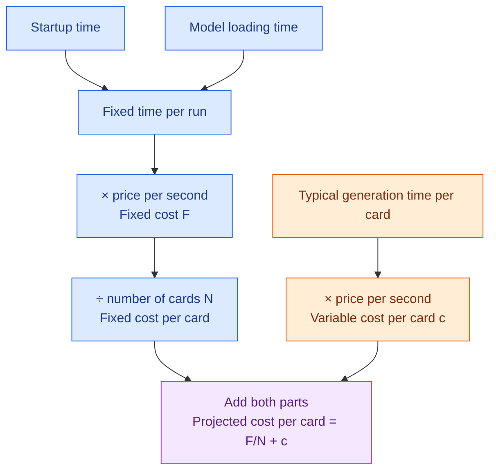

# 05 - Measuring Startup, Load and Generation Costs

> ⚠️ **Read this first**
>
> 💸 **Prices here are examples only.** They come from our runs and price checks on the dates shown, and what you pay can differ: prices change, and spot prices can change every 15 minutes. For real prices, see [Compute pricing](https://docs.nebius.com/compute/resources/pricing) and [spot prices](https://docs.nebius.com/signup-billing/spot-prices).
>
> ⚠️ **Remove all running resources after the lesson to prevent bills.** Stop or delete every Endpoint, Job and DevLab you started, even after a failed run, and delete bucket data you no longer need. An Endpoint or DevLab keeps billing while it runs, even when idle.

<!-- Draft v5, 2026-11-16. Numbers: assets/example_runs/*.json (20 kids each, 2026-11-14), copied unchanged from the runs. Startup 157.7 s: one H100 Job on 2026-11-14 (not in metrics_batch.json). Prices: the notebook's "Prices and assumptions" (read 2026-11-15; spot snapshot 2026-11-14T15:05Z; fal checked 2026-11-15). Figures: code/costs.py draws them, the notebook shows them, and .DEV/scripts/make_05_figures.py saves them to assets/ from the example runs and that notebook cell. When prices change: update "Prices and assumptions", rerun the notebook and the figure script, then recheck every [calc] below. -->

Santa's elves ran one batch Job on one H100 GPU. It made animated greeting cards for 20 kids: for each kid, an illustration, a card, a short video clip, a spoken greeting and the final video with music. The worker ran for about 45 minutes in our run on 2026-11-14, after a few minutes for the machine to start. So what does one card cost? And what would Santa's list of 200,000 kids cost?

There's no single answer, because a run has two kinds of cost. Starting the machine and loading the models is paid once per run. Making a card is paid once per card. In this lesson you split one run into those two parts and turn them into a cost per card at any batch size. Then you use the split to answer four questions: which step decides the bill, which GPU makes the cheapest card, what spot prices change, and when self-hosting beats a per-call API.

You're done when you have:

- the per-step table for one run: each model's load time and the median time per card;
- the cost per card at N = 1, 10, 20 and 200 at regular prices, extrapolated from that one run;
- the cost per card on each GPU;
- what spot prices change;
- a breakeven N for the clip step against a per-call API for the same model, at regular and spot prices.

**Time and cost.** About 30 minutes, on your laptop. The notebook reads runs we saved, so it needs no GPU and no credits, and you don't run anything new. One run gives the fixed part and the per-card part, and those extrapolate to any N. The comparison across GPUs reads our runs on three of them. If your lesson 04 run is still in your bucket, you can put its `metrics_batch.json` through the same notebook: the notebook's section 7 does it.

## The example runs

A cost is only as good as the times behind it. Ours come from three runs of the same worker: the same 20 kids, once on each of three GPUs. Each run left one file, `metrics_batch.json`, written by the worker inside the Job. The copies are in [assets/example_runs/](assets/example_runs/):

- [h100.json](assets/example_runs/h100.json): NVIDIA H100 80GB, the main example
- [h200.json](assets/example_runs/h200.json): NVIDIA H200
- [rtx-pro-6000.json](assets/example_runs/rtx-pro-6000.json): NVIDIA RTX PRO 6000 Blackwell

The worker is lesson 04's pipeline. It runs six steps for every kid, one step at a time:

1. text, from a CSV;
2. an illustration, with Sana;
3. the card image, with Pillow on the CPU;
4. a 5-second clip animated from the illustration, with Wan2.2-I2V-A14B;
5. a spoken greeting, with Kokoro-82M;
6. the final video with music, with ffmpeg on the CPU.

Each step loads its model once, makes its file for every kid, frees the GPU and moves on. So the file records each model's load time once, and the time for each kid. Here is the clip step, shortened to three of the 20 kids:

```json
"clip": {
  "load_s": 1045.976,
  "latency_s": {"k01": 77.732, "k02": 76.827, "k03": 76.437},
  "median_s": 76.675,
  "total_s": 2580.897
}
```

In these three files, `region`, `platform`, `preset` and `billing` were copied in afterwards from `nebius ai job get`: the worker that made them couldn't see the Job. Lesson 04's worker writes them itself, from the flags in the Job command.

**The file leaves out the startup.** The file starts when the worker starts. Before that, from **Create** until the container runs, the machine starts and the worker image downloads. That's the startup. One H100 Job measured it at 157.7 s on 2026-11-14, from the Job's `created_at` and `started_at`. The notebook uses that for every run.

## Where the time goes

A run's total time hides which part to fix. Split it by step, and one step stands out.

Open [code/nb-measuring-costs.ipynb](code/nb-measuring-costs.ipynb) and run sections 0 to 2: "Prices and assumptions", "The example runs" and "Where the time goes". The notebook prints the full per-step table and draws this figure, which shows the two parts that matter.


*Measured: [h100.json](assets/example_runs/h100.json), NVIDIA H100 80GB, 20 kids, 2026-11-14. Blue: paid once per run. Orange: paid once per card. "No model": the step loads nothing, which isn't the same as a load time of zero.*

**Takeaway:** the clip step dominates both parts: 1,046 seconds to load, 76.7 seconds per card.

Three things the figure doesn't show:

- **The clip load is mostly a download.** The model's weights are about 126 GB, fetched at the start of the step on every run. <!-- c:M1-063 --> That's a design choice in this worker, and the first thing to fix.
- **The first asset of each model is slower.** The first illustration took 6.0 s, the typical one 0.8 s. That's warm-up. The median per kid keeps it out of the per-card time. Across all six steps it adds about 8 s per run `[calc]`.
- **The CPU steps bill at the GPU price,** because they run on the GPU machine. Here they take about 1 s per card, so it doesn't matter yet.

## From time to money

Every cost in this lesson is a projection: what a run costs at a given price, from its times. Use it to plan and to compare options. What you actually paid is in **Billing → Usage**.

Billing is per second while the machine runs, priced per hour: half an hour costs half the hourly price. <!-- c:M1-337 c:M1-338 --> A Job stops billing when it ends. <!-- c:M1-290 c:M1-291 --> So the projection splits into a part paid once per run and a part paid once per card:



*Conceptual. Blue: paid once per run. Orange: paid once per card. Purple: both together. The figures below use the same colours.*

**Projected cost per card = F/N + c**

For the H100 run at the regular price, at N = 20: $1.63 / 20 + $0.098 ≈ **$0.18 per card** `[calc]`.

Against a per-call API that charges `p` per asset, the breakeven is `N = ceil(F / (p − c))` assets per run. From that N on, self-hosting is cheaper. If `p ≤ c`, there's no finite breakeven: self-hosting never wins (assuming `F > 0`). The notebook prints that case as "never (0)". `0` is the convention the homework uses for it.

**Assumptions:** the run is one Job, as in `metrics_batch.json`: one startup, billed in full, then the cards one after another. The Job stops after the last card, so nothing bills idle.

### What the projection leaves out

- **The container disk.** It bills alongside the GPU ([Pricing and quotas](https://docs.nebius.com/serverless/pricing-quotas)). Our 500 GB disk costs about $0.05 per hour, about 1% of an H100's regular price `[calc]`.
- **The first-asset warm-up:** about 8 s per run ([Where the time goes](#where-the-time-goes)).
- **Everything around the run:** failed or retried runs, engineering and ops time, bucket storage and egress, and quality differences against an API.

Each one makes self-hosting look cheaper than it is.

## Prices and assumptions

Prices change, and a table that mixes regular and spot prices compares nothing. So the notebook keeps every price in one place, **"Prices and assumptions"**, and every cost after it uses that section. When prices change, update it and run the notebook again. The prices below are the ones on the day we wrote this lesson.

### GPU prices for the calculations

| GPU | Platform, region | Regular, USD per hour | Spot, USD per hour |
| --- | --- | --- | --- |
| H100 | `gpu-h100-sxm`, eu-north1 | 4.50 | 2.07 |
| H200 | `gpu-h200-sxm`, eu-north1 | 5.40 | 2.48 |
| RTX PRO 6000 | `gpu-rtx6000-a`, uk-south2 | 1.80 | 1.38 |

*Regular: [Compute pricing](https://docs.nebius.com/compute/resources/pricing), read 2026-11-15. Spot: the public [spot-price API](https://docs.nebius.com/signup-billing/spot-prices), read 2026-11-15, snapshot 2026-11-14 15:05 UTC.* <!-- c:M1-345 c:M1-346 -->

The **regular** price, also called on-demand, is fixed. The **spot** price is what preemptible GPUs pay, and our example runs were preemptible. Spot prices can change as often as every 15 minutes and differ by region. They aren't capped: a spot price can rise above the regular price ([Compute pricing](https://docs.nebius.com/compute/resources/pricing)). To limit it, set a max price in a [pricing policy](https://docs.nebius.com/signup-billing/pricing-policy). `--follows-spot-price`, which lesson 04 uses by default, sets none. <!-- c:M1-344 -->

Read today's spot prices yourself, no login needed:

```bash
curl -s https://api.nebius.cloud/billing/v1alpha1/spot-price
```

### The per-call API: Wan 2.2 A14B on fal

We compare one step with a per-call API: the clip, because it's most of the card's cost. [fal](https://fal.ai/models/fal-ai/wan/v2.2-a14b/image-to-video) sells the same model, Wan 2.2 A14B image-to-video, so the price difference isn't a model difference. It charges per video second by resolution, and counts video seconds at 16 frames per second. For our 480p clip:

**81 frames ÷ 16 fps × $0.04 per video second = $0.2025 per clip** `[calc]`

> [!NOTE]
> This is fal's listed price on 2026-11-15, not a measured run. Check the [model page](https://fal.ai/models/fal-ai/wan/v2.2-a14b/image-to-video) before you quote the numbers, and update "Prices and assumptions". <!-- c:M1-353 -->

## The analysis at regular prices

We start with regular prices. They're fixed, so the numbers stay comparable from day to day.

### Batch size and what to optimize

The notebook's "Batch size and what to optimize" section prints the numbers and draws this chart.


*Projected `[calc]`: H100, regular [GPU price](#gpu-prices-for-the-calculations), from the measured loads and median per-card time in [h100.json](assets/example_runs/h100.json) plus the 157.7 s startup. Left out: disk, warm-up, retries. Cached weights are a best case, clip load time set to zero: real cached weights still take some time to load from disk.*

**Takeaway:** a shorter load helps small batches most. Faster generation matters more as batches grow. The two cross at about N = 27 cards per run `[calc]`.

At Santa's scale it's all generation. 200,000 cards on one H100 take about 4,400 GPU-hours: roughly half a year of one GPU running nonstop, and about $19,700 at the regular price `[calc]`. The fixed part disappears. That's the number Module 3 starts from. The notebook also prints the whole-run cost for each N.

### Parallel workers

Parallel workers buy time with money. Every worker pays its own startup and model loads. For 200 cards:

| Workers | Wall time | Cost |
| --- | --- | --- |
| 1 | 4.7 h | $21.31 |
| 4 | 1.5 h | $26.19 |
| 10 | 0.8 h | $35.94 |

*Projected `[calc]`: H100, regular [GPU price](#gpu-prices-for-the-calculations). Assumed: the cards split evenly, each worker pays one startup and one set of model loads, and the workers run fully in parallel.*

**Takeaway:** more workers cut the elapsed time but repeat the fixed part. With the clip weights cached, ten workers would cost about $22.87 at best, close to what one worker costs today `[calc]`. That's why caching comes before scaling out.

### Same cards, different GPUs

The notebook's "Same cards, different GPUs" section loops over the three runs. It also prints the clip load times.

| GPU | Seconds per card | USD per card at N = 20, regular | USD per card at N = 200, regular |
| --- | ---: | ---: | ---: |
| H100 | 78.7 | 0.18 | 0.11 |
| H200 | 76.5 | 0.17 | 0.12 |
| RTX PRO 6000 | 125.6 | 0.081 | 0.065 |

*Seconds per card measured: [assets/example_runs/](assets/example_runs/), one run per GPU, 20 kids each, 2026-11-14. Costs projected at regular [GPU prices](#gpu-prices-for-the-calculations), with a 157.7 s startup for every GPU.*

**Takeaway:** a faster GPU doesn't necessarily make a cheaper card.

1. **Cost per card is price × time.** The RTX PRO 6000 is 1.6× slower per card than the H100, but 2.5× cheaper per hour, so its card is 36% cheaper.
2. **Model load time differs a lot between machines.** The same 126 GB of clip weights loaded in 1,046 s on the H100 and in about 532 s on both the H200 and the RTX PRO 6000. Loading was slower in both our H100 runs: 1046.0 s here, 1046.5 s in a 5-kid run. These runs don't show why. Download speed, disk, region, caching and model initialization all sit inside `load_s`. Caching the weights takes most of this difference away.

**Caveats**

- **One run per GPU.** 
- **Not every GPU is in every region.** Our RTX PRO 6000 run was in uk-south2, the others in eu-north1. Download speeds and spot prices can differ by region.
- **One startup for every GPU.** It was measured on one H100 Job; other GPUs may start faster or slower.

## What spot prices change

Our runs were preemptible, so they paid spot prices, not regular ones. The notebook's "What spot prices change" section recomputes the GPU comparison at the spot prices in [Prices and assumptions](#prices-and-assumptions), and draws this chart.


*Projected `[calc]` using the recorded price snapshot, not what the runs paid: marginal cost per card `c` from the measured median per-card time in each run, at the regular and spot [GPU prices](#gpu-prices-for-the-calculations). The snapshot was taken before the runs started.*

**Takeaway:** which GPU is cheapest depends on both its time and its price.

- **Every cost drops by the same share as the price.** Cost is price × time, and the times don't change. The H100 and H200 save 54%. The RTX PRO 6000 saves 23%, because its spot price is closer to its regular price.
- **The cheapest marginal cost doesn't guarantee the cheapest small batch.** At this snapshot the H100 has the lowest `c`. The RTX PRO 6000 is still cheapest at N = 20, mostly because its clip model loads twice as fast. At N = 200 the three are within $0.01 per card `[calc]`.

What spot prices cost you instead:

- **The price can move during a run,** and it can go above the regular price. A pricing policy sets a max price; if spot goes above it, the Job is stopped. [Compute pricing](https://docs.nebius.com/compute/resources/pricing), [pricing policies](https://docs.nebius.com/signup-billing/pricing-policy)
- **Nebius can take the GPU back.** A preempted Job ends in `ERROR` and isn't retried. The rerun pays the startup and the 1,046 s clip load again, and this worker starts again from the first kid. <!-- c:M1-296 --> Resuming where a run stopped is Module 3.
- **Our spot prices are a snapshot.** A snapshot projects a run's cost. It can't tell you what the run paid if the price changed during it. Only Billing → Usage can.

Use regular prices to compare and plan: they're fixed. They aren't a ceiling for a preemptible run unless you set a max price in a pricing policy. Use Billing → Usage to know what a run actually cost.

## Self-hosted vs the API: the clip step

Now the question from the start: from how many assets does running the model yourself beat paying per call? We compare the clip step alone, against fal's [per-call price](#the-per-call-api-wan-22-a14b-on-fal) for the same model. `F` is the startup plus the clip model's load, and `c` is the median clip time. A one-step run has the same shape as any single-model run: one model, one load, N assets. A clip and a whole card are different outputs, so this comparison gets its own chart.

The notebook's "Self-hosted vs the API" section prints both breakevens, draws this chart and prints the table further down.


*Projected `[calc]`: H100 at the regular price and the spot snapshot ([GPU prices](#gpu-prices-for-the-calculations)), fal's 480p [API price](#the-per-call-api-wan-22-a14b-on-fal). Clip load and median clip time from [h100.json](assets/example_runs/h100.json), plus the 157.7 s startup. The notebook prints larger batches too: about $0.10 per clip at N = 200 at the regular price.*

**Takeaway:** the API skips the fixed startup and load. Self-hosting spreads them across enough clips: **15 clips per run** at the regular price, **5** at the spot snapshot `[calc]`. A lower price shrinks both `F` and `c`, so the breakeven drops. Caching the weights drops it too, because `F` shrinks.

The breakeven also depends on the GPU:

| GPU | Median clip, s | Breakeven, regular | Breakeven, spot snapshot |
| --- | ---: | ---: | ---: |
| H100 | 76.7 | 15 | 5 |
| H200 | 74.6 | 12 | 4 |
| RTX PRO 6000 | 123.6 | 3 | 2 |

*Clip times measured: [assets/example_runs/](assets/example_runs/), one run per GPU, 2026-11-14. Breakevens projected `[calc]` in clips per run, at the [GPU prices](#gpu-prices-for-the-calculations) against fal's 480p price, with a 157.7 s startup for every GPU.*

The slowest GPU breaks even first, at both prices. Its clip model loads in half the H100's time, and at the regular price each clip costs less too.

Price isn't the whole decision:

|                                    | Self-hosted                                                | Per-call API                            |
| ---------------------------------- | ---------------------------------------------------------- | --------------------------------------- |
| Settings you control               | All of them: model revision, steps, seed, resolution       | Only the ones the provider exposes      |
| How long the model stays available | As long as you keep the weights                            | As long as the provider keeps the model |
| Work on your side                  | The image, quotas, weights and failures                    | A key                                   |
| First clip                         | About 23 minutes after **Create**, in this worker `[calc]` | After one request                       |

## What's next

You can now say what one asset costs, from one run's times and a price. Module 2 gives the pipeline an agent, starting with [the agent loop from scratch](../02-multi-agent-media-workflows/01-agent-loop.md). Module 3 comes back to Santa's 200,000 cards, starting from the one-GPU baseline above.

## References

- [Compute pricing](https://docs.nebius.com/compute/resources/pricing), Nebius
- [Getting spot prices](https://docs.nebius.com/signup-billing/spot-prices), Nebius
- [Serverless AI: jobs](https://docs.nebius.com/serverless/jobs/manage), Nebius
- [fal: Wan2.2-A14B image-to-video](https://fal.ai/models/fal-ai/wan/v2.2-a14b/image-to-video)
- [ServerlessLLM: low-latency serverless inference for large language models (OSDI '24)](https://arxiv.org/abs/2401.14351), Fu et al.: why loading weights dominates cold starts
- [Wan2.2-I2V-A14B](https://huggingface.co/Wan-AI/Wan2.2-I2V-A14B-Diffusers), model card

<!-- nav:start -->
[← Previous: 04 - Serving vs Batch Inference: the Same Generation for Different Use Cases](04-serving-vs-batch.md) · [Next: 2.1 The Agent Loop: Deep Dive →](../02-multi-agent-media-workflows/01-agent-loop.md)
<!-- nav:end -->
