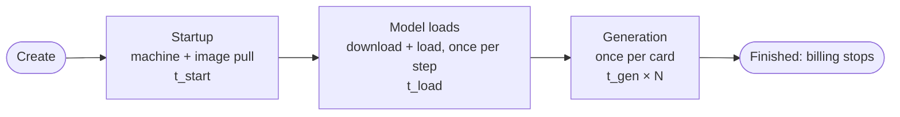

# 05 - Measuring Startup, Load and Generation Costs

<!-- Draft v4, 2026-11-15. Numbers: assets/example_runs/*.json (20 kids each, 2026-11-14), copied unchanged from the runs. Startup 157.7 s: one H100 Job on 2026-11-14 (not in metrics_batch.json). Prices: "The prices we use", read 2026-11-15 (spot snapshot 2026-11-14T15:05Z; fal checked 2026-11-15). Order: prices → analysis at regular prices → what spot prices change. When prices change: update cell 0 of the notebook and the price tables, then every [calc] below. -->

Say Santa's elves ran one batch Job that made animated gift cards for 20 kids: an illustration, a card, a short video clip, a spoken greeting and the final video with music, for each kid. On one H100 GPU, the worker ran for about 45 minutes `[measured]`, after a few minutes for the machine to start. So what does one card cost? And what would Santa's list of 200,000 kids cost?

There's no single answer. Starting the machine and loading the models is paid once per run. Making a card is paid once per card. In this lesson we split one run into those parts, turn them into a cost per card at different batch sizes, find the step that decides the bill, compare the most expensive step with a per-call API that sells the same model, compare four GPUs, and see what spot prices change.

You're done when you have:

- the per-step table for one run: each model's load time and the median time per card;
- the cost per card at N = 1, 10, 20 and 200 at regular prices, extrapolated from that one run;
- the cost per card on each GPU, and a breakeven N for the clip step against a per-call API for the same model, from our example runs;
- what spot prices change.

Time and cost: about 30 minutes, on your laptop. The notebook needs no GPU and no credits: it reads our example runs. You don't run anything new for this lesson:

- **One run is enough.** Use our H100 run, or the `metrics_batch.json` from your own 10-kid batch Job. One run gives the fixed part `F` and the per-card part `c`, and `F / N + c` extrapolates to any N.
- **No other GPUs.** The comparison across H100, H200, RTX PRO 6000 and L40S reads our runs.

## The example runs

The same worker made cards for the same 20 kids, once on each of four GPUs. Each run left one file, `metrics_batch.json`, written by the worker inside the Job. The timings are that file. `region`, `platform`, `preset` and `billing` were copied afterwards from `nebius ai job get`: the worker that wrote these runs could not see the Job, and the Job does not return an hourly price. The copies are in [assets/example_runs/](assets/example_runs/):

| File | GPU |
| --- | --- |
| [h100.json](assets/example_runs/h100.json) | NVIDIA H100 80GB: the main example |
| [h200.json](assets/example_runs/h200.json) | NVIDIA H200 |
| [rtx-pro-6000.json](assets/example_runs/rtx-pro-6000.json) | NVIDIA RTX PRO 6000 Blackwell |
| [l40s.json](assets/example_runs/l40s.json) | NVIDIA L40S, without the clip and mix steps |

Each run goes through the same steps, one after another. Each step loads its model once, makes its file for every kid, frees the GPU and moves on:

| Step | Model | Runs on |
| --- | --- | --- |
| 1. Text: the wish and greeting, copied from a CSV | none | CPU |
| 2. Illustration | Sana | GPU |
| 3. Card: illustration + name + wish | Pillow | CPU |
| 4. Clip: about 5 seconds of animation from the illustration | Wan2.2-I2V-A14B | GPU |
| 5. Greeting: text to speech | Kokoro-82M | GPU |
| 6. Mix: clip + greeting + music | ffmpeg | CPU |

A step's entry in `metrics_batch.json` looks like this (shortened to three of the 20 kids):

```json
"clip": {
  "load_s": 1045.976,
  "latency_s": {"k01": 77.732, "k02": 76.827, "k03": 76.437},
  "median_s": 76.675,
  "total_s": 2580.897
}
```

The file starts when the worker starts. The time before that, from **Create** until the container runs, is the startup: the machine starts and the worker image downloads. It isn't in the file. One H100 Job measured it at 157.7 s on 2026-11-14 `[measured: created_at → started_at from nebius ai job get]`, and the notebook uses that for every run.

We count the startup as billed time. That's an assumption: the docs say a Job bills its compute and storage "while running" ([Pricing and quotas](https://docs.nebius.com/serverless/pricing-quotas)) and don't say whether the minutes before the container starts count. So treat it as an upper bound. On an H100 at the regular price it's about $0.20 per run `[calc: 157.7 s × $4.50/h]`.

## Where the time goes

<!-- visual: id=V1 | teaches=which parts of a run are paid once and which per card | shape=timeline | must-be-accurate=phase order, field names | claims=example files -->



*Conceptual. Startup and model loads are paid once per run; generation once per card. Here the loads happen step by step between the generations, but each one is still paid once.*

Open [code/nb-measuring-costs.ipynb](code/nb-measuring-costs.ipynb) and run cell 0 and sections 1 and 2. They print the per-step table for the H100 run:

| Step | Runs on | Model load, s | First kid, s | Median per kid, s | Share of a card |
| --- | --- | --- | --- | --- | --- |
| Text | CPU | – | 0.0 | 0.0 | 0.0% |
| Illustration | GPU | 89.9 | 6.0 | 0.8 | 1.0% |
| Card | CPU | – | 0.4 | 0.4 | 0.5% |
| Clip | GPU | 1046.0 | 77.7 | 76.7 | 97.4% |
| Greeting | GPU | 7.3 | 2.2 | 0.2 | 0.2% |
| Mix | CPU | – | 0.6 | 0.6 | 0.7% |

*Measured: [assets/example_runs/h100.json](assets/example_runs/h100.json), 20 kids, NVIDIA H100 80GB, 2026-11-14. Share of a card: the step's median over the median card time, 78.7 s.*

<!-- visual: id=V2 | teaches=the clip decides both the fixed and the per-card time | shape=horizontal bars per step, load vs per card | must-be-accurate=values from h100.json | claims=measured -->

Four things to read from it:

- **Startup: 157.7 s** before the worker runs a line. This is the cold start.
- **Model loads: 1143.2 s,** and 1046.0 s of that is the clip model. Its weights are about 126 GB, downloaded at the start of the step on every run. <!-- c:M1-063 --> That's a design choice in this worker, not a law of nature: it's the first thing to fix.
- **One card: 78.7 s** (the median of the 20 cards, all six steps). The clip is 76.7 s of it.
- **The first asset of each model is slower:** 6.0 s for the first illustration, 0.8 s for the next ones. That's warm-up. We use the median per kid, so warm-up stays out of the per-card time. The projection below leaves it out too: across all six steps it's about 8 s per run, about $0.01 on an H100 `[calc: first kid − median, summed over the steps in h100.json]`.

The card and mix steps don't need a GPU, but they run on the GPU machine, so they bill at the GPU price. Here they're about 1 s per card, so it doesn't matter yet.

Fixed time is `t_start + t_load` = 1300.9 s. How much of the billed time is that, for a run of N cards? No prices needed yet:

| N cards | Projected billed time | Fixed part |
| --- | --- | --- |
| 1 | 23 min | 94% |
| 10 | 35 min | 62% |
| 20 | 48 min | 45% |
| 200 | 4.7 h | 8% |

*`[calc]` billed time ≈ 1300.9 s + N × 78.7 s.*

## From time to money

There are two different calculations, and they answer different questions:

- **Projected cost**, before a run: the fixed part plus N × the typical time per card, times a price. Use it to plan and to compare options.
- **Observed cost**, after a run: the billed duration of that run, times the rate it actually paid, plus the other resources it used, checked against **Billing → Usage**.

Everything from here to "What spot prices change" is a projection. The observed cost is in "Observed cost: check what a run cost" below.

Billing is per second while the machine runs, priced per hour: half an hour costs half the hourly price. <!-- c:M1-337 c:M1-338 --> A Job stops billing when it ends; an Endpoint bills while it's `RUNNING`, idle or not. <!-- c:M1-290 c:M1-291 --> So with a `rate` in dollars per second, the projection is:

- Marginal cost per card: `c = rate × t_gen`, with `t_gen` the median time per card.
- Fixed cost per run: `F = rate × (t_start + t_load)`. An Endpoint left idle adds `rate × t_idle`.
- Total per card for N cards: `F / N + c`.
- Breakeven against an API that charges `p` per asset: `N = ceil(F / (p − c))`, or `0` if `p ≤ c`.

**Assumptions:** one startup per run, billed in full; cards made one after another; no idle time.

**Left out of the projection:**

- The container disk: it bills alongside the GPU ([Pricing and quotas](https://docs.nebius.com/serverless/pricing-quotas)). Our 500 GB disk costs about $0.05 per hour, about 1% of an H100's regular price `[calc: 500 GiB × $0.071 per GiB per 730 h; Compute pricing]`.
- The first-asset warm-up: about 8 s per run (above).
- Failed or retried runs, engineering and ops time, bucket storage and egress, and quality differences against an API.

Each one makes self-hosting look cheaper than it is.

`c` is the *marginal* cost, never "the cost per card": with N = 1 the fixed part is most of the bill.

## The prices we use

Prices change, so the notebook keeps them all in one cell, **cell 0**, and every cost after it uses that cell. When prices change, update cell 0 and run the notebook again. These are the prices on the day we wrote this lesson.

### GPU prices for the calculations

| GPU | Platform, region | Regular, USD per hour | Spot, USD per hour |
| --- | --- | --- | --- |
| H100 | `gpu-h100-sxm`, eu-north1 | 4.50 | 2.07 |
| H200 | `gpu-h200-sxm`, eu-north1 | 5.40 | 2.48 |
| RTX PRO 6000 | `gpu-rtx6000-a`, uk-south2 | 1.80 | 1.38 |
| L40S, `1gpu-8vcpu-32gb` | `gpu-l40s-a`, eu-north1 | 1.55 | 0.75 (fixed preemptible price) |

*Regular: [Compute pricing](https://docs.nebius.com/compute/resources/pricing), read 2026-11-15. Spot: the public [spot-price API](https://docs.nebius.com/signup-billing/spot-prices), read 2026-11-15, snapshot 2026-11-14 15:05 UTC. L40S lists GPU, vCPU and RAM separately; the preset's price is GPU + 8 × vCPU + 32 × RAM.* <!-- c:M1-345 c:M1-346 -->

The **regular** (on-demand) price is fixed. The **spot** price is what preemptible GPUs pay, and our example runs were preemptible. Spot prices can change as often as every 15 minutes and differ by region. They're capped at one cent below the regular price, so the regular price is the most a preemptible GPU can cost per hour ([Compute pricing](https://docs.nebius.com/compute/resources/pricing)). <!-- c:M1-344 --> Read today's spot prices yourself, no login needed:

```bash
curl -s https://api.nebius.cloud/billing/v1alpha1/spot-price
```

### The per-call API: Wan 2.2 A14B on fal

We compare one step with a per-call API: the clip, because it's most of the card's cost. And we compare it only with the same model, so the price difference isn't a model difference.

| | |
| --- | --- |
| Provider and model | fal, [`fal-ai/wan/v2.2-a14b/image-to-video`](https://fal.ai/models/fal-ai/wan/v2.2-a14b/image-to-video): Wan 2.2 A14B, image-to-video, the model of our clip step |
| Listed price | $0.04 per video second at 480p ($0.06 at 580p, $0.08 at 720p), counting video seconds at 16 frames per second |
| Our clip | 480p, 81 frames at 16 fps = 5.06 video seconds, so `p` = $0.2025 per clip `[calc]` |
| Checked | 2026-11-15 |

> [!NOTE]
> This is fal's listed price on the day we checked it, not a measured run. Prices, available resolutions and the model itself can change at any time: on 2026-11-14 fal's API page said this endpoint will be removed on January 4, 2027. Check the [model page](https://fal.ai/models/fal-ai/wan/v2.2-a14b/image-to-video) before you quote the numbers, and update cell 0. <!-- c:M1-353 -->

## The analysis at regular prices

We start with regular prices: they're fixed, so the numbers stay comparable from day to day.

### Cost per card

Section 3.1 of the notebook prints the cost table for the H100 run:

| N cards | Per card | Whole run |
| --- | --- | --- |
| 1 | $1.72 | $1.72 |
| 10 | $0.26 | $2.61 |
| 20 | $0.18 | $3.59 |
| 200 | $0.11 | $21.31 |

*`[calc]` H100 run, regular [GPU prices](#gpu-prices-for-the-calculations). `c` = $0.098 per card, `F` = $1.63 per run.*

Santa's whole list, 200,000 cards on one H100, is about 4,400 GPU-hours, roughly half a year of one GPU running nonstop, and about $19,700 `[calc]`. Nearly all of that is `c`: at this size the fixed part disappears. That's the number Module 3 starts from.

### What to optimize

Each change moves one term of `F / N + c`. Section 3.2 of the notebook prints these; they're best cases from the example numbers, not measurements:

| Change | Term it moves | Per card at N = 10 | Where |
| --- | --- | --- | --- |
| As measured | – | $0.26 | – |
| Clip weights already on disk (cached or baked into the image) | `F`: the 1046.0 s clip load | $0.13 at best | Module 3 |
| Clip twice as fast (fewer steps or frames, faster kernels, another GPU) | `c` | $0.21 | Module 3 |
| More cards per run | `F / N` | $0.11 at N = 200 | this lesson |

*`[calc]` H100 run, regular [GPU prices](#gpu-prices-for-the-calculations). "At best": a cached model still takes some time to load from disk.*

Small batches are dominated by the weights download; large batches by the clip itself. So the order is: stop downloading 126 GB on every run, then make each clip cheaper.

**Parallel workers buy time with money.** Every worker pays its own startup and model loads. For 200 cards:

| Workers | Wall time | Cost |
| --- | --- | --- |
| 1 | 4.7 h | $21.31 |
| 4 | 1.5 h | $26.19 |
| 10 | 0.8 h | $35.94 |

*`[calc]` each worker pays `F` once; cards split evenly. H100 run, regular [GPU prices](#gpu-prices-for-the-calculations).*

With the clip weights cached, ten workers would cost about $22.87 at best, close to what one worker costs today `[calc: best case, clip load = 0]`. That's why caching comes before scaling out.

### Self-hosted vs the API: the clip step

Section 3.3 of the notebook takes the clip step alone on the H100: `F` is the startup plus the clip model's load, `c` is the median clip time. A one-step run has the same shape as any single-model run: one model, one load, N assets.

| Clips per run | Self-hosted, per clip | fal API, per clip |
| --- | --- | --- |
| 1 | $1.60 | $0.20 |
| 10 | $0.25 | $0.20 |
| 20 | $0.17 | $0.20 |
| 200 | $0.10 | $0.20 |

*`[calc]` H100 run, regular [GPU prices](#gpu-prices-for-the-calculations), fal's 480p [API price](#the-per-call-api-wan-22-a14b-on-fal).*

Breakeven: **15 clips per run** `[calc]`. Below that, the API is cheaper; above it, self-hosting is, by up to half per clip. Cache the weights and the breakeven drops, because `F` shrinks.

Price is one row of the decision:

| | Self-hosted Job | Per-call API |
| --- | --- | --- |
| Cost | `F / N + c`: cheap only in large batches | `p` per asset at any N |
| First clip | Startup, two model loads, 20 illustrations and cards, then the first clip: about 23 minutes here `[calc]` | One request; the provider keeps the model loaded |
| Settings | Everything: model revision, steps, seed, resolution | What the API exposes |
| Model stays available | As long as you keep the weights | As long as the provider keeps it |
| Your work | Image, quotas, weights, failures | An API key |

### Same cards, different GPUs

Section 3.4 of the notebook loops over the four runs:

| GPU | Regular, USD/h | Clip load, s | Clip, s per card | Card, s | `c` per card | Per card at N = 20 | Per card at N = 200 | Clip breakeven vs fal |
| --- | --- | --- | --- | --- | --- | --- | --- | --- |
| H100 | 4.50 | 1046 | 76.7 | 78.7 | $0.098 | $0.18 | $0.11 | 15 |
| H200 | 5.40 | 534 | 74.6 | 76.5 | $0.115 | $0.17 | $0.12 | 12 |
| RTX PRO 6000 | 1.80 | 531 | 123.6 | 125.6 | $0.063 | $0.081 | $0.065 | 3 |
| L40S | 1.55 | no clip step | – | – | – | – | – | – |

*Times measured: [assets/example_runs/](assets/example_runs/), one run per GPU, 20 kids each, 2026-11-14. Costs and breakevens `[calc]` at regular [GPU prices](#gpu-prices-for-the-calculations), with a 157.7 s startup for every GPU.*

Every GPU ran the illustration step, so that's where all four compare:

| GPU | Sana load, s | Per image, s | Per image, regular |
| --- | --- | --- | --- |
| H100 | 89.9 | 0.78 | $0.00098 |
| H200 | 52.4 | 0.78 | $0.00117 |
| RTX PRO 6000 | 51.0 | 0.92 | $0.00046 |
| L40S | 92.5 | 1.53 | $0.00066 |

*Times measured: [assets/example_runs/](assets/example_runs/), 2026-11-14. The L40S run is [l40s.json](assets/example_runs/l40s.json): text, illustration, card and greeting only. Costs `[calc]` at regular [GPU prices](#gpu-prices-for-the-calculations).*

Three findings:

1. **The fastest GPU doesn't make the cheapest card.** Cost per card is price × time. The RTX PRO 6000 is 1.6× slower per card than the H100, but 2.5× cheaper per hour, so its card is 36% cheaper.
2. **Model load time differs a lot between machines.** The same 126 GB of clip weights loaded in 1046 s on the H100 and in about 532 s on both the H200 and the RTX PRO 6000. Loading was consistently slower in our H100 runs (1046.0 s here, 1046.5 s in a 5-kid run); these measurements do not isolate the cause: download speed, disk, region, caching and model initialization all sit inside `load_s`. Caching the weights takes most of this difference away.
3. **A cheaper card changes the API decision.** The RTX PRO 6000 beats the API from 3 clips per run; the H100 needs 15. For the illustration step alone, the L40S is the slowest GPU but makes a cheaper image than the H100 or H200, and the RTX PRO 6000 makes the cheapest, so the GPU you'd pick depends on the step. Giving each step its own hardware is Module 3.

**Caveats**

- One run per GPU. The H100 is the only GPU we ran twice.
- Not every GPU is in every region. Our RTX PRO 6000 run was in uk-south2, the others in eu-north1. The pricing page lists the H100 only in eu-north1, and the RTX PRO 6000 in eu-south1, uk-south2 and us-central1, so download speeds and spot prices can differ by region.
- The L40S run ([l40s.json](assets/example_runs/l40s.json)) has no clip or mix step: the Wan2.2 image-to-video model needs an H100-class GPU, so the L40S appears in the illustration comparison only. <!-- c:M1-328 -->
- The startup was measured on one H100 Job; other GPUs may start faster or slower.

## What spot prices change

Our runs were preemptible, so they actually paid the spot price. Section 4 of the notebook recomputes everything above at the spot prices in cell 0:

| GPU | Regular → spot, USD/h | Saving | `c` per card | Per card at N = 20 | 200,000 cards | Clip breakeven vs fal |
| --- | --- | --- | --- | --- | --- | --- |
| H100 | 4.50 → 2.07 | 54% | $0.098 → $0.045 | $0.18 → $0.083 | $19,700 → $9,100 | 15 → 5 |
| H200 | 5.40 → 2.48 | 54% | $0.115 → $0.053 | $0.17 → $0.079 | $23,000 → $10,500 | 12 → 4 |
| RTX PRO 6000 | 1.80 → 1.38 | 23% | $0.063 → $0.048 | $0.081 → $0.062 | $12,600 → $9,600 | 3 → 2 |

*`[calc]` from the [GPU prices](#gpu-prices-for-the-calculations).*

What changes:

- **Every cost drops by the same share as the price.** Cost is price × time, and the times don't change. The H100 and H200 save 54%; the RTX PRO 6000 saves 23%, because its spot price is closer to its regular price.
- **The GPU ranking changes.** At regular prices the RTX PRO 6000 has the lowest marginal cost per card by far. At these spot prices the H100 has the lowest `c` ($0.045 vs $0.048), the three GPUs are within $0.01 of each other at N = 200, and the RTX PRO 6000 stays cheapest at N = 20, mostly because of its shorter clip load. Which GPU is cheapest depends on the price on the day you run.
- **The API decision moves.** At spot prices every GPU beats fal's per-call price from 2 to 5 clips per run, and at N = 200 a self-hosted clip on the H100 costs about a quarter of the API's price ($0.048 vs $0.20) `[calc]`.

**What spot prices cost you instead**

- **The price can move during a run,** up to one cent below the regular price. Set a lower maximum in a pricing policy if you need one. [Compute pricing](https://docs.nebius.com/compute/resources/pricing)
- **Nebius can take the GPU back.** A preempted Job ends in `ERROR` and isn't retried; the rerun pays the startup and the 1,046 s clip load again, and this worker starts again from the first kid. <!-- c:M1-296 --> Resuming where a run stopped is Module 3.
- **Our spot prices are a snapshot.** We read them before our runs started. A snapshot estimates a run's cost; it can't tell you what the run paid if the price changed during it. That's the observed cost below.

Use regular prices to compare and plan: they're fixed, and they're also the most a preemptible run can cost. Use the observed cost to know what a run actually cost.

## Observed cost: check what a run cost

The projection used typical times and a price you chose. The observed cost uses what the run actually did:

- **GPU time:** the billed duration × the rate the run paid. For a Job, the billed duration lies between `started_at` → `finished_at` and `created_at` → `finished_at` from `nebius ai job get <job_ID> --format json`: the docs don't say whether the startup bills (see "The example runs"). For an Endpoint, **Create** → **Stop**, idle time included.
- **The rate:** the regular price, or for a preemptible run the spot price during the run. The spot price can change every 15 minutes, so a single snapshot is an estimate; Billing → Usage is what you paid.
- **The container disk:** its size × $0.071 per GiB per 730 hours, for the same duration ([Compute pricing](https://docs.nebius.com/compute/resources/pricing)). A DevLab also bills its disk while stopped, until you delete it.
- **The bucket:** stored data and internet egress, billed separately ([Object Storage pricing](https://docs.nebius.com/object-storage/resources/pricing)).

For a Job, [code/reconcile_run.py](code/reconcile_run.py) reads the Job's JSON and your `metrics_batch.json` and prints the projected cost next to the observed range `[verify on first run]`:

```bash
nebius ai job get <job_ID> --format json > job.json
uv run python code/reconcile_run.py --job job.json --metrics metrics_batch.json \
  --rate 4.50 --disk-gib 500 --project 1000
```

Then check it against the console. It shows your balance under **Billing** and the spend per project, service and resource under **Billing → Usage**. The docs describe no separate "credits remaining" view. Usage is shown per hour, so it won't match to the second. [Billing: usage](https://docs.nebius.com/signup-billing/usage/view) <!-- c:M1-341 c:M1-342 c:M1-343 -->

## Common failures and recovery

| Mistake | Fix |
| --- | --- |
| A missing time treated as 0 | `calculate_cost` refuses `None`: measure it, or leave the run out |
| The weights download left out of `F` | It's inside the clip step's `load_s`; keep it |
| The startup left out of `F` | It isn't in `metrics_batch.json`; add it from the Job's `created_at` → `started_at` |
| CPU steps left out of the card's time | They run on the GPU machine and bill at the GPU price; the notebook sums all six steps |
| Spot and regular prices mixed in one table | Label each table with the price it used |
| A price for the wrong GPU, region or preset | Use the row for the run's platform and region; spot prices differ by region |
| L40S GPU price without its vCPU and RAM lines | Add all three for the preset |
| Old prices after a price change | Update cell 0 first, then run the notebook again |
| An API price in other units | Convert to per asset first: per video second × video seconds, per megapixel × megapixels |
| `c` called "the cost per card" | Say marginal; the total per card is `F / N + c` |
| An Endpoint left running | Idle adds `rate × t_idle`; stop it |
| The breakeven quoted alone | Keep the "left out" list next to it |
| A projection quoted as what a run cost | The projection uses typical times and a chosen price; what you spent is the observed cost, checked in Billing → Usage |
| The container disk neither counted nor mentioned | Add it to the observed cost, or say it's left out: about 1% of an H100 run here |

Next: Module 2 puts an agent in front of these models.

## References

- [Compute pricing](https://docs.nebius.com/compute/resources/pricing), Nebius
- [Getting spot prices](https://docs.nebius.com/signup-billing/spot-prices), Nebius
- [Serverless AI: jobs](https://docs.nebius.com/serverless/jobs/manage), Nebius
- [fal: Wan2.2-A14B image-to-video](https://fal.ai/models/fal-ai/wan/v2.2-a14b/image-to-video)
- [ServerlessLLM: low-latency serverless inference for large language models (OSDI '24)](https://arxiv.org/abs/2401.14351), Fu et al.: why loading weights dominates cold starts
- [Wan2.2-I2V-A14B](https://huggingface.co/Wan-AI/Wan2.2-I2V-A14B-Diffusers), model card
