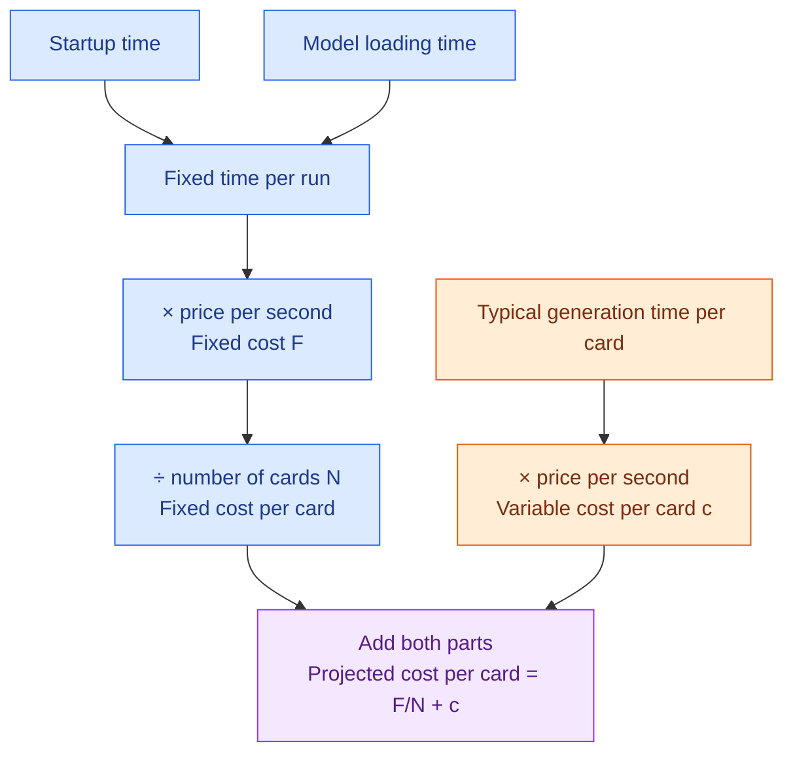

# 05 - Measuring Startup, Load and Generation Costs

> ⚠️ **Read this first**
>
> 💸 **Prices here are examples only.** They come from our runs and price checks on the dates shown, and what you pay can differ: prices change, and spot prices can change every 15 minutes. For real prices, see [Compute pricing](https://docs.nebius.com/compute/resources/pricing) and [spot prices](https://docs.nebius.com/signup-billing/spot-prices).
>
> ⚠️ **Remove all running resources after the lesson to prevent bills.** Stop or delete every Endpoint, Job and DevLab you started, even after a failed run, and delete bucket data you no longer need. An Endpoint or DevLab keeps billing while it runs, even when idle.

<!-- Draft v5, 2026-11-16. Numbers: assets/example_runs/*.json (20 kids each, 2026-11-14), copied unchanged from the runs. Startup 157.7 s: one H100 Job on 2026-11-14 (not in metrics_batch.json). Prices: the notebook's "Prices and assumptions" (read 2026-11-15; spot snapshot 2026-11-14T15:05Z; fal checked 2026-11-15). Figures: .DEV/scripts/make_05_figures.py reads the example runs and that notebook cell. When prices change: update "Prices and assumptions", rerun the notebook and the figure script, then recheck every [calc] below. -->

Say Santa's elves ran one batch Job that made animated gift cards for 20 kids: an illustration, a card, a short video clip, a spoken greeting and the final video with music, for each kid. On one H100 GPU, the worker ran for about 45 minutes in our run on 2026-11-14, after a few minutes for the machine to start. So what does one card cost? And what would Santa's list of 200,000 kids cost?

There's no single answer. Starting the machine and loading the models is paid once per run. Making a card is paid once per card. In this lesson we split one run into those parts, turn them into a cost per card at different batch sizes, find the step that decides the bill, compare the most expensive step with a per-call API that sells the same model, compare four GPUs, and see what spot prices change.

You're done when you have:

- the per-step table for one run: each model's load time and the median time per card;
- the cost per card at N = 1, 10, 20 and 200 at regular prices, extrapolated from that one run;
- the cost per card on each GPU, and a breakeven N for the clip step against a per-call API for the same model, from our example runs;
- what spot prices change.

Time and cost: about 30 minutes, on your laptop. The notebook needs no GPU and no credits: it reads our example runs. You don't run anything new for this lesson:

- **One run is enough.** Use our H100 run, or the `metrics_batch.json` from your own 10-kid batch Job, downloaded before lesson 04's clean-up. One run gives the fixed part `F` and the per-card part `c`, and `F / N + c` extrapolates to any N.
- **No other GPUs.** The comparison across H100, H200, RTX PRO 6000 and L40S reads our runs.

## The example runs

The same worker made cards for the same 20 kids, once on each of four GPUs. Each run left one file, `metrics_batch.json`, written by the worker inside the Job. The timings are that file. `region`, `platform`, `preset` and `billing` were copied afterwards from `nebius ai job get`: the worker that wrote these runs could not see the Job, and the Job does not return an hourly price. The copies are in [assets/example_runs/](assets/example_runs/):

- [h100.json](assets/example_runs/h100.json): NVIDIA H100 80GB, the main example
- [h200.json](assets/example_runs/h200.json): NVIDIA H200
- [rtx-pro-6000.json](assets/example_runs/rtx-pro-6000.json): NVIDIA RTX PRO 6000 Blackwell
- [l40s.json](assets/example_runs/l40s.json): NVIDIA L40S, without the clip and mix steps

The worker runs six steps for every kid, one step at a time: text from a CSV, an illustration (Sana), the card image (Pillow, CPU), a 5-second clip animated from the illustration (Wan2.2-I2V-A14B), a spoken greeting (Kokoro-82M), and the final video with music (ffmpeg, CPU). Each step loads its model once, makes its file for every kid, frees the GPU and moves on.

A step's entry in `metrics_batch.json` looks like this (shortened to three of the 20 kids):

```json
"clip": {
  "load_s": 1045.976,
  "latency_s": {"k01": 77.732, "k02": 76.827, "k03": 76.437},
  "median_s": 76.675,
  "total_s": 2580.897
}
```

The file starts when the worker starts. The time before that, from **Create** until the container runs, is the startup: the machine starts and the worker image downloads. It isn't in the file. One H100 Job measured it at 157.7 s on 2026-11-14, from the Job's `created_at` and `started_at`, and the notebook uses that for every run.

**Assumed:** we count the startup as billed time. The docs say a Job bills its compute and storage "while running" ([Pricing and quotas](https://docs.nebius.com/serverless/pricing-quotas)) and don't say whether the minutes before the container starts count. Counting it is conservative for that one part: if the startup doesn't bill, every projection below is about $0.20 per run too high on an H100 at the regular price `[calc: 157.7 s × $4.50/h]`. That doesn't make the projection an upper bound: it leaves out the disk, the first-asset warm-up and retries (see "Left out of the projection"), and those push the real cost up.

## Where the time goes

Open [code/nb-measuring-costs.ipynb](code/nb-measuring-costs.ipynb) and run "Prices and assumptions", "Load one run" and "Where the time goes". The notebook prints the full per-step table; the figure shows the two parts that matter.


*Measured: [h100.json](assets/example_runs/h100.json), NVIDIA H100 80GB, 20 kids, 2026-11-14. Blue: paid once per run. Orange: paid once per card. "No model": the step loads nothing, which isn't the same as a load time of zero.*

**Takeaway:** the video step dominates both: 1,046 seconds to load, 76.7 seconds per card.

Three things the figure doesn't show:

- **The clip load is mostly a download.** The model's weights are about 126 GB, fetched at the start of the step on every run. <!-- c:M1-063 --> That's a design choice in this worker, and the first thing to fix.
- **The first asset of each model is slower.** The first illustration took 6.0 s, the typical one 0.8 s. That's warm-up. The median per kid keeps it out of the per-card time; across all six steps it adds about 8 s per run `[calc]`.
- **The CPU steps bill at the GPU price,** because they run on the GPU machine. Here they're about 1 s per card, so it doesn't matter yet.

## From time to money

There are two different calculations, and they answer different questions:

- **Projected cost**, before a run: the fixed part plus N × the typical time per card, times a price. Use it to plan and to compare options.
- **Reconstructed cost**, after a run: the run's duration, times the rate it paid, plus the other resources it used. An estimate from what the run did.
- **Verified spend**: what **Billing → Usage** shows for the run. Only this is what you paid.

Everything from here to "What spot prices change" is a projection. The other two are in "After a run: reconstructed cost and verified spend" below.

Billing is per second while the machine runs, priced per hour: half an hour costs half the hourly price. <!-- c:M1-337 c:M1-338 --> A Job stops billing when it ends; an Endpoint bills while it's `RUNNING`, idle or not. <!-- c:M1-290 c:M1-291 --> So the projection splits into a part paid once per run and a part paid once per card:



*Conceptual. Blue: paid once per run. Orange: paid once per card. Purple: both together. The figures below use the same colours.*

**Projected cost per card = F/N + c**

For the H100 run at the regular price, at N = 20: $1.63 / 20 + $0.098 ≈ **$0.18 per card** `[calc]`.

Against a per-call API that charges `p` per asset, the breakeven is `N = ceil(F / (p − c))` assets per run: from that N on, self-hosting is cheaper. If `p ≤ c`, there is no finite breakeven, because self-hosting never wins (assuming `F > 0`). The notebook prints that case as "never (0)"; `0` is the convention the homework uses for it.

**Assumptions:** one startup per run, billed in full; cards made one after another; no idle time. An Endpoint left idle adds `price per second × idle time` to `F`.

**Left out of the projection:**

- The container disk: it bills alongside the GPU ([Pricing and quotas](https://docs.nebius.com/serverless/pricing-quotas)). Our 500 GB disk costs about $0.05 per hour, about 1% of an H100's regular price `[calc]`.
- The first-asset warm-up: about 8 s per run (above).
- Failed or retried runs, engineering and ops time, bucket storage and egress, and quality differences against an API.

Each one makes self-hosting look cheaper than it is.

`c` is the *marginal* cost, never "the cost per card": with N = 1 the fixed part is most of the bill.

## Prices and assumptions

Prices change, so the notebook keeps them all in one place, **"Prices and assumptions"**, and every cost after it uses that section. When prices change, update it and run the notebook again. These are the prices on the day we wrote this lesson.

### GPU prices for the calculations

| GPU | Platform, region | Regular, USD per hour | Spot, USD per hour |
| --- | --- | --- | --- |
| H100 | `gpu-h100-sxm`, eu-north1 | 4.50 | 2.07 |
| H200 | `gpu-h200-sxm`, eu-north1 | 5.40 | 2.48 |
| RTX PRO 6000 | `gpu-rtx6000-a`, uk-south2 | 1.80 | 1.38 |
| L40S, `1gpu-8vcpu-32gb` | `gpu-l40s-a`, eu-north1 | 1.55 | 0.75 (fixed preemptible price) |

*Regular: [Compute pricing](https://docs.nebius.com/compute/resources/pricing), read 2026-11-15. Spot: the public [spot-price API](https://docs.nebius.com/signup-billing/spot-prices), read 2026-11-15, snapshot 2026-11-14 15:05 UTC. L40S lists GPU, vCPU and RAM separately; the preset's price is GPU + 8 × vCPU + 32 × RAM.* <!-- c:M1-345 c:M1-346 -->

The **regular** (on-demand) price is fixed. The **spot** price is what preemptible GPUs pay, and our example runs were preemptible. Spot prices can change as often as every 15 minutes and differ by region. They aren't capped: a spot price can rise above the regular price ([Compute pricing](https://docs.nebius.com/compute/resources/pricing)). To limit it, set a max price in a [pricing policy](https://docs.nebius.com/signup-billing/pricing-policy); `--follows-spot-price`, which lesson 04 uses by default, sets none. <!-- c:M1-344 --> Read today's spot prices yourself, no login needed:

```bash
curl -s https://api.nebius.cloud/billing/v1alpha1/spot-price
```

### The per-call API: Wan 2.2 A14B on fal

We compare one step with a per-call API: the clip, because it's most of the card's cost. [fal](https://fal.ai/models/fal-ai/wan/v2.2-a14b/image-to-video) sells the same model, Wan 2.2 A14B image-to-video, so the price difference isn't a model difference. It charges per video second by resolution, counting video seconds at 16 frames per second. For our 480p clip:

**81 frames ÷ 16 fps × $0.04 per video second = $0.2025 per clip** `[calc]`

> [!NOTE]
> This is fal's listed price on 2026-11-15, not a measured run. Prices, available resolutions and the model itself can change at any time: on 2026-11-14 fal's API page said this endpoint will be removed on January 4, 2027. Check the [model page](https://fal.ai/models/fal-ai/wan/v2.2-a14b/image-to-video) before you quote the numbers, and update "Prices and assumptions". <!-- c:M1-353 -->

## The analysis at regular prices

We start with regular prices: they're fixed, so the numbers stay comparable from day to day.

### Batch size and what to optimize

The notebook's "Cost per card" and "What to optimize" sections print the numbers; the figure puts them on one chart.


*Projected `[calc]`: H100, regular [GPU price](#gpu-prices-for-the-calculations), from the measured loads and median per-card time in [h100.json](assets/example_runs/h100.json) plus the 157.7 s startup. Left out: disk, warm-up, retries. Cached weights are a best case, clip load time set to zero: real cached weights still take some time to load from disk.*

**Takeaway:** reducing loading time helps small batches most; faster generation becomes more valuable as batches grow. The two cross at about N = 27 cards per run `[calc]`.

At Santa's scale it's all generation: 200,000 cards on one H100 is about 4,400 GPU-hours, roughly half a year of one GPU running nonstop, and about $19,700 at the regular price `[calc]`. The fixed part disappears. That's the number Module 3 starts from. The notebook also prints the whole-run cost for each N.

### Parallel workers

**Parallel workers buy time with money.** Every worker pays its own startup and model loads. For 200 cards:

| Workers | Wall time | Cost |
| --- | --- | --- |
| 1 | 4.7 h | $21.31 |
| 4 | 1.5 h | $26.19 |
| 10 | 0.8 h | $35.94 |

*Projected `[calc]`: H100, regular [GPU price](#gpu-prices-for-the-calculations). Assumed: the cards split evenly, each worker pays one startup and one set of model loads, and the workers run fully in parallel.*

**Takeaway:** more workers reduce elapsed time while repeating the fixed overhead. With the clip weights cached, ten workers would cost about $22.87 at best, close to what one worker costs today `[calc]`. That's why caching comes before scaling out.

### Self-hosted vs the API: the clip step

The notebook's "Self-hosted vs a per-call API" section takes the clip step alone on the H100: `F` is the startup plus the clip model's load, `c` is the median clip time. A one-step run has the same shape as any single-model run: one model, one load, N assets. A clip and a whole card are different outputs, so this comparison has its own chart.


*Projected `[calc]`: H100, regular [GPU price](#gpu-prices-for-the-calculations), fal's 480p [API price](#the-per-call-api-wan-22-a14b-on-fal). Clip load and median clip time from [h100.json](assets/example_runs/h100.json), plus the 157.7 s startup. The notebook prints larger batches too: about $0.10 per clip at N = 200.*

**Takeaway:** the API avoids the fixed startup and load; self-hosting spreads them across enough clips. Here that's **15 clips per run** `[calc]`. Cache the weights and the breakeven drops, because `F` shrinks.

Price isn't the whole decision. Self-hosting gives you full control of the model revision, steps, seed and resolution, and the model stays available as long as you keep the weights. It also leaves you the operational work: the image, quotas, weights and failures, and about 23 minutes before the first clip in this worker `[calc]`. The API needs only a key, returns the first clip after one request, and exposes only the settings the provider chooses, for as long as the provider keeps the model.

### Same cards, different GPUs

The notebook's "Same cards, different GPUs" section loops over the four runs and prints load times and breakevens as well:

| GPU | Seconds per card | USD per card at N = 20, regular | USD per card at N = 200, regular |
| --- | ---: | ---: | ---: |
| H100 | 78.7 | 0.18 | 0.11 |
| H200 | 76.5 | 0.17 | 0.12 |
| RTX PRO 6000 | 125.6 | 0.081 | 0.065 |

*Seconds per card measured: [assets/example_runs/](assets/example_runs/), one run per GPU, 20 kids each, 2026-11-14. Costs projected at regular [GPU prices](#gpu-prices-for-the-calculations), with a 157.7 s startup for every GPU. The L40S run isn't in this table: it omitted the clip and mix steps, so it has no full-card cost.*

**Takeaway:** faster hardware doesn't necessarily produce cheaper cards.

1. **Cost per card is price × time.** The RTX PRO 6000 is 1.6× slower per card than the H100, but 2.5× cheaper per hour, so its card is 36% cheaper.
2. **Model load time differs a lot between machines.** The same 126 GB of clip weights loaded in 1,046 s on the H100 and in about 532 s on both the H200 and the RTX PRO 6000. Loading was consistently slower in our H100 runs (1046.0 s here, 1046.5 s in a 5-kid run); these measurements don't isolate the cause: download speed, disk, region, caching and model initialization all sit inside `load_s`. Caching the weights takes most of this difference away.
3. **A cheaper card changes the API decision.** For the clip step against fal, the RTX PRO 6000 breaks even at 3 clips per run and the H200 at 12, against 15 for the H100 `[calc]`.

**Caveats**

- One run per GPU. The H100 is the only GPU we ran twice.
- Not every GPU is in every region. Our RTX PRO 6000 run was in uk-south2, the others in eu-north1. The pricing page lists the H100 only in eu-north1, and the RTX PRO 6000 in eu-south1, uk-south2 and us-central1, so download speeds and spot prices can differ by region.
- The L40S run ([l40s.json](assets/example_runs/l40s.json)) has no clip or mix step: the Wan2.2 image-to-video model needs an H100-class GPU. <!-- c:M1-328 -->
- The startup was measured on one H100 Job; other GPUs may start faster or slower.

<details>
<summary>Optional: the illustration step on all four GPUs</summary>

Every GPU ran the illustration step, so that's where all four compare. The GPU you'd pick depends on the step: giving each step its own hardware is Module 3.

| GPU | Sana load, s | Per image, s | Per image, regular |
| --- | ---: | ---: | ---: |
| H100 | 89.9 | 0.78 | $0.00098 |
| H200 | 52.4 | 0.78 | $0.00117 |
| RTX PRO 6000 | 51.0 | 0.92 | $0.00046 |
| L40S | 92.5 | 1.53 | $0.00066 |

*Times measured: [assets/example_runs/](assets/example_runs/), 2026-11-14. Costs projected at regular [GPU prices](#gpu-prices-for-the-calculations).*

</details>

## What spot prices change

Our runs were preemptible, so they paid spot prices. The notebook's "What spot prices change" section recomputes everything above at the spot prices in "Prices and assumptions".


*Projected `[calc]` using the recorded price snapshot, not what the runs paid: marginal cost per card `c` from the measured median per-card time in each run, at the regular and spot [GPU prices](#gpu-prices-for-the-calculations). The snapshot was taken before the runs started.*

**Takeaway:** GPU rankings depend on both execution time and the applicable price.

- **Every cost drops by the same share as the price.** Cost is price × time, and the times don't change. The H100 and H200 save 54%; the RTX PRO 6000 saves 23%, because its spot price is closer to its regular price.
- **The cheapest marginal cost doesn't guarantee the cheapest small batch.** At this snapshot the H100 has the lowest `c`, but the RTX PRO 6000 is still cheapest at N = 20, mostly because its clip model loads twice as fast. At N = 200 the three are within $0.01 per card `[calc]`.
- **The API decision moves.** At spot prices every GPU beats fal's per-call price from 2 to 5 clips per run `[calc]`.

**What spot prices cost you instead**

- **The price can move during a run,** and it can go above the regular price. A pricing policy sets a max price; if spot goes above it, the Job is stopped. [Compute pricing](https://docs.nebius.com/compute/resources/pricing), [pricing policies](https://docs.nebius.com/signup-billing/pricing-policy)
- **Nebius can take the GPU back.** A preempted Job ends in `ERROR` and isn't retried; the rerun pays the startup and the 1,046 s clip load again, and this worker starts again from the first kid. <!-- c:M1-296 --> Resuming where a run stopped is Module 3.
- **Our spot prices are a snapshot.** A snapshot projects a run's cost; it can't tell you what the run paid if the price changed during it. Only Billing → Usage can (below).

Use regular prices to compare and plan: they're fixed. They aren't a ceiling for a preemptible run unless you set a max price in a pricing policy. Use Billing → Usage to know what a run actually cost.

## After a run: reconstructed cost and verified spend

The projection used typical times and a price you chose. The reconstructed cost uses what the run actually did:

- **GPU time:** the billed duration × the rate the run paid. For a Job, the billed duration lies between `started_at` → `finished_at` and `created_at` → `finished_at` from `nebius ai job get <job_ID> --format json`: the docs don't say whether the startup bills (see "The example runs"). For an Endpoint, **Create** → **Stop**, idle time included.
- **The rate:** the regular price, or for a preemptible run the spot price during the run. The spot price can change every 15 minutes, so a single snapshot is an estimate; Billing → Usage is what you paid.
- **The container disk:** its size × $0.071 per GiB per 730 hours, for the same duration ([Compute pricing](https://docs.nebius.com/compute/resources/pricing)). A DevLab also bills its disk while stopped, until you delete it.
- **The bucket:** stored data and internet egress, billed separately ([Object Storage pricing](https://docs.nebius.com/object-storage/resources/pricing)).

**Worked example: the H100 run, 20 cards, at the spot price snapshot**

1. **Projected compute cost: $1.65.** Startup + model loads + 20 × the median card time = 2,875 s, at $2.07 per hour `[calc]`.
2. **Reconstructed cost range: $1.60–$1.70.** GPU time from the worker's 2,726 s runtime, without and with the 157.7 s startup, at the same price, plus the 500 GB disk for the same time `[calc]`.
3. **Billing → Usage amount: not available yet.** This is the verified spend; we haven't recorded it for this run.

The projection and the range agree to within a few cents for two reasons. The worker's real runtime is 8 s longer than the projected time, because the median leaves out the first-asset warm-up. And the range adds the disk, which the projection leaves out. Neither is the bill: the spot price may have moved during the run, and only Billing → Usage shows what it was.

For a Job, the times come from `nebius ai job get <job_ID> --format json`:

```text
range ≈ rate × (finished_at − started_at)             # if the startup doesn't bill
      … rate × (finished_at − created_at)             # if it does
      + disk GiB × $0.071 / 730 × the same hours
```

Then check it against the console. It shows your balance under **Billing** and the spend per project, service and resource under **Billing → Usage**. The docs describe no separate "credits remaining" view. Usage is shown per hour, so it won't match to the second. [Billing: usage](https://docs.nebius.com/signup-billing/usage/view) <!-- c:M1-341 c:M1-342 c:M1-343 -->

To apply the same three values to a run of your own, use the notebook's optional practice section.

## Measure a run of your own (homework)

The homework needs a new run: one model, ten assets, one startup, one model load. Our example runs and lesson 02's three-image runs don't count. Measure three things:

| You run | Startup + readiness | Generation, per asset |
| --- | --- | --- |
| Endpoint | One interval: from clicking **Create** to the first answer from `/v1/models`. Lesson 02's notebook computes it as `create_to_ready_s` if you type in the time you clicked **Create** | `latency_s` per request, from your laptop |
| Job | `created_at` → `started_at` from `nebius ai job get <job_ID> --format json`, plus the model's `load_s` | `latency_s` in `metrics_batch.json` |
| DevLab | **Create** → `RUNNING`, plus the model's `load_s` | The notebook's time per asset |

For an Endpoint, don't add up the console's `RUNNING` time and the notebook's polling time: the polling starts when you run the cell, so any gap before that is lost. One interval from **Create** has no gap.

The lesson 02 notebooks save these fields in `metrics.json`. To get ten assets, change their step 4 loop from `range(3)` to `range(10)`, then load the file in this notebook's section 5. What you report is a projection; section 6 checks it against Billing → Usage.

## Common failures and recovery

**Measurements**

- [ ] No missing time treated as 0. `calculate_cost` refuses `None`, and the notebook's `model_loads()` raises on a GPU step with no `load_s`. Only the CPU steps (text, card, mix) have no load time, because they load no model.
- [ ] The weights download is in `F`. It's inside the clip step's `load_s`; keep it.
- [ ] The startup is in `F`. It isn't in `metrics_batch.json`; add it from the Job's `created_at` → `started_at`.
- [ ] The CPU steps are in the card's time. They run on the GPU machine and bill at the GPU price; the notebook sums all six steps.

**Prices**

- [ ] Each table and chart says whether it used spot or regular prices.
- [ ] The price matches the run's GPU, region and preset. Spot prices differ by region.
- [ ] L40S prices include the vCPU and RAM lines, not just the GPU.
- [ ] After a price change, "Prices and assumptions" was updated first and the notebook rerun.
- [ ] API prices are converted to per asset first: per video second × video seconds, per megapixel × megapixels.

**Interpretation**

- [ ] `c` is called the marginal cost, never "the cost per card"; the total per card is `F / N + c`.
- [ ] No Endpoint was left running. Idle adds `price per second × idle time`.
- [ ] A breakeven is quoted with the "left out" list next to it.
- [ ] A projection isn't quoted as what a run cost, and neither is a reconstruction. What you spent is the verified spend in Billing → Usage.
- [ ] The container disk is either counted or said to be left out: about 1% of an H100 run here.

> ⚠️ **Remove all running resources after the lesson to prevent bills.** Stop or delete every Endpoint, Job and DevLab you started, even after a failed run, and delete bucket data you no longer need. An Endpoint or DevLab keeps billing while it runs, even when idle.

## References

- [Compute pricing](https://docs.nebius.com/compute/resources/pricing), Nebius
- [Getting spot prices](https://docs.nebius.com/signup-billing/spot-prices), Nebius
- [Serverless AI: jobs](https://docs.nebius.com/serverless/jobs/manage), Nebius
- [fal: Wan2.2-A14B image-to-video](https://fal.ai/models/fal-ai/wan/v2.2-a14b/image-to-video)
- [ServerlessLLM: low-latency serverless inference for large language models (OSDI '24)](https://arxiv.org/abs/2401.14351), Fu et al.: why loading weights dominates cold starts
- [Wan2.2-I2V-A14B](https://huggingface.co/Wan-AI/Wan2.2-I2V-A14B-Diffusers), model card
