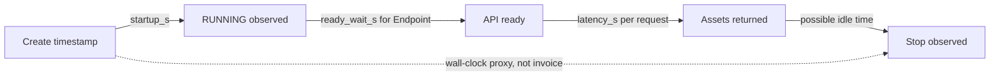

# 1.5 Measuring Startup, Load and Generation Costs


We use timestamps and generation timers to explain the cost of an asset. You will produce a `metrics.json`, calculate marginal compute cost, project a run at 1, 10 and 100 assets, and find a breakeven against a per-call API. The projections do not require generating 100 paid assets.

## Four measurements answer different questions

A request that takes a long time does not tell us whether the model was downloading, loading or generating. Separate the intervals before multiplying anything by a price.

| Field | What it measures | Where it comes from |
|---|---|---|
| `startup_s` | Create/submission to observed RUNNING | Your recorded lifecycle timestamps |
| `ready_wait_s` | Observed RUNNING to first successful model-list probe | Endpoint client plus RUNNING timestamp |
| `load_s` | Model load in the worker | Internal timer, including missing-weight downloads |
| `latency_s` | One sample per asset | Endpoint request/response latency or synchronized worker generation |
| `billable_s` | Create to terminal/stop wall time proxy | Your lifecycle timestamps; not an invoice measurement |

Unavailable fields are `null`, not zero. The Endpoint's readiness wait includes more than pure model load; the worker's `load_s` is a different observation. Do not add both together. The Endpoint server logs a “ready in” duration, but the client cannot automatically read those logs; `load_s` stays null unless independently measured and documented.



Lifecycle observation includes console refresh or polling delay. If you start polling an already warm Endpoint, you cannot reconstruct its cold readiness time. The code stores `probe_wait_s` separately and leaves `ready_wait_s` null when no RUNNING timestamp was supplied. Record how the timestamps were obtained and any delay in [run-report.md](run-report.md).

## Collect an Endpoint run

Before creating the Endpoint, record an ISO timestamp with timezone; record RUNNING when first observed. Start the measuring client promptly after that observation. Supply your actual values, not the symbolic names in this example:

```bash
uv run python 01-consistent-media-generation-on-serverless-gpus/code/measure_endpoint.py \
  --created-at "$CREATED_AT" --running-at "$RUNNING_AT" --n 3
```

The client writes the same metrics as `call_endpoint.py`, with the lifecycle inputs attached. It does not create or stop the Endpoint. After the final image, stop/delete the Endpoint and record the observed finish time. Enrich the saved file with the complete wall interval:

```bash
uv run python 01-consistent-media-generation-on-serverless-gpus/code/measure_job.py \
  "$METRICS_PATH" --created-at "$CREATED_AT" --running-at "$RUNNING_AT" \
  --finished-at "$FINISHED_AT"
```

Despite its filename, this enrichment command works for both resource types. It validates timezone-aware chronological timestamps and labels `billable_s` as a wall-clock proxy. It never claims the whole submission interval was billed.

## Collect a Job or JupyterLab run

The worker already records `load_s`, generation samples and runtime details. Download `metrics.json` from the bucket and run the same enrichment command using the Job's timestamps. For JupyterLab, record Devlab startup separately from when you execute the notebook. A long gap between those events is idle time, not model loading.

Keep all original latency samples. The first generation can include warm-up overhead; later requests may differ. HW1 asks for the median of at least three same-configuration runs. Report which samples you used and avoid calling a tiny sample a latency distribution benchmark. The Job timer excludes PNG file saving; the Endpoint timer includes response transfer. State that boundary when comparing them.

## From seconds to a cost model

Look up the current [Compute rate](https://docs.nebius.com/compute/resources/pricing) for your actual region and preset. Record the URL, date, currency and what's included. Do not mix a per-GPU rate with a whole-VM rate or apply one constant rate to a changing spot-price interval without explaining the approximation.

Let `r` be the selected compute rate per hour divided by 3600. Let `t_gen` be the median latency. Use `ready_wait_s` for an Endpoint and `load_s` for a Job/JupyterLab as `t_ready`.

```text
marginal compute cost:        c = r × t_gen
fixed run estimate:          F = r × (startup_s + t_ready + idle_s)
projected cost per asset:        F / N + c
```

This model assumes one startup, sequential generation and a constant compute rate. Idle time defaults to zero. It estimates compute only; storage, transfers, failed attempts, taxes and other services need separate accounting. Cold startup may be amortized over many assets, but a retry that creates a new worker incurs another startup.

Do not replace total cost per asset with `c`: that would discard all fixed overhead. Conversely, do not add `F` to `r × billable_s`; the wall interval already includes startup, generation and idle portions. The latter is an alternative observed wall-clock proxy, not another component.

## Calculate 1, 10 and 100 assets

```bash
uv run python 01-consistent-media-generation-on-serverless-gpus/code/cost.py \
  "$METRICS_PATH" --price-per-hour "$PRICE_PER_HOUR" --n 1 10 100 \
  --api-price "$API_PRICE_PER_ASSET"
```

The output includes `marginal_compute_usd`, `fixed_run_usd`, a projection for each N and `breakeven_assets`. Run it separately for the Endpoint and Job metrics and compare the two rows in [run-report.md](run-report.md). A missing startup/readiness value is an error: fill the evidence gap instead of inventing zero.

There is no measured Sana reference result bundled with this draft. The automated Python tests use synthetic inputs to check the arithmetic. Use your own measured metrics and current rate for this exercise.

## Breakeven with a per-call API

Find a per-call API for the same model, or clearly label the closest equivalent. Match resolution, duration, quality and included services. Record its price source and access date. If its price per asset is `p`, solve:

```text
F / N + c <= p
N >= F / (p - c)
```

For `p > c`, round up to the first whole positive number of assets. If `p <= c`, use `0` for the homework's “no breakeven” convention. This is a sequential-run comparison; it is not a general claim that self-hosting is cheaper at that traffic volume. An intermittently used Endpoint may accrue much more idle cost.

## Try it: add idle time

Repeat the calculation with `--idle-seconds 600` and a count of your choice. This is a hypothetical ten-minute idle gap, not a measured run. Before running the command, predict the change: marginal cost stays the same; fixed cost rises by `r × 600`; cost per asset rises by `(r × 600) / N`. Check those relationships in the output.

Finish [Homework 1](../cohorts/2026/homework/01-consistent-media-generation-on-serverless-gpus/homework.md) with your own asset and measured evidence. Use [proposal-template.md](proposal-template.md) to sketch how a second media model could extend your idea. Confirm all GPU resources have stopped. In [Module 2](../02-multi-agent-media-workflows/01-agent-loop.md), the agent will choose when to call these generation functions.
