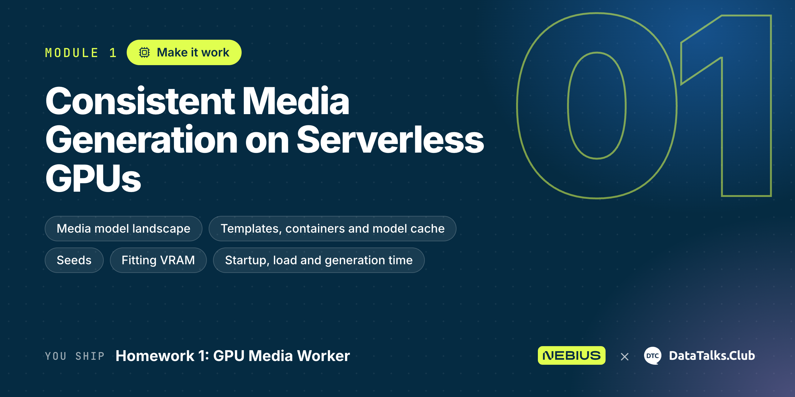
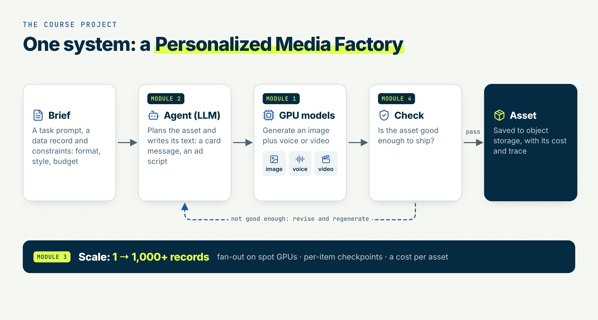

<p align="center">
  
</p>

# Module 1: Consistent Media Generation on Serverless GPUs

Welcome to Module 1 of Production AI Agents for Generative Media! These two weeks we make it work: run image, video and audio models on serverless GPUs, for serving and for batch, and measure what one asset costs.

> [!NOTE]
> Get an account, a project and GPU credits through the [Nebius AI Builder Program](https://dev.nebius.com/builders) before you start.

> [!WARNING]
> Make sure you stop or delete your resources (Endpoints, Jobs, JupyterLab) when you finish the module to avoid charges. An Endpoint bills while it's RUNNING, even when it serves no requests.

* Video Link (Coming Soon)
* Slides (Coming Soon)

<p align="center">
  
</p>

## What you will learn

By the end of this module, you will be able to:

* Compare generative media modalities and model families (size, VRAM, latency, quality, licence) and explain why video is expensive
* Generate your first image, video or audio asset in minutes: through an Endpoint, or in JupyterLab on a GPU
* Explain what goes into a container for generative AI and what stays out of it (weights, secrets, outputs)
* Run the same generation for serving (Endpoint) and for batch inference (Job), and choose between them
* Measure startup, readiness and generation time, and turn them into marginal and total cost per asset

## Lessons

1. [1.1 Landscape: Modalities and Model Families](01-landscape.md)
2. [1.2 First Media Generation in a Few Minutes](02-first-generation.md)
3. [1.3 Containers for Generative AI](03-containers.md)
4. [1.4 Serving vs Batch Inference: the Same Generation for Different Use Cases](04-serving-vs-batch.md)
5. [1.5 Measuring Startup, Load and Generation Costs](05-measuring-costs.md)

## Models used in this module

All with 1-click templates in the [Serverless AI Cookbook](https://github.com/nebius/serverless-ai-cookbook/blob/main/templates/README.md). The default path is [Sana](https://github.com/nebius/serverless-ai-cookbook/blob/main/templates/endpoint-sana/README.md) on L40S; the others are there to explore.

| Task | Model | Template GPU |
|---|---|---|
| Text-to-image | [Sana](https://github.com/nebius/serverless-ai-cookbook/blob/main/templates/endpoint-sana/README.md) | L40S |
| Text-to-image | [Qwen-Image](https://github.com/nebius/serverless-ai-cookbook/blob/main/templates/endpoint-qwen-image/README.md) | H100 |
| Text-to-image | [Z-Image-Turbo](https://github.com/nebius/serverless-ai-cookbook/blob/main/templates/endpoint-z-image-turbo/README.md) | H100 |
| Image editing | [Qwen-Image-Edit-2511](https://github.com/nebius/serverless-ai-cookbook/blob/main/templates/endpoint-qwen-image-edit-2511/README.md) | H100 |
| Text-to-video | [Wan2.1-T2V-1.3B](https://github.com/nebius/serverless-ai-cookbook/blob/main/templates/endpoint-wan21-t2v-1-3b/README.md) | H100 |
| Image-to-video | [Wan2.2-I2V-A14B](https://github.com/nebius/serverless-ai-cookbook/blob/main/templates/endpoint-wan22-i2v-a14b/README.md) | H100 |
| Text-to-speech | [Kokoro-82M](https://github.com/nebius/serverless-ai-cookbook/blob/main/templates/endpoint-kokoro-82m/README.md) | L40S |
| Text-to-speech | [Chatterbox](https://github.com/nebius/serverless-ai-cookbook/blob/main/templates/endpoint-chatterbox/README.md) | H100 |
| Text-to-music | [ACE-Step 1.5](https://github.com/nebius/serverless-ai-cookbook/blob/main/templates/endpoint-ace-step-1-5/README.md) | H100 |

## Homework 1: GPU Media Worker

Generate one media asset with any model from the [table above](#models-used-in-this-module), measure it, and compare its cost with a per-call API.

* Notebook or `.py` script, your choice
* Report your model, generation time and cost per asset, and the creative idea behind your asset
* Find the per-call API price for the same model and compute your self-host breakeven in number of assets

Questions and submission: [homework.md](../cohorts/2026/homework/01-consistent-media-generation-on-serverless-gpus/homework.md).

## Capstone Proposal

Write a one-page proposal for your capstone: problem, records, two GPU media models and a budget estimate. Template: [projects](../projects).

## Module structure (proposed)

One page per lesson at the module root, all code flat in `code/`, images in `images/`.

```text
01-consistent-media-generation-on-serverless-gpus/
├── README.md                       # lessons index
├── 01-landscape.md                 # one page per lesson
├── 02-first-generation.md
├── 03-containers.md                # bad vs production Dockerfile, line by line
├── 04-serving-vs-batch.md
├── 05-measuring-costs.md
├── images/                         # NN-slug-MM-what.jpg
└── code/
    ├── README.md                   # how to run each file, env vars
    ├── endpoint_quickstart.ipynb   # 1.2 A: laptop notebook → template Endpoint
    ├── jupyterlab_models.ipynb     # 1.2 B: JupyterLab on GPU, several HF models
    ├── Dockerfile.bad              # 1.3: what not to do
    ├── Dockerfile                  # 1.3: production version
    ├── generate.py                 # 1.4: one generation; same code in a Job and in JupyterLab
    ├── call_endpoint.py            # 1.4: same prompt + seed through an Endpoint
    ├── submit_job.sh               # 1.4: nebius ai job create … --timeout
    ├── measure_endpoint.py         # 1.5: create → RUNNING → /v1/models ready → N generations
    ├── measure_job.py              # 1.5: Job status transitions + generate.py timings
    └── cost.py                     # 1.5: metrics.json + GPU $/h → cost per asset
```

# Community Notes

Did you take notes? You can share them here:

* Add your notes here!
