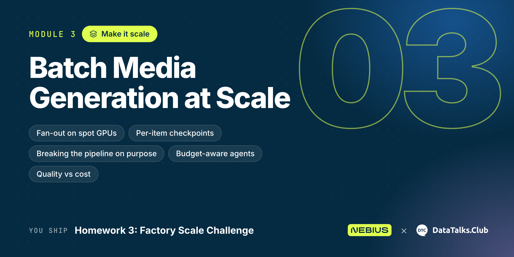
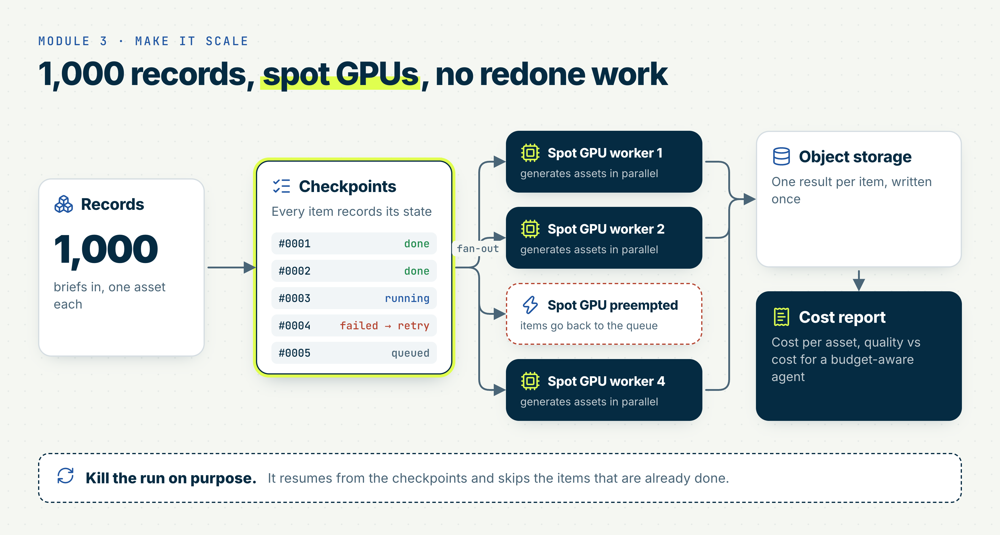

<p align="center">
  
</p>

# Module 3: Batch Media Generation at Scale

Welcome to Module 3 of Production AI Agents for Generative Media! This week we make it scale: run the same generation for every record over parallel Jobs, survive an interrupted Spot run without paying twice, lower the cost of usable outputs, and stop the run when it breaks a spending or quality limit.

Run → Recover → Optimize → Control

> [!NOTE]
> **Updated 13 Nov 2026.** This lesson plan replaces the earlier outline. Lessons may still change before the module starts.

> [!NOTE]
> This module builds on Module 1 and Module 2: Jobs, the Object Storage bucket and the cost terms from [1.4](../01-consistent-media-generation-on-serverless-gpus/04-serving-vs-batch.md) and [1.5](../01-consistent-media-generation-on-serverless-gpus/05-measuring-costs.md), the idempotency key from [2.2](../02-multi-agent-media-workflows/02-tools.md), tickets from [2.4](../02-multi-agent-media-workflows/04-long-running-tools.md) and the judge and rubric v1 from [2.5](../02-multi-agent-media-workflows/05-judge-loop.md).

> [!IMPORTANT]
> Parallel Jobs need quota. Serverless AI Jobs count toward Compute quotas: one VM, one disk and one allocation per running Job, plus GPUs for regular VMs. A new account starts with 2 regular and 2 preemptible VMs per region. Homework 3 runs 10 Jobs in parallel, so request an increase to at least 10 preemptible VMs, 10 disks and the matching allocations before the homework week. How to check and increase quotas: [3.1](01-batch-jobs.md#quotas-set-how-many-jobs-run-at-once).

> [!WARNING]
> Cancel your Jobs (`nebius ai job cancel <job_ID>`) and stop your Endpoints when you finish the module to avoid charges. Set a `--timeout` on every Job and a `budget_usd` on every run. Run the lessons on 10 to 100 records; all 200 records is the homework. Keep video to a 10-record sample.

* Video Link (Coming Soon)
* Slides (Coming Soon)

<p align="center">
  
</p>

## What you will learn

By the end of this module, you will be able to:

* Submit a GPU Job, check its status and retrieve its output, then split a batch across parallel Jobs and track which records completed
* Run batch work on Spot GPUs, save progress after each completed record, and resume an interrupted run without regenerating finished assets
* Measure startup and generation costs, compare one record per Job with several records sharing one model load, and pick the configuration with the lowest cost per usable output at your quality bar
* Set a spending limit, timeouts and a minimum acceptance rate, check that the run stops when a limit is breached, and report completion, failures, quality and cost

Default path for the whole module: [Sana](https://github.com/nebius/serverless-ai-cookbook/blob/main/templates/endpoint-sana/README.md) on L40S for images, [Kokoro-82M](https://github.com/nebius/serverless-ai-cookbook/blob/main/templates/endpoint-kokoro-82m/README.md) for voice and [Wan2.2-I2V-A14B](https://github.com/nebius/serverless-ai-cookbook/blob/main/templates/endpoint-wan22-i2v-a14b/README.md) on H100 for the video sample. Records: [`examples/mediafactory/data/kids.csv`](../examples/mediafactory/data/kids.csv), 200 records (`id`, `name`, `age`, `wishlist`), and its first 10 rows in [`kids_10.csv`](../examples/mediafactory/data/kids_10.csv). Lessons that use 100 records take the first 100 rows of `kids.csv`. Every run writes `events.jsonl`, `metrics.json` and `summary.json` to its run folder in the bucket.

## Lessons

* [3.1 Batch Generation with Serverless Jobs](01-batch-jobs.md)
* [3.2 Spot GPUs and Surviving Interruptions](02-spot-and-interruption.md)
* [3.3 Reducing Media Generation Costs](03-optimizing-cost.md)
* [3.4 Keeping Batch Runs Within Limits](04-run-limits.md)

## Homework 3: Factory Scale Challenge

Scale the Personalized Media Factory to all 200 records in `kids.csv` over 10 Jobs in parallel: card text, image and voice for every record, video for a 10-record sample. Use Spot Jobs, your 3.3 configuration and the 3.4 limits, and survive at least one interruption → resume.

* Before you start: a quota of at least 10 preemptible VMs (see the note at the top)
* Submit your `summary.json`: records, Jobs, completed, dead-lettered, total cost, cost per accepted asset, saved vs on-demand, p50 and p95 time per asset, judge pass rate, and the resume proof (records done before the interruption, records regenerated after it)

Questions and submission: [homework.md](../cohorts/2026/homework/03-batch-media-generation-at-scale/homework.md).

## Capstone Step

Run your own records through your capstone pipeline on 100 records (10 for video) with one interruption → resume. Keep `summary.json`: it is your capstone cost report. See [projects](../projects).

## Module structure (proposed)

One page per lesson at the module root, all code flat in `code/`, images in `images/`.

```text
03-batch-media-generation-at-scale/
├── README.md                       # lessons index
├── 01-batch-jobs.md
├── 02-spot-and-interruption.md
├── 03-optimizing-cost.md
├── 04-run-limits.md
├── images/
└── code/                           # lesson code, filled in as each lesson is built
```

Shared records at the repo root:

```text
examples/mediafactory/data/
├── kids.csv                        # 200 records. Homework 3 and 100-record lessons (first 100)
├── kids_10.csv                     # first 10 rows of kids.csv
└── kids_bad.csv                    # bad records for 3.4
```

# Community Notes

Did you take notes? You can share them here:

* Add your notes here!
