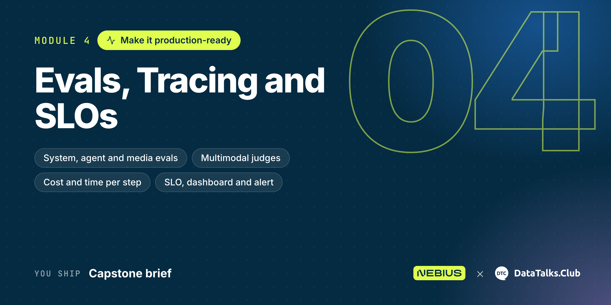
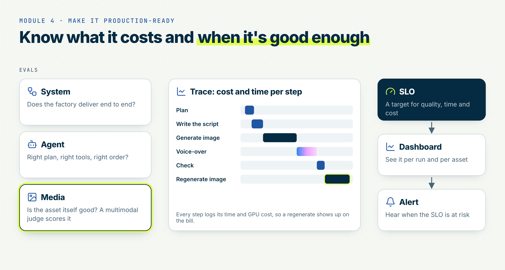

<p align="center">
  
</p>

# Module 4: Evaluation, Observability and Production

Welcome to Module 4 of Production AI Agents for Generative Media! This week we make it production-ready: measure how good your assets are, optionally tune the model for a consistent style, see what each record cost and why it took that long, and decide whether the factory is ready to ship.

Measure → Improve → Understand → Decide

> [!NOTE]
> **Updated 13 Nov 2026.** This lesson plan replaces the earlier outline. Lessons may still change before the module starts.

> [!NOTE]
> This module builds on Modules 1 to 3: the cost terms from [1.5](../01-consistent-media-generation-on-serverless-gpus/05-measuring-costs.md), the judge and rubric v1 from [2.5](../02-multi-agent-media-workflows/05-judge-loop.md), the run limits and run summary from [3.4](../03-batch-media-generation-at-scale/04-run-limits.md), and your Homework 3 run folder (`events.jsonl`, `metrics.json`, `summary.json`, `items/`, `dead_letter.jsonl`). If you skipped Homework 3, use the reference run published on Mon 14 Dec.

> [!WARNING]
> 4.1 and 4.4 read existing run folders. 4.3 traces a 10-record run. 4.2 is optional and is the most expensive lesson in this module: it trains a LoRA and generates the golden set with the base and the tuned model. Set a `--timeout` on every Job and stop your Endpoints when you finish.

* Video Link (Coming Soon)
* Slides (Coming Soon)

<p align="center">
  
</p>

## What you will learn

By the end of this module, you will be able to:

* Extend the 2.5 rubric with a style check, build a golden set with human labels, compare the judge's verdicts with those labels, and set a quality baseline for a run
* Optional: train a LoRA for a consistent style and keep it only if it passes a regression gate on style, prompt adherence and cost
* Trace a media-generation run with MLflow and compute success rate, p95 time per asset and cost per accepted asset
* Set a per-run SLO, check a run against it, review interruption recovery, safety, permissions, model licences and AI-content marking, and make a go/no-go call

Default path for the whole module: your Homework 3 run folder as input (or the reference run), the 2.5 judge with a pinned model, the prepared golden set, and MLflow running locally for traces. Each lesson writes its output to `runs/04-evaluation-observability-production/<run_id>/` and leaves your Homework 3 run folder unchanged: `labels.csv` and `evals.json` (4.1), `gate.json` (4.2), `trace_metrics.json` (4.3), `slo.md` and `readiness.md` (4.4). 4.4 also writes into your capstone brief.

## Lessons

* [4.1 Evaluating Media Quality](01-evaluating-media-quality.md)
* [4.2 Fine-Tuning for Consistent Style (Optional)](02-fine-tune-style.md)
* [4.3 Tracing Runs with MLflow](03-tracing-mlflow.md)
* [4.4 Production Readiness and Go/No-Go](04-production-readiness.md)

## Capstone Step

Module 4 has no homework. Apply it in your capstone: a golden set with human labels and a quality baseline (4.1), and an SLO with a pass/fail check, the readiness checklist and your go/no-go call (4.4). The capstone brief is published with this module. See [projects](../projects).

## Module structure (proposed)

One page per lesson at the module root, all code flat in `code/`, images in `images/`.

```text
04-evaluation-observability-production/
├── README.md                       # lessons index
├── 01-evaluating-media-quality.md
├── 02-fine-tune-style.md
├── 03-tracing-mlflow.md
├── 04-production-readiness.md
├── images/
└── code/                           # lesson code, filled in as each lesson is built
```

# Community Notes

Did you take notes? You can share them here:

* Add your notes here!
