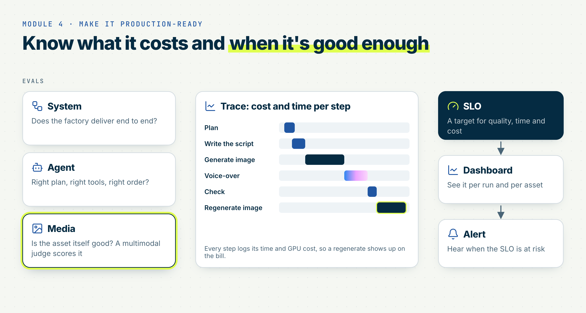

# Module 4: Evaluation, Observability and Production

Welcome to Module 4 of Production AI Agents for Generative Media! This week we make it production-ready: measure how good your assets are, explain what each record cost and why it took that long, and decide whether the factory is good enough to ship.

> [!NOTE]
> This module builds on Modules 1 to 3: the measurements and cost terms from [1.5](../01-generative-media-workloads#15-measuring-startup-load-and-generation-costs), the judge from [2.5](../02-agents-that-use-gpus#25-planner-generator-reviewer-the-judge-loop), the budget and quality thresholds from [3.4](../03-scaling-reliability-cost#34-breaking-the-pipeline-on-purpose), and your Homework 3 run folder (`events.jsonl`, `metrics.json`, `summary.json`, `items/`, `dead_letter.jsonl`). Every lesson works on that run folder. If you skipped Homework 3, use the reference run published on Mon 14 Dec.

> [!WARNING]
> Most of this module reads an existing run folder and needs no GPU. The only live work is the candidate run in 4.2: keep it to the 10 golden records, set a `--timeout` on every Job, and stop your Endpoints when you finish. Everything else uses the judge verdicts and transcripts already stored in the run folder, so you don't pay for the judge twice.

* Video Link (Coming Soon)
* Slides (Coming Soon)

  

## Learning Objectives

By the end of this module, you will be able to:

* Choose metrics for the system, agent and media layers and compute them from a run folder, cheap deterministic checks first
* Write a rubric for a multimodal judge, calibrate it against your own labels, and say how far you trust it
* Block a change to a model, prompt or configuration with a golden set and a regression gate
* Answer "why did this record cost $X and take N s?" from one trace
* Sketch a production architecture for a media agent, set an SLO with an alert on burn rate, and make a go/no-go call

Default path for the whole module: your Homework 3 run folder as input, the 2.5 judge with a pinned model as the judge, a pinned [Whisper](https://huggingface.co/openai/whisper-large-v3-turbo) model for the speech check, and `events.jsonl` as the trace. The reference run ships cached judge verdicts and Whisper transcripts for every asset, so 4.1 and 4.2 run offline. The tracing backend is to be announced; everything in this module works from the JSONL files alone. Each lesson writes its output to `runs/04-evaluation-observability-production/<run_id>/` and leaves your Homework 3 run folder unchanged: `evals.json` (4.1), `calibration.json` and `gate.json` (4.2), `waterfall.md` (4.3), `slo.md` and `dashboard.html` (4.4).

## 4.1 Evaluating Generative Systems: System, Agent and Media

* Three layers, three questions:
  * System: did the run deliver? Completion rate, dead-letter rate, p50 and p95 time per asset, cost per asset and cost per accepted asset. From `summary.json` and `metrics.json`.
  * Agent: did the agent spend well? Attempts per asset, generation time on rejected assets, refusals from budget and attempt caps. When an agent drives the run, also steps per record and wrong or redundant tool calls (your Homework 2 trace). From `items/` and `events.jsonl`.
  * Media: is the asset right? Deterministic checks, then the judge (4.2), then a human on a sample.
* Deterministic media checks, no model needed:
  * Image: the file opens, size and aspect ratio, not blank
  * Video: duration, fps, not frozen
  * Audio: present, duration, silence ratio, loudness
  * Speech says the right name: compare the Whisper transcript with the record. Use the cached transcript, or transcribe with the pinned Whisper model.
* Order: checks → judge → human. An asset that fails a check never reaches the paid judge, the same gate as in 2.5.
* Human eval: for what checks and judges miss (taste, brand, safety edge cases). A small labelled sample, which is also the input for calibration in 4.2.
* Cost per accepted asset joins the layers: a cheap run with a low accept rate is not cheap
* Also try: cheap draft → judge → full final. A low-step or low-resolution image first, the full image only after a `PASS`. Change one variable at a time on 10 records and keep the cheapest configuration above your quality bar.
* Practice: compute all three layers for your Homework 3 run and write `evals.json`, per record and per run

Done when: `evals.json` has system, agent and media metrics for your run, and you can name the record that failed the most checks and say why.

## 4.2 Multimodal Judges and Calibration

* Rubric first, prompt second: a few criteria (matches the brief, name and text correct, style, artefacts), each with one pass and one fail example
* Judge setup: structured output (verdict, score, reasons, as in 2.5), temperature 0, pinned judge model. Record the model and rubric version in every result.
* Calibration:
  * Label 40 assets from your run by hand, `PASS` or `FAIL`
  * Compare with the judge verdicts already in your run (`judge_verdict` in `items/<id>.json`): `PASS` against `RETRY` or `WEAK`. Re-run the judge only after you change the rubric.
  * Write `calibration.json`: agreement and the confusion matrix
  * Read the disagreements. Fix the rubric before you trust the judge with a decision.
* Known failure modes: leniency, position and verbosity bias (documented for LLM judges in [Zheng et al., 2023](https://arxiv.org/abs/2306.05685)), missing small text and fine detail
* Judge cost per asset: tokens × rate. Above a few hundred assets, judge a sample.
* Golden set: exactly 10 fixed records with fixed seeds and configurations, including some that failed in your run. Expected properties, not expected pixels.
* Regression gate:
  * Baseline: the golden records from your Homework 3 run. Candidate: the same records with one change.
  * What triggers the gate: a model revision, prompt, judge, rubric or sampler setting
  * Rule: fail if the judge pass rate drops more than N points or cost per accepted asset rises more than M%. You pick N and M and write down why.
  * Run it on the golden set before every release. Also try: run it in CI.
* Practice: run the gate on a deliberately worse candidate (for example, fewer steps) and write `gate.json`

Done when: `calibration.json` shows agreement and the confusion matrix on your 40 labelled assets, and `gate.json` shows the gate failing the worse candidate.

## 4.3 Observability and Tracing

* One trace per record, built from `events.jsonl`: each event's `parent_id` points to the event that caused it, so the events form a tree: record → model request or pipeline step → GPU call → judge
* What each event already carries: `workload` (Endpoint, Job or LLM) and its ID, `attempt`, `verdict`, `t_gen_s`, `wall_s`, tokens and `cost_usd`
* GPU phases come from the Job's `metrics.json`: startup, model load, generation time
* Cost per record with the Module 1 terms: `c = rate × t_gen` for each attempt, plus the record's share of its Job's fixed cost, `F / n` for a chunk of `n` records, plus judge tokens. Same assumptions as 3.2.
* From events to a waterfall: where the time went, where the money went
* Answer "why $X / why N s" for the most expensive record. Usual answers: it paid a cold start, the judge asked for retries, a preempted chunk was resubmitted, or it had a video.
* Predicted vs actual: compare the run cost you predicted in 3.1 (`predicted_cost_usd`) with `total_cost_usd`, and find the records that explain the difference
* Traces, metrics and logs answer different questions ([OpenTelemetry: Signals](https://opentelemetry.io/docs/concepts/signals/)):
  * Trace: what happened to this one record
  * Metrics: how the run behaves in aggregate; they feed the SLIs in 4.4
  * Logs: the detail of one event, such as a Job error message
* Budget in the trace: every 3.4 budget check and every refusal is an event with its reason, so you can show that spend never passed `budget_usd`
* Also try: a budget-aware agent. One budget shared by parallel records: reserve the estimate before a GPU call, commit the actual cost after it, release the reservation on failure. When the budget can't cover the next call, the tool refuses with a typed reason (budget left, cost needed), and the agent keeps its best `WEAK` asset or skips the record. [`UsageLimits`](https://pydantic.dev/docs/ai/api/pydantic-ai/usage/) caps the LLM; the GPU budget is your own check.
* Sinks: `events.jsonl` in the run folder by default. The tracing backend is to be announced. Also try: name your spans after the [OpenTelemetry GenAI semantic conventions](https://github.com/open-telemetry/semantic-conventions-genai).
* Practice: a waterfall and cost breakdown for the most expensive record in your run

Done when: `waterfall.md` for your most expensive record shows time and cost per step that add up to the record total, with two sentences on why it cost what it did.

## 4.4 Designing for Production: Architecture, SLO, Dashboard and Alerts

High level: one diagram, one SLO, one checklist. Enough to make a go/no-go call, not a full SRE course.

* Reference architecture: intake (API or queue) → agent on CPU → GPU tools (Endpoints, Jobs) → Object Storage → evals → trace sink → dashboard and alerts
* The platform: Serverless AI is in Preview, with no service level and no automatic retry or recovery ([Serverless AI terms](https://docs.nebius.com/legal/specific-terms/serverless-ai)). Your SLO absorbs platform failures through the retries, resubmits and fallbacks from Module 3.
* SLIs from your run folder: share of records with an accepted asset within the deadline, p95 time to an accepted asset, judge pass rate
* SLO: completion and quality by a deadline. Format: "X% of records produce an accepted asset within T minutes". You pick X and T from your own run.
* Cost guardrail, separate from the SLO: cost per accepted asset at or below $C for the run. Cost stays out of the SLO because a per-record cost would depend on how the shared startup cost is split across records.
* Error budget and burn rate: alert when the budget burns fast, not on a single failure ([Google SRE Workbook: Alerting on SLOs](https://sre.google/workbook/alerting-on-slos/)). A 200-record run is low traffic: one failed record moves the rate a lot, so evaluate over the run, not per minute.
* Minimal dashboard: a static `dashboard.html` from `summary.json` and `evals.json`, one panel per SLI, the cost guardrail and cost per hour
* Alert: a burn-rate check that exits non-zero. Also try: send it to a webhook.
* Production checklist, one line each, with where the course covers it:
  * Auth and secrets: Endpoint tokens and bucket keys at runtime, never in the image, rotated ([1.3](../01-generative-media-workloads#13-containers-for-generative-ai))
  * Quotas, budget caps, per-user limits and abuse ([3.1](../03-scaling-reliability-cost#31-one-to-1000-fan-out-with-jobs), [3.4](../03-scaling-reliability-cost#34-breaking-the-pipeline-on-purpose))
  * Prompt injection through record fields and briefs: validate at the edge ([3.4](../03-scaling-reliability-cost#34-breaking-the-pipeline-on-purpose))
  * Content safety: input and output filters. Not covered in depth.
  * Personal data and retention: the course uses synthetic names. Real users need consent and a retention period for assets and traces.
  * Licences and provenance: model licences ([1.1](../01-generative-media-workloads#11-landscape-modalities-and-model-families)) and a manifest per asset (model, revision, prompt, seed)
  * Reproducibility: a repeatable configuration. The same output is expected only on the same hardware, runtime and deterministic settings ([PyTorch: Reproducibility](https://docs.pytorch.org/docs/2.15/notes/randomness.html)).
  * Release: versioning, a canary on a slice, rollback ([Google SRE Workbook: Canarying Releases](https://sre.google/workbook/canarying-releases/)). The 4.2 gate is the release check.
* Practice: write the SLO for your factory, render the dashboard for your Homework 3 run, and make the call

Done when: `slo.md` has your SLO and cost guardrail with your values, and a go/no-go paragraph for your Homework 3 run (if it misses the SLO, what would have to change), and `dashboard.html` renders from your run folder.

## Capstone Step

Module 4 has no homework. Apply it in your capstone: an eval suite at the system, agent and media layers with a golden set and a regression gate (4.1, 4.2), one trace per record (4.3), and an SLO with a dashboard and your go/no-go call (4.4). The capstone brief is published with this module. See [projects](../projects).

# Community Notes

Did you take notes? You can share them here:

* Add your notes here!
